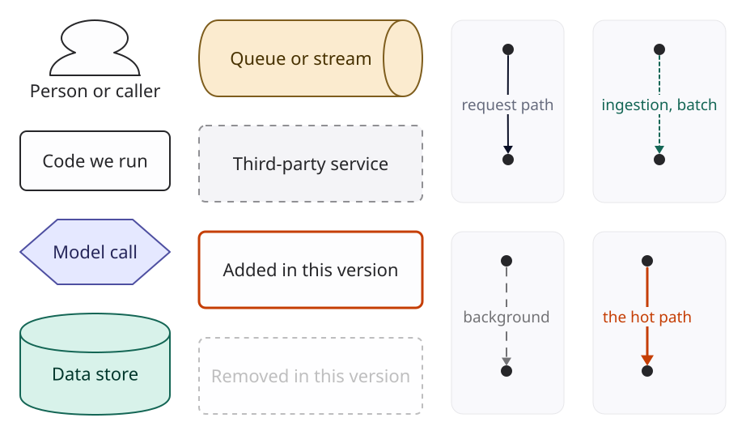

A GenAI system is designed the way any system is designed, with three differences that change
almost every decision. The component doing the work is **probabilistic**, so you cannot assert that it
is correct; you have to measure it. It is **priced per call**, so cost is a variable on every request
rather than a fixed line for servers. And it is **slow**: one model call takes longer than every
other hop in the request put together, so the latency budget is spent before you start.

This chapter sets out the method the rest of the book follows. Every system chapter uses the same
headings in the same order, so once you have read one you can jump to the part you need in any
other.

## Why arrive at the design step by step

You could open each chapter with the finished architecture diagram. Most writing on this topic
does. It is the least useful thing to show, for two reasons.

First, a finished diagram hides the reasons. A reranker sits between retrieval and generation.
Why? Because the first version retrieved twenty chunks to get recall, the model got confused by
the fifteen irrelevant ones, and the bill was paying for all twenty. Take the reason away and the
reranker is decoration. A reviewer will ask "why is that there?" and you need the answer.

Second, the finished design is wrong for most readers. Your corpus is smaller, your users are more
forgiving, your compliance team is stricter. If you know which failure each component fixes, you
know which components you can leave out. If you only know the final picture, you copy all of it.

So every chapter starts with the simplest thing that could work, called version 0, and then
breaks it. Each break cites evidence: an evaluation score, a load test, a line on the cost
estimate, a latency budget that does not add up. Each fix is the smallest change that addresses
that evidence. The final design is where the sequence stops, which is when the remaining failures
are cheaper to live with than to fix.

## The loop

| Step | What you produce | The question it answers |
|---|---|---|
| The brief | One paragraph, as the stakeholder said it | What are we being asked for? |
| Questions | A table of questions and the assumptions you will design to | What is actually required? |
| The numbers | Traffic, tokens, storage, money, with arithmetic | How big is this, and where will it hurt? |
| Version 0 | The simplest design and its diagram | What is the least we could build? |
| Where it breaks | Evidence that version N fails a requirement | What is wrong with it, specifically? |
| Version N+1 | The smallest change that fixes it | What do we add, and what does it cost? |
| Final design | Full diagram, component table | What are we building? |
| Deployment | Topology, regions, scaling | Where does it run? |
| Cost | Monthly cost at three scales | What will the bill be? |
| Optimisation | Techniques by code, with savings | How do we make it cheaper and faster? |
| Operating it | Metrics, alerts, failure modes | How will we know it is broken? |
| Variants | What changes under different requirements | What if the brief had said something else? |
| Trade-offs | Decision, alternative, reason | What did we give up? |

In an interview you will not get through all of it. Spend your time on the questions, the
numbers and the first two breaks. Those are where judgement shows. Anyone can draw the final
diagram from memory; few people can explain why version 1 was not enough.

## Asking the questions

A brief from a stakeholder is never a specification. "Build us a bot that answers questions from
our documents" leaves open whether there are 500 documents or 5 million, whether a wrong answer is
an annoyance or a lawsuit, and whether the documents may leave the country. Each of those flips a
decision.

Every chapter lists its questions as a table with three columns: the question, why it changes the
design, and the answer the chapter assumes. The middle column is the point. A question whose
answer would not change anything is not worth the stakeholder's time.

The questions fall into six groups. Most chapters need one or two from each.

| Group | Typical questions | What the answers move |
|---|---|---|
| Users and scale | Who uses it? How many, how often, when? Is traffic bursty? | Capacity, rate limits, whether cost per request or fixed cost dominates |
| Data | What sources, what formats, how much, how often does it change, who may see what? | Ingestion design, freshness, access control, index size |
| Quality bar | What does a wrong answer cost? Who checks? Is "I don't know" acceptable? | Model tier, grounding and citation, human review, evaluation effort |
| Latency | Is someone waiting? Streaming or not? What is the p95 that matters? | Model size, streaming, caching, parallelism, region |
| Compliance | Which regulations? Data residency? Retention? Audit? | Provider choice, region, logging, redaction, self-hosting |
| Budget | Cost per request or per month the business can carry? Who pays for spikes? | Model tier, caching, batching, whether to self-host |

When nobody can answer a question, do not stall. Pick an answer, write it in the third column,
and design to it. The table then doubles as the list of assumptions a reviewer can challenge.

## The numbers

Before drawing anything, size the problem. GenAI arithmetic is short, and it often settles the
design on its own. If the whole corpus is 40,000 tokens, you do not need retrieval at all; it fits
in one prompt. If the peak is two requests a second, you do not have a scaling problem; you have a
quality problem. If the model bill at launch volume is $300 a month, nobody should spend a sprint
optimising tokens.

[F2](f2-numbers.qmd) has the constants and formulas. Every chapter shows its arithmetic in a
block like this one, so you can redo it with your own inputs:

::: {.numbers}
Queries per month = staff x weekly active share x questions per week x weeks per month
                  = 1,200 x 0.4 x 4 x 4.35 = 8,352
:::

## Prices and how this book keeps them current

The cost sections use real vendors and real list prices. Prices change, sometimes monthly, so
none of them are typed into the chapters. They live in one file, `data/prices.toml`, with the
source URL and the date each one was checked. A script, `tools/costgen.py`, recomputes every cost
table and every inline figure from that file. When prices move, the book is refreshed by editing
one file and running `make costs`.

The prices in this edition were checked on . The appendix
[Prices](../appendix/prices.qmd) lists every one with its source.

Naming a vendor is not a recommendation. Where a chapter uses one provider's price, it is because
the arithmetic needs a number; the comparison tables show the alternatives.

## Worked scenarios are illustrative

Each chapter follows one organisation through the design. When a chapter says "the first
evaluation run scores 61% on the golden set", that is a worked scenario, chosen to be typical of
what teams see, not a measurement of a real system. The chapter says so the first time. The
arithmetic, the prices and the mechanisms are real; the scenario is there so the reasoning has
something concrete to push against.

## Reading the diagrams

Every diagram uses the same shapes and colours. Code we run is a plain box. A model call is an
indigo hexagon. Stores are green cylinders, and queues are sand-coloured. Third-party services have dashed borders. Anything added
in the current version has a thick vermilion border, so you can see what changed from the
previous diagram at a glance; anything removed stays on the page, faded.

{fig-alt="Legend: person shape for callers, plain box for our code, indigo hexagon for model calls, green cylinder for stores, sand-coloured queue, dashed box for third-party services, vermilion border for components added in this version, faded dashed box for removed components, and four edge styles."}

Solid edges are the request path. Dashed edges are background work. Dotted green edges are
ingestion or batch jobs. A vermilion edge marks the hot path the chapter is discussing.

## Levels and reading paths

Each system has a level from one to four stars. One star is a single model call with good
engineering around it. Four stars means several interacting subsystems, hard latency or
reliability constraints, and real money at stake.

There are three ways through the book:

- **Preparing for design interviews.** Read F1 and F2, then the systems in order. For each one,
  stop after the questions table and sketch your own version 0 before reading on.
- **Building one specific thing.** Read F2 and F5, then the chapter closest to your problem and its
  variants section. The variants usually point at the neighbouring chapter that fits better.
- **Running a platform team.** Read F3 to F6, then Part VI, which treats the gateway, caching,
  routing, inference, fine-tuning and evaluation as shared infrastructure.

## Optimisation codes

Optimisations are catalogued once, in [F5](f5-optimisation.qmd), with codes O1 to O20. Chapters
cite them by code, for example O1 for prompt caching, and give the
saving for that system rather than re-explaining the technique. The point of the catalogue is
that the same twenty techniques do almost all of the work in almost every system. What differs is
which ones apply and how much each one saves.
