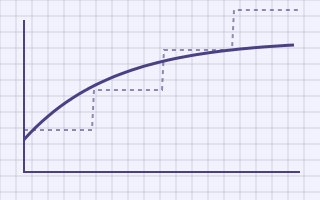
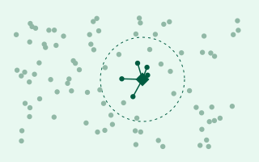

```{=html}
<section class="hero">
  <div class="kicker">
    <span class="live">● EARLY EDITION</span>
    <span>50 SYSTEMS</span>
    <span>6 FOUNDATIONS</span>
    <span>PRICES AS OF 3 NOV 2026</span>
  </div>
  <h1>Fifty GenAI systems, from the first question <span class="pixel">to the monthly bill.</span></h1>
  <p class="lede">Each chapter starts from a vague request, asks the questions that turn it into
  requirements, builds the simplest thing that could work, breaks it with evidence, and fixes it
  one step at a time. Then it deploys it, prices it with real vendors, and makes it cheaper.</p>
  <div class="actions">
    <a class="btn-ink" href="foundations/f1-method.html">Start with the method <span aria-hidden="true">→</span></a>
    <a class="btn-quiet" href="systems/07-simple-rag.html">Read a system chapter</a>
    <a class="btn-quiet" href="appendix/roadmap.html">See all fifty</a>
  </div>
</section>

<div class="section-label">The parts</div>
<div class="parts">
  <a class="part-card p-foundations" href="foundations/f1-method.html">
    <div class="cover"></div>
    <span class="pk">FOUNDATIONS</span>
    <h3>The toolkit</h3>
    <ul><li>Questions that change the design</li><li>Token, latency and GPU arithmetic</li><li>Twenty optimisations, O1 to O20</li></ul>
    <div class="meta"><span class="chip"><b>6</b>&nbsp;CHAPTERS · ALL WRITTEN</span><span class="open">Open →</span></div>
  </a>
  <a class="part-card p-text" href="systems/01-ticket-classifier.html">
    <div class="cover"></div>
    <span class="pk">PART I</span>
    <h3>Text in, text out</h3>
    <ul><li>Classify, summarise, extract</li><li>Batch generation at catalogue scale</li><li>Moderation cascades</li></ul>
    <div class="meta"><span class="chip"><b>6</b>&nbsp;SYSTEMS · 1 WRITTEN</span><span class="open">Open →</span></div>
  </a>
  <a class="part-card p-retrieval" href="systems/07-simple-rag.html">
    <div class="cover"></div>
    <span class="pk">PART II</span>
    <h3>Retrieval</h3>
    <ul><li>From naive RAG to grounded answers</li><li>Hybrid search, GraphRAG, enterprise search</li><li>Text-to-SQL and code search</li></ul>
    <div class="meta"><span class="chip"><b>10</b>&nbsp;SYSTEMS · 4 WRITTEN</span><span class="open">Open →</span></div>
  </a>
  <a class="part-card p-agents" href="systems/17-tool-calling-assistant.html">
    <div class="cover"></div>
    <span class="pk">PART III</span>
    <h3>Agents and tools</h3>
    <ul><li>Tool calling and MCP platforms</li><li>Agents that take real actions</li><li>Coding and computer-use agents</li></ul>
    <div class="meta"><span class="chip"><b>10</b>&nbsp;SYSTEMS · 1 WRITTEN</span><span class="open">Open →</span></div>
  </a>
  <a class="part-card p-realtime" href="systems/28-voice-agent.html">
    <div class="cover"></div>
    <span class="pk">PART IV</span>
    <h3>Real-time and conversational</h3>
    <ul><li>Voice agents under a 1-second budget</li><li>Chat at ten million daily users</li><li>Tutors and meeting copilots</li></ul>
    <div class="meta"><span class="chip"><b>5</b>&nbsp;SYSTEMS · 1 WRITTEN</span><span class="open">Open →</span></div>
  </a>
  <a class="part-card p-generation" href="appendix/roadmap.html#part-v-generation-beyond-text">
    <div class="cover"></div>
    <span class="pk">PART V</span>
    <h3>Beyond text</h3>
    <ul><li>Image generation services</li><li>Brand studios and visual search</li><li>Video pipelines</li></ul>
    <div class="meta"><span class="chip"><b>4</b>&nbsp;SYSTEMS · SOON</span><span class="open">Roadmap →</span></div>
  </a>
  <a class="part-card p-platform" href="systems/36-llm-gateway.html">
    <div class="cover"></div>
    <span class="pk">PART VI</span>
    <h3>The model platform</h3>
    <ul><li>Gateways, caches and routers</li><li>Self-hosted inference, honestly priced</li><li>Fine-tuning, evals, guardrails</li></ul>
    <div class="meta"><span class="chip"><b>11</b>&nbsp;SYSTEMS · 2 WRITTEN</span><span class="open">Open →</span></div>
  </a>
  <a class="part-card p-capstones" href="appendix/roadmap.html#part-vii-capstones">
    <div class="cover"></div>
    <span class="pk">PART VII</span>
    <h3>Capstones</h3>
    <ul><li>Clinical scribe, finance copilot</li><li>Shopping on top of a recommender</li><li>On-device with cloud fallback</li></ul>
    <div class="meta"><span class="chip"><b>4</b>&nbsp;SYSTEMS · SOON</span><span class="open">Roadmap →</span></div>
  </a>
</div>

<div class="section-label">Preface</div>
```

::: {.prose-card}
This book designs fifty systems built on generative models, from a ticket classifier that costs
less than a cup of coffee a month to a self-hosted inference platform that costs more than the team
running it. It is written for engineers who already know how to design ordinary systems and now have
to design ones where the component doing the work is a model: probabilistic, priced per call, and
slow. Those three properties change more decisions than most people expect.

**The path, not just the destination.** Every chapter shows version 0 and the evidence that broke
it. A finished architecture diagram tells you what to build; the path tells you which parts you can
leave out.

**Real prices, kept current.** Costs use real vendors and list prices, checked on
. They live in one data file with their sources, and a script regenerates
every cost table and inline figure from it.

**Arithmetic you can redo.** Every number is worked out on the page, a dated price, or a rule of
thumb labelled as one. Change the inputs to match your situation and the conclusions follow.

**How to read it.** Start with [F1, the design method](foundations/f1-method.qmd) and
[F2, the numbers](foundations/f2-numbers.qmd). After that, the system chapters stand alone, and
[F1](foundations/f1-method.qmd#levels-and-reading-paths) suggests three reading paths.

The text is licensed under CC BY-NC-SA 4.0 and the code under MIT. Corrections are welcome on
GitHub, especially for prices: a pull request that updates `data/prices.toml` with its source is all
it takes.

Ravi Teja
:::
