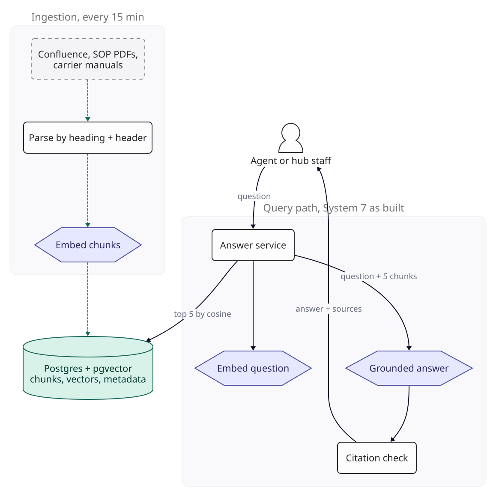
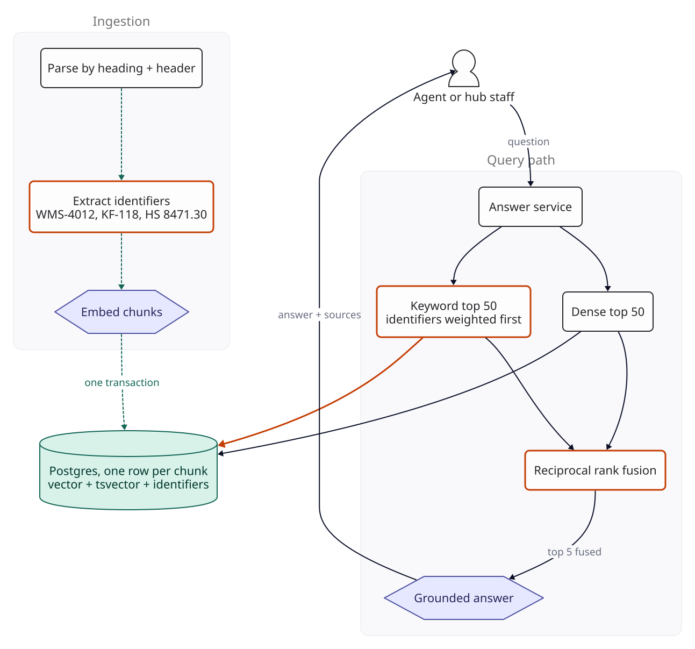
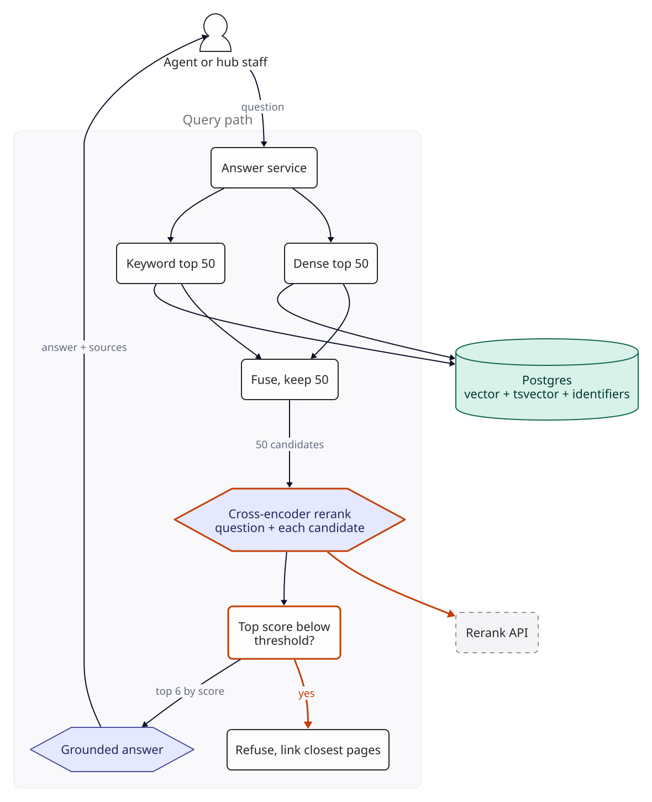
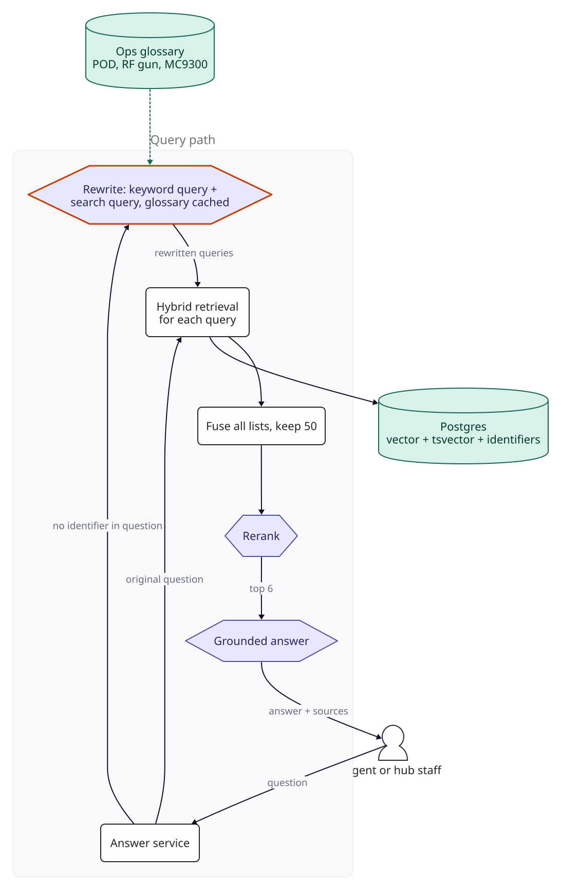
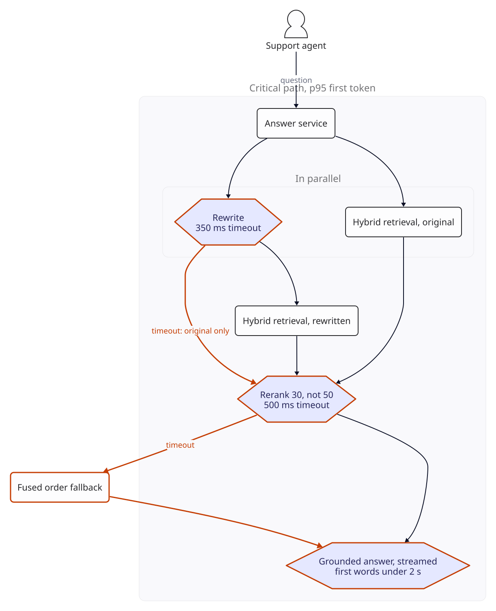
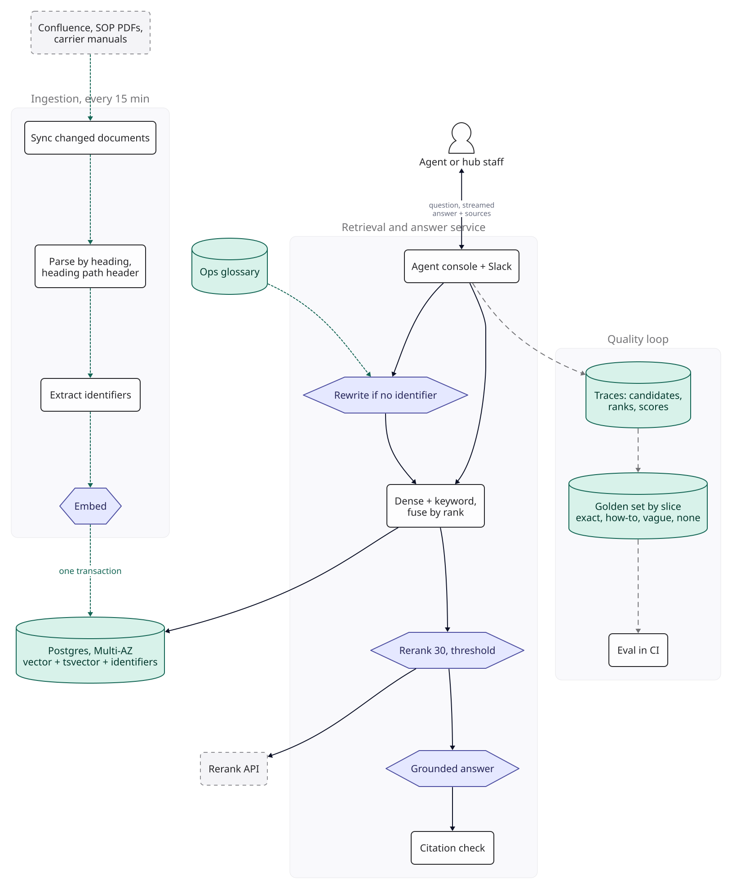

::: {.chapter-meta}
[Level <span class="level">★★★</span>]{} [Part II, Retrieval]{} [Uses <span class="ocode">O1</span> <span class="ocode">O2</span> <span class="ocode">O9</span>]{}
:::

System 7 left one kind of failure for later: questions that hinge on an exact term, such as an
error code or a form number, which dense embeddings blur into their neighbours. On an HR wiki those
are a small share of questions. On an operations knowledge base they are a third of the traffic. This
chapter keeps what System 7 built (structure-aware chunks, continuous sync, the grounded answer
contract, the quality loop) and rebuilds the retrieval stage in front of it, one failure at a time.
The new stages also cost latency and money, so the chapter ends up as much about a time budget as
about relevance.

## The brief

::: {.brief}
[From the head of Customer Operations, Kestrel Freight]{.from}
The wiki bot is the most popular thing IT has shipped all year. Can we have the same for operations?
Since we took over the national carrier's hub network, our 300 support agents and 4,000 hub staff
look things up all day: SOPs, carrier manuals, the WMS error guide, customs notes. The last search
tool we bought was useless with codes. Type WMS-4012 and you get every page except the one for
WMS-4012. And it has to be quick: our agents are mid-chat with a customer when they ask.
:::

Kestrel Freight is the worked scenario from System 7, a year and one acquisition later. The
scenario supplies inputs (corpus, traffic, a latency target); nothing in this chapter was measured.
Each version says what to measure and the target that would justify keeping it. Two phrases in the brief carry the design: "useless
with codes" names the failure, and "mid-chat with a customer" sets a latency budget that every fix
will have to fit inside.

## Questions to ask

| Question | Why it changes the design | We assume |
|---|---|---|
| What is in the corpus, and how much? | Size decides whether one Postgres database still holds everything; format decides parsing |  Confluence pages and  PDFs (SOPs, carrier manuals, customs guidance), about  tokens |
| How much of the traffic hinges on an exact identifier? | If identifiers matter, dense retrieval alone cannot work, however good the embedding model | About a third of questions name an error code, form number, HS code or shipment reference |
| Do people use the documents' words? | If not, retrieval needs help translating their words into the documents' words | Often not. Hub staff say "the gun" for the RF handheld terminal and "the cage" for the high-value store |
| Who asks, and how fast must it be? | Support agents have a customer waiting; every stage we add comes out of their budget | First words of the answer within 2 s and the full answer within 5 s, both at p95, for agents. Hub staff tolerate more |
| Can everyone read everything? | Per-user permissions are a different system ([System 10](10-multi-tenant-rag.qmd)) | Yes: operations content is readable by all operations and support staff |
| Can a third vendor see the text? | A hosted reranker sends every candidate passage to another company | Legal accepts a reranking API under the same data processing terms as the model provider, as for System 7 |
| What do we reuse from System 7? | Chunking, sync, grounding and the quality loop were all designed there | All of it. This chapter changes retrieval; the answer contract downstream stays as it was |
| Languages? | Keyword search and rerankers are language-specific | English. Hindi is a variant (see Variants) |

The third answer is the one people skip. A question written in the user's vocabulary against
documents written in the vendor's vocabulary defeats keyword search and dense search alike, and it
is the hardest failure in this chapter to fix.

## The numbers

::: {.numbers}
Corpus:    pages x 1,600 tokens = 
           PDFs x 8,000 tokens   = 
          total  tokens / 400 per chunk =  chunks
Vectors:   x 1,536 dims x 4 bytes x 1.5 index overhead (rule of thumb) =  GB
Embed it:  tokens x /M = , once

Traffic:  hub staff 4,000 x 60% weekly active x 10 questions x 4.35 weeks = 
          support 300 agents x 30 questions x 22 days                   = 
          total  queries/month
Peak:     85% of queries in 220 business hours, peak twice the average =  queries/second

Per query, final design:
  generation  500 system + 6 x 400 chunks + 40 question =  in,  out on Haiku 5.5 = 
  reranking   30 candidates x (400 + 40) =  tokens x /M = 
:::

The corpus is seven and a half times System 7's, and still fits comfortably in one Postgres
instance:  GB of vectors plus a full-text index on a machine with
16 GB of memory. Traffic is still well under one query per second. Nothing here is a scaling problem
yet. The system prompt is System 7's 450 tokens plus 50 tokens of instructions about SOP versions.

The last two lines are the surprise. **The reranker reads  times as many
tokens as the generator,** because it scores thirty passages to choose six. Even at a lower price per
token, it costs more per query than writing the answer does. With a small, cheap generation model it
is the largest variable cost in the system, and the Cost section follows that through.

## Version 0

Version 0 is System 7's final design pointed at the new corpus: structure-aware chunks with heading
paths, continuous sync, dense retrieval of the top 5 by cosine similarity in Postgres with pgvector,
and the grounded answer contract with numbered sources, citations and a code-checked refusal path.
Generation runs on Claude Haiku 5.5 because it is the cheapest current model; the golden set has to
show it answers well from good passages before launch, and Sonnet 5.5 is the fallback. PDFs are parsed into
headings and tables by a layout parser; the harder cases (scanned forms, charts) are System 11's
problem and are excluded from this golden set.

{fig-alt="Version 0. Ingestion every 15 minutes parses Confluence, SOP PDFs and carrier manuals by heading, embeds chunks and writes them to Postgres with pgvector. The query path embeds the question, takes the top 5 chunks by cosine similarity, generates a grounded answer and runs the citation check."}

A golden set measures it. System 7's 150 questions give an uncertainty of up to plus or minus 8
points, too coarse to tell a good reranker from a mediocre one, so this one has 400: up to plus or
minus 5 points overall ([F4](../foundations/f4-evaluation.qmd)). The questions come from three
months of the support desk's internal chat and the hub teams' channels, and they are split into four
slices, because a single average would hide exactly the failure the brief describes:

| Slice | Questions | Uncertainty, 95% | Example |
|---|---|---|---|
| Exact term | 120 | ±9 points | "Handheld shows WMS-4012 after scanning a pallet" |
| How-to | 160 | ±8 points | "How do I raise a damage claim for a cross-docked shipment?" |
| Vague | 60 | ±13 points | "gun won't sync after shift change" |
| No answer in the corpus | 60 | ±13 points | "Can we ship lithium batteries to the Maldives by sea?" |

The uncertainty column is the worst case, at a score of 50%, for each slice measured on its own.
Compare versions pair by pair (the same questions, before and after a change), which detects
smaller differences than these intervals suggest; F4 shows how. A slice of 60 still cannot show a
change of two or three questions, so do not read one.

For each answerable question we record which chunk holds the answer, so retrieval can be scored on
its own: **recall at k** is the share of answerable questions whose answer chunk is in the top k.
Answers are judged as in System 7, counting a correct refusal as correct. A separate calibration set
of 100 questions (60 answerable, 40 not), drawn the same way, is used for setting thresholds and
never for reporting.

## Where exact terms break

Dense retrieval cannot find a key. Ask about WMS-4012 and the nearest chunks are likely to be about
WMS-4021, WMS-4102 and WMS-4011, the code's neighbour in the error table. To an embedding model these
strings are nearly the same: same prefix, same digits, same surrounding words about scanners and
pallets. The model is doing its job, which is to place similar meanings close together. An error
code has no meaning to be similar to; it is a key, and the right tool for a key is an exact match.

::: {.breaks}
How you would see it: recall at 5 on the exact-term slice, against the how-to slice. Target: the
exact-term slice within 10 points of how-to. Then look at recall at 50 on the exact-term slice. If
the answer chunk is missing from the top 50 too, retrieving more of the same ranking cannot fix it,
and a second retriever is the only fix.
:::

## Version 1

[**Changed** keyword search beside dense search, identifiers extracted at ingestion, and reciprocal rank fusion.]{.changed}

Add a second retriever that matches words instead of meanings, and merge the two result lists.

**Keyword search in the same database.** Each chunk row gets a `tsvector` column built from its
heading path and text, with a GIN index. Postgres full-text search is not BM25: its ranking functions
use term frequency and proximity but not inverse document frequency, so a rare word counts no more
than a common one. We start with it anyway, for two reasons. Fusion (below) uses only the order of
results, not their scores. And each identifier appears in only a few chunks, which is where exact
matching is strongest and inverse document frequency adds least. Whether that holds for your corpus
is a measurement: if traces show the right chunk losing on keyword rank for ordinary words, a BM25
index (a Postgres extension, if your provider offers one, or a separate engine) is the next step.

**Identifiers as their own column.** We do not trust a general-purpose text parser with codes. At
ingestion, a catalogue of regular expressions (WMS error codes, Kestrel form numbers such as KF-118,
HS tariff codes such as 8471.30, shipment references) extracts every identifier in a chunk into a
`text[]` column, declared `NOT NULL DEFAULT '{}'`, with its own GIN index. Identifiers are
normalised before they are stored: upper case, spaces and hyphens removed, so WMS-4012, wms 4012 and
WMS4012 are one key. HS codes are hierarchical, so a chunk about 8471.30 also stores 8471, and a
question naming the heading finds its subheadings. The same catalogue and normalisation run over
each question.

The question's words become an OR query, because `plainto_tsquery` and `websearch_to_tsquery` both
require every word to match, and a natural-language question almost never has all its words in one
chunk. A chunk that contains an identifier from the question goes to the top of the list:

```sql
SELECT id
FROM chunks,
     CAST(replace(plainto_tsquery('english', $1)::text, ' & ', ' | ') AS tsquery) AS q
WHERE live
  AND (tsv @@ q OR identifiers && $2)
ORDER BY (identifiers && $2) DESC,
         ts_rank_cd(tsv, q) DESC
LIMIT 50;
```

`ts_rank_cd` is computed for every matching row, and an OR query over common words matches many
rows. It is the first query to watch as the corpus grows.

The dense side needs two settings to return 50 rows. pgvector's HNSW search returns at most
`hnsw.ef_search` candidates (40 by default), so it is raised to 100. And the `live` filter is
applied after the index scan, which can leave fewer than 50 rows; pgvector 0.8 and later can keep
scanning until enough rows pass the filter (`hnsw.iterative_scan`).

**Reciprocal rank fusion.** Dense and keyword scores are on different scales and cannot be added.
Reciprocal rank fusion ignores the scores and combines positions: each document scores
1 / (k + rank) in every list it appears in, summed, with k = 60, the value from the original paper
by Cormack, Clarke and Büttcher. A document missing from a list gets nothing from it.

| Chunk | Dense rank | Keyword rank | Fused score |
|---|---|---|---|
| WMS-4012 page, resolution steps | 9 | 1 | 1/69 + 1/61 = 0.0309 |
| WMS-4021 page | 1 | absent | 1/61 = 0.0164 |
| Scanner troubleshooting SOP | 2 | 14 | 1/62 + 1/74 = 0.0296 |

: An illustration of the arithmetic, not retrieval output.

The constant k is what makes this work: at k = 60, rank 1 is worth only about 1.13 times rank 9
(69/61), so a document that both retrievers rank moderately well beats one that only one
retriever loves. Fusion takes the top 50 from each list and sends the top 5 fused chunks to the
model, keeping System 7's rule of at most one chunk per page.

The vector, the `tsvector` and the identifiers for a chunk are written in one transaction by the
same ingestion worker. Running keyword search in a separate engine would have meant two indexes that
can disagree about which version of a page exists; one database means they cannot.

{fig-alt="Version 1. Ingestion now extracts identifiers such as WMS-4012, KF-118 and HS 8471.30 before embedding, and writes vector, tsvector and identifiers in one transaction to one Postgres row per chunk. The query path runs dense top 50 and keyword top 50 with identifiers weighted first, merges them with reciprocal rank fusion, and sends the top 5 fused chunks to the model."}

Measure version 1 against version 0 on every slice, pair by pair. Keep it if the exact-term slice
reaches its target and no slice loses questions it used to get right; hybrid retrieval can push good
dense results out of the top 5, and the how-to slice is where that would show.

## Where ranking breaks

Rank fusion knows where each retriever put a chunk and nothing about whether the chunk answers the
question. Both retrievers are fast because they compare a precomputed representation of the
question against precomputed representations of chunks. Neither ever reads the question and the
chunk together. So the right chunk can be among the candidates and still rank too low to reach the
model.

::: {.breaks}
How you would see it: recall at 50 against recall at 5. The gap is the answerable questions whose
answer chunk was retrieved and then never shown to the model. Target: a gap under 5 points. A
larger gap says the candidates are good and the ordering is not.
:::

The tempting fix is to send more chunks. Sending 20 instead of 5 raises input from
 to  tokens per query (
times) and cost per answer from  to 
( times; the output does not grow). It also gives the model nineteen
passages to ignore for every one it needs, which [F5](../foundations/f5-optimisation.qmd) warns
often makes answers worse (<span class="ocode">O2</span>). If you try it, measure answers correct,
not just recall: recall at 20 will rise by construction.

## Version 2

[**Changed** a cross-encoder reranker over the top 50 fused candidates, the top 6 sent to the model, and a score threshold for refusing.]{.changed}

A **cross-encoder** reads the question and one candidate passage together, as a single input, and
outputs a relevance score. That is the step the retrievers skip. It can judge relevance in a way they cannot for the same
reason it is too slow to run over a corpus: it does fresh work for every pair. The design
pattern follows from that: retrieve wide with cheap methods, then rerank a few dozen candidates with
the expensive one.

We send the 50 fused candidates to a hosted reranker (Cohere Rerank 5 Pro, under the data
processing terms Legal reviewed) and keep the 6 highest-scoring, at most two from any one document.
Each call scores 50 passages of about 440 tokens including the question:
 tokens,  a query at
/M.

The reranker's score has a second use. When nothing in the corpus answers the question, the best
candidate should score low, so a threshold on the top score can send the question to System 7's
refusal path before the model sees it. Whether the scores separate answerable from unanswerable
questions well enough is the thing to check: plot the top score for both groups on the calibration
set. Set the threshold there, not on the golden set, at the point where it refuses no more than 3%
of the calibration set's answerable questions, and let the golden set report what it does.

{fig-alt="Version 2. Dense and keyword retrieval each return 50, fusion keeps 50 candidates, a cross-encoder reranker (an external API) scores the question with each candidate. If the top score is below a threshold, the question is refused with links to the closest pages; otherwise the top 6 by score go to the grounded answer."}

Keep version 2 if recall at 6 after reranking closes most of the gap to recall at 50, answers
correct rise on a paired comparison, and the threshold's wrong refusals stay inside the 3% budget
on every slice, not just on average.

## Where the question breaks

"Gun won't sync after shift change" contains no word that appears in the right document. The SOP
says "RF handheld terminal fails to reconnect to the WMS after a user logs off". Keyword search
finds nothing; dense search is likely to find pages about synchronising calendars; and the reranker,
reading both texts, has no way to know that "gun" means a barcode scanner at Kestrel. Hub staff use
a few hundred such terms (the gun, the cage, a short-ship, "the portal" for the customer shipment
site), some standard in logistics and many local to Kestrel, and the documents use the formal names.

::: {.breaks}
How you would see it: recall at 6 on the vague slice against the other two, and the threshold's
wrong refusals by slice, which this failure concentrates in the vague slice. Split the vague misses
in two: answer chunk not among the 50 candidates (retrieval never found it), and a candidate that
scored below sixth (the reranker could not connect the words). Both halves point at the question,
not the index. Target: the vague slice within 10 points of how-to.
:::

## Version 3

[**Changed** query rewriting with the operations glossary, skipped for questions that contain an identifier.]{.changed}

Before retrieval, a small model rewrites the question into the documents' vocabulary. Its prompt
holds the operations glossary, about 2,000 tokens of Kestrel terms with their formal equivalents,
maintained by the hub training team, and it returns two things as JSON: a keyword query with
synonyms expanded, and a full sentence for dense search. "Gun won't sync after shift change"
becomes the keywords `RF handheld terminal reconnect WMS logoff` and the sentence "The RF handheld
terminal does not reconnect to the WMS after a user logs off at shift change."

Retrieval then runs for the original question and for the rewrite, and fusion merges all four lists
(two retrievers, two queries) before reranking. Keeping the original matters: the rewriter is
sometimes wrong, and when it is, the original still competes. The reranker scores candidates against
the rewritten sentence when there is one, since that is the text in the documents' words, and the
refusal threshold is recalibrated on the calibration set for that reason.

Two rules keep the cost down. Rewriting is **skipped when the question contains an identifier**,
which the regex catalogue already detects: a question naming WMS-4012 is as specific as it can get,
and rewriting it only risks changing the code. In this worked scenario that is about a third of
questions, so about two thirds are rewritten. And the glossary is the first thing in the prompt and
identical on every call, so it can be cached (<span class="ocode">O1</span>); each rewrite then
costs  instead of .

{fig-alt="Version 3. The answer service sends questions with no identifier to a rewrite model whose cached prompt holds the operations glossary (POD, RF gun, MC9300). Hybrid retrieval runs for the original question and the rewritten queries, all lists are fused to 50 candidates, reranked, and the top 6 go to the grounded answer."}

The other common technique, writing a hypothetical answer and embedding that (often called HyDE),
was not adopted. It needs a full answer-length generation before retrieval can start, which is
longer than a two-line rewrite and sits on the critical path, and an invented answer about an error
code invents error codes. The glossary rewrite is shorter, cheaper and easier to inspect.

Keep version 3 if the vague slice moves towards its target and the exact-term slice does not move
at all, which it should not, since those questions skip the rewrite. A change on the exact-term
slice means the identifier detector is missing codes.

## Where latency breaks

Every version so far adds a stage before generation, and the support desk's budget is first words
within 2 s at p95. The budget below is arithmetic over assumed p95 stage times: rules of thumb for a
small hosted model, a hosted reranker and a nearby database, to be replaced with your own traces
before launch. Summing p95s overstates the total, since the slowest requests are not the same ones
at each stage; that makes it a conservative check.

::: {.breaks}
Version 3 latency budget, assumed p95 per stage:

| Stage | Assumed p95 |
|---|---|
| Query rewrite | 650 ms |
| Embed the original question, retrieve | 130 ms |
| Embed the rewritten sentence, retrieve | 130 ms |
| Rerank 50 candidates | 620 ms |
| Generation, time to first token | 900 ms |
| Network and service overhead | 150 ms |
| **Total** | **2,580 ms against a 2,000 ms budget** |
:::

The stages added since version 0 (rewrite, second retrieval, rerank) account for 1.4 s of that.
Each was added for a quality reason, and together they do not fit. The answer is not to remove one
but to stop paying for each in full on every request.

## Version 4

[**Changed** rewrite in parallel with first-pass retrieval under a 350 ms timeout, 30 rerank candidates instead of 50 under a 500 ms timeout, and streaming.]{.changed}

**Rewrite in parallel, with a deadline.** Embedding and retrieval for the original question start
at the same moment as the rewrite instead of after it. If the rewrite returns within 350 ms, its
queries are embedded, retrieved and fused in; if not, the request continues with the original
question's candidates alone. Two numbers decide whether the deadline is right, and both are
measurements: the share of rewrites that miss it under load, and what that share costs in answers
correct. Simulate the second on the golden set by dropping that share of rewrites at random.

**Rerank fewer candidates.** Reranking time and cost grow with the number of passages scored.
Measure recall at 30 after fusion against recall at 50; if the paired difference is a question or
two, rerank 30. That cuts reranking to  tokens and 
a query. Expect the p95 to fall by less than the 40% cut in tokens, because part of each call is
fixed network and queueing time; the budget below assumes 410 ms.

**A fallback for the reranker.** The reranker is now a hosted dependency on the critical path. Under
a 500 ms timeout, or on an error, the request uses the fused order and skips the score threshold.
Answers in that mode lose whatever version 2 added, but they arrive. A 500 ms deadline over an
assumed 410 ms p95 is a narrow margin, so the fallback rate is a metric with an alert on it.

**Stream the answer** into the agent console as it is generated, so the 2 s budget is for the first
words, not the whole answer, as the questions table specified. System 7's citation check needs the
whole answer, so it runs as the answer completes: a failed check replaces the streamed text with the
refusal. The agent sees that happen; it is the price of streaming, and the refusal rate says how
often.

{fig-alt="Version 4. The answer service starts hybrid retrieval for the original question and the rewrite in parallel; the rewrite has a 350 ms timeout, after which the request uses the original question only. Rewritten queries get a second retrieval pass. The reranker scores 30 candidates, with a 500 ms timeout that falls back to the fused order. The answer is streamed to the support agent, first words under 2 s."}

::: {.breaks}
Version 4 latency budget, the same assumed stage times:

- **Rewritten questions: 1,940 ms.** The 350 ms rewrite deadline (the original question's 130 ms
  retrieval runs inside it), 130 ms to embed and retrieve the rewrite, 410 ms rerank, 900 ms first
  token, 150 ms overhead.
- **Questions with an identifier: 1,590 ms.** 130 ms retrieval, 410 ms rerank, 900 ms first token,
  150 ms overhead.

Both fit the 2,000 ms budget on paper, the first by 60 ms.
:::

Sixty milliseconds is no headroom. If generation's time to first token is a tenth slower than
assumed, the budget is gone. Load-test before launch at three times the expected peak, compare each
stage's p95 with this table, and if the total is over, the next levers are the rewrite deadline and
then the candidate count, each checked on the golden set.

## The final design

{fig-alt="Final design. Ingestion every 15 minutes syncs changed Confluence pages, SOP PDFs and carrier manuals, parses by heading with a heading path header, extracts identifiers, embeds, and writes in one transaction to a Multi-AZ Postgres holding vector, tsvector and identifiers. The retrieval and answer service receives questions from the agent console and Slack, rewrites questions with no identifier using the cached glossary, runs dense plus keyword retrieval and fuses by rank, reranks 30 through an external API with a threshold, generates a grounded answer, checks citations and streams the answer with sources. Traces of candidates, ranks and scores feed a golden set by slice, which runs in CI."}

| Component | Choice | Why this and not something bigger |
|---|---|---|
| Store | Postgres 16 on RDS, Multi-AZ: pgvector HNSW, `tsvector` with GIN, identifiers `text[]` with GIN |  GB of vectors; one row per chunk keeps the indexes consistent |
| Keyword search | Postgres full text as an OR query, normalised identifier matches ranked first | One fewer system; a BM25 engine is the next step if traces show keyword ranking losing |
| Dense search | text-embedding-3-small, 1,536 dimensions, top 50 with `ef_search` raised | Unchanged from System 7 |
| Fusion | Reciprocal rank fusion, k = 60, over two or four lists | No score calibration and nothing to train; k and list length are the only settings |
| Query rewriting | Claude Haiku 5.5 with the cached glossary, skipped for identifiers, 350 ms deadline | Aimed at the vocabulary gap without touching the slice it could harm |
| Reranking | Cohere Rerank 5 Pro over 30 candidates, 500 ms deadline, fused-order fallback | Reads question and passage together, which neither retriever does; bounded latency |
| Refusal | Threshold on the top rerank score, set on a separate calibration set, then System 7's citation check | Refuses before generation, calibrated on questions it is not scored on |
| Generation | Claude Haiku 5.5, 6 chunks, numbered sources, streamed | The cheapest current model; the golden set must show it answers well from good passages before launch, otherwise Sonnet 5.5 |
| Quality loop | Golden set of 400 in four slices, recall and answers per slice, paired gates in CI | An average would hide every failure in this chapter; [System 43](43-evaluation-platform.qmd) sizes slices from what the gate can detect |

A request from the agent console, end to end, with the same assumed stage times as ranges:

| Step | Assumed time |
|---|---|
| Network and service overhead | 50 to 150 ms |
| Identifier detection, embed the question, first-pass retrieval | 50 to 160 ms |
| Rewrite, when it runs, in parallel with the step above (deadline 350 ms) | 200 to 350 ms |
| Embed the rewrite, second-pass retrieval and fusion | 50 to 130 ms |
| Rerank 30 candidates | 150 to 410 ms |
| Model: time to first token | 400 to 900 ms |
| **First words on screen** | **about 0.7 to 1.9 s** |
| Model: about 220 output tokens, streamed | 1 to 2 s more |

## Deployment

The layout is System 7's, in AWS Mumbai (ap-south-1). The model, embedding and reranking calls
leave the region; nothing else does.

- **Retrieval and answer service:** one container image on ECS Fargate, two tasks at launch. It
  serves the agent console's sidebar app and the Slack bot from System 7, which now routes
  operations channels here.
- **Ingestion worker:** the same image on an EventBridge schedule every 15 minutes, now with the
  layout parser for PDFs and the identifier catalogue. A change to the catalogue triggers a
  re-extraction over every chunk. The cost table's ingestion hours are a worked-scenario allowance;
  time the layout parser per page before relying on them.
- **Postgres:** RDS for PostgreSQL with pgvector, db.r6g.large Multi-AZ from day one. The support
  desk depends on this from launch, so the single-AZ pilot stage of System 7 is skipped.
- **Reranking vendor:** the contract covers data retention and processing region, and the reranker
  model version is pinned. The trace store keeps candidate passages, so it gets the corpus's access
  rules and retention period.
- **Timeouts and fallbacks** live in configuration, not code, so the rewrite and rerank deadlines can
  be tuned from load-test results without a release.
- **Glossary and identifier catalogue:** versioned files with tests, owned by the hub training team
  and the WMS team respectively, reviewed like code. A glossary change changes the cached prefix, so
  the rewrite cache is cold for a few minutes after each release.

## Cost

Monthly cost at three scales. Launch is Kestrel Freight's operations and support desk. Growth is ten
times the traffic over a -token corpus (a national carrier); large is a
hundred times the traffic over  tokens, with a read replica for query
load. Prices as of .



: Monthly cost of the final design, Cohere Rerank 5 Pro and Claude Haiku 5.5. {.striped}

At launch, as in System 7, the fixed lines (database, containers, ingestion, evaluation) are
 of the bill and the cheapest model in the system is not worth
optimising. The interesting line is reranking. It costs more than generation at every scale, and by
the large column it is  of the total, against
 for generation.

That is a different result from [F5](../foundations/f5-optimisation.qmd)'s rule that reranking
usually pays for itself in generation tokens. Here the 14 chunks it removes are input to Haiku 5.5,
the cheapest model in the book, so they cost less than the reranking does. Reranking has to earn its
place on quality: if the golden set does not show version 2 beating version 1, the cheaper design is
no reranker.

## Optimisation

**<span class="ocode">O2</span> Retrieval budget, applied twice.** Version 4 already cut rerank
candidates from 50 to 30, which took reranking from  to 
a query, on the condition that recall at 30 holds against recall at 50. The same measurement is worth running on
the other side: if recall at 4 after reranking is close to recall at 6, generation input falls by a
quarter.

**<span class="ocode">O9</span> Step down the reranker, with evidence.** Cohere's Rerank 5 Fast is
/M against /M for Pro. Run the golden set
with Fast, compared pair by pair with Pro on each slice. If no slice loses, this is what it saves:

| | Launch | Growth | Large |
|---|--:|--:|--:|
| Final design, Rerank 5 Pro |  |  |  |
| With Rerank 5 Fast |  |  |  |
| Saving |  |  |  |

: Monthly cost with the faster reranker. Everything else unchanged.

If one slice does lose, a cascade is the middle way: Fast for the slices where it holds, Pro for the
rest. Questions with an identifier are the natural first candidate, because the keyword match has
already done most of the ranking.

**<span class="ocode">O1</span> Cache the glossary.** The rewrite prompt is a 2,000-token glossary
followed by a 60-token question. With the glossary cached, a rewrite costs 
instead of , a saving of . It also shortens
time to first token on the rewrite, the stage with the tightest deadline. Check that it is happening:
the API reports cached input tokens on every response, and a prefix below the model's minimum
cacheable length is silently not cached.

**Self-hosting the reranker: a break-even, not a recommendation.** An open cross-encoder such as
bge-reranker-v2-m3 ( parameters) fits on one L4 GPU. What it would cost
depends on how many queries per second one GPU sustains within the 500 ms rerank deadline, and that
is a load-test result on your hardware, not something arithmetic can supply. Arithmetic can say what
the throughput would have to be:

::: {.numbers}
Work per query: 2 x  params x  tokens =  TFLOP
One L4 at its datasheet peak:  TFLOPS BF16 /  TFLOP =  queries/second, an upper bound
One L4 always on (g6.xlarge):  an hour x 730 =  a month
:::

Each API bill pays for a fleet of always-on L4s. Self-hosting matches the API only if that fleet,
at two GPUs or more for redundancy, can carry the peak:



: Monthly reranking cost through the API, and the throughput each L4 would need to sustain at peak to cost the same. The g6.xlarge is priced at the us-east-1 list price; Mumbai is typically higher. {.striped}

At launch neither API bill pays for two GPUs, so the API is cheaper whatever the GPU achieves. At
growth, Pro's bill pays for  L4s, each of which would need
 queries per second at peak (
of its datasheet ceiling); Fast's bill does not pay for two. At the large scale, matching Fast would
take  queries per second on each of 
GPUs,  of the ceiling, while also meeting the latency deadline.
Running fewer GPUs outside business hours lowers the bar; this table does not count that. Whether
any of these rates is achievable is the measurement to make before the decision, together with the
open model's scores on the golden set. A GPU fleet is also a service to run, which is System 39's
whole chapter.

## Operating it

The thresholds are starting values; set them from your own first month of traces.

| Metric | Healthy | Alert when |
|---|---|---|
| Golden set, recall at 6 and answers correct, per slice | At or above the last release on every slice | A paired drop on any slice that its size can detect (CI fails the build) |
| Reranker fallback rate | Under 1% of requests | Over 5% for 10 minutes: the vendor is slow or down |
| Rewrite deadline misses | Within the budget set from the launch load test | Twice the budget: the rewrite model is slow, or the cache is cold |
| Questions with an identifier but no identifier match | Under 5% | A sustained rise: a new code format the catalogue does not know |
| Top rerank score, median | Steady week on week | Shifts by more than 10%: content or traffic changed, or the reranker version did |
| Refusal rate | Starting range 10% to 20%; recalibrate after the first month | Below 5% or above 30% |
| p95 time to first token, agent console | Under 2 s | Over 2 s for 15 minutes; the rewritten path has 60 ms of headroom |
| Cost per query | Steady | Over twice the trailing weekly average |

**Failure modes to expect.**

- **The reranker vendor has an outage.** Answers continue in fused order, without whatever the
  reranker adds. The fallback alert should notice before users do. Decide in advance how long
  degraded mode may run before the support desk is told.
- **A new identifier format appears.** The WMS upgrade introduces five-digit error codes, the regex
  catalogue matches none of them, and those questions lose the identifier boost: keyword search
  still sees the code as a word, but no longer ranks exact matches first. The "identifier but no
  match" metric catches it, but only if questions are scanned with a broader pattern than the
  catalogue; keep a generic `[A-Z]{2,4}-?\d{3,6}` detector for exactly this.
- **The reranker model changes underneath you.** A hosted reranker version upgrade shifts the score
  distribution, and the refusal threshold, calibrated on the old scores, now refuses too much or too
  little. Pin the model version, and re-calibrate the threshold on the calibration set before
  moving.
- **The glossary goes stale.** New slang appears with every new hub and every new tool. Thumbs-down
  answers on vague questions are the signal; the weekly review from System 7 routes them to the hub
  training team.

## Variants

**If the corpus were a hundred times larger.** Billions of tokens and tens of millions of chunks
outgrow one Postgres instance's memory for HNSW. Move to a search engine that does both keyword and
vector retrieval in one index (OpenSearch, Vespa, Elasticsearch), which keeps the one-index
consistency this design depends on. Reduce vector size before you move: text-embedding-3 models can
return shorter vectors, and halving the dimensions halves the stored vectors (the HNSW graph's links
do not shrink), at a recall cost you measure.

**If the latency budget were 500 ms.** Drop the rewrite from the critical path entirely, rerank 20
candidates with a reranker in the same availability zone as the service, or skip reranking for
questions whose identifier match is already at rank 1. Each of those is a quality trade to measure
on the golden set.

**If questions came in Hindi.** Keyword search needs a Hindi-aware text configuration or a separate
engine with one, the embedding model and reranker must be multilingual, and the golden set needs a
Hindi slice of its own. Expect two to four times as many tokens per question
([F2](../foundations/f2-numbers.qmd)), which falls hardest on the reranker.

**If you could not use a hosted reranker.** Self-host the open cross-encoder from Optimisation, or
look at late-interaction retrieval (ColBERT-style models), which stores one vector per token and
scores questions against them without a separate reranking call, at the price of a much larger index
unless the vectors are compressed.

**If people ask follow-ups.** "And if it shows 4013 instead?" must be rewritten into a standalone
question before retrieval. The rewrite stage built here is where that happens; [System 9](09-conversational-rag.qmd) covers it.

**If some documents were restricted.** Both retrievers must apply the same permission filter before
fusion, or the reranker will see, and the trace store will record, passages the user may not read.
That is [System 10](10-multi-tenant-rag.qmd).

## Trade-offs

| Decision | Alternative | Why we chose it |
|---|---|---|
| Postgres full text beside pgvector | A dedicated BM25 engine | One transaction keeps both indexes consistent; move if traces show keyword ranking losing |
| Identifiers as a normalised exact-match column | Trusting the text parser with codes | Identifier questions are a third of traffic in this scenario; a regex catalogue is cheap and testable |
| Reciprocal rank fusion | Weighted score blending | Scores are not comparable across retrievers; RRF has nothing to train |
| Cross-encoder reranking of 30 | Sending 20 chunks to the model | Sending more costs  times as much per answer and buries the passage that matters; reranking reads question and passage together |
| Hosted reranker | Self-hosted on GPUs | At launch the API costs less than two GPUs; above that it depends on throughput nobody has measured yet |
| Rerank score threshold, set on a calibration set | Relying on the citation check alone | Refuses before generation; calibrated on questions it is not scored on |
| Glossary-based rewriting, skipped for identifiers | Rewriting every question, or HyDE | Aimed at the vague slice without touching the exact-term slice; shorter on the critical path |
| Deadlines with fallbacks on rewrite and rerank | Waiting for every stage | A slightly worse answer on time beats a better one after the customer has gone |
| Four-slice golden set of 400 | One average over 150 | Each failure in this chapter shows up in one slice and disappears in the average |
