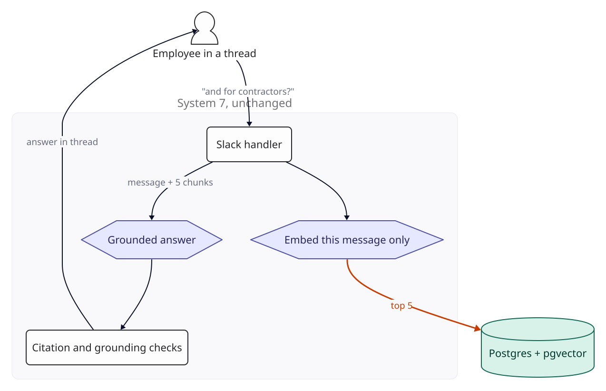
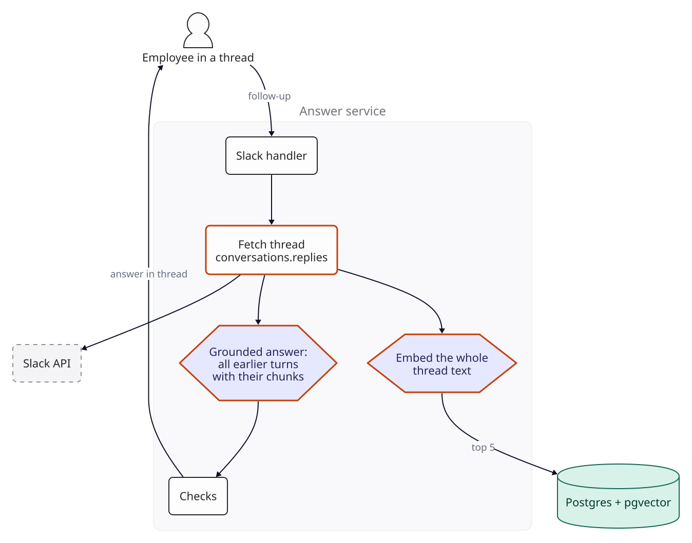
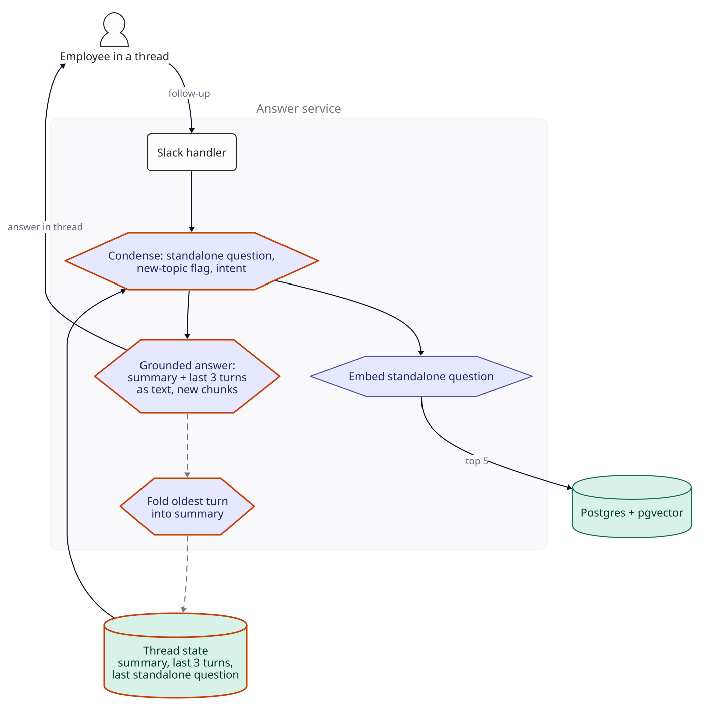
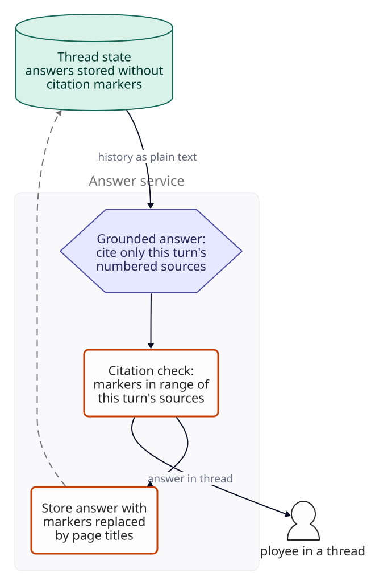
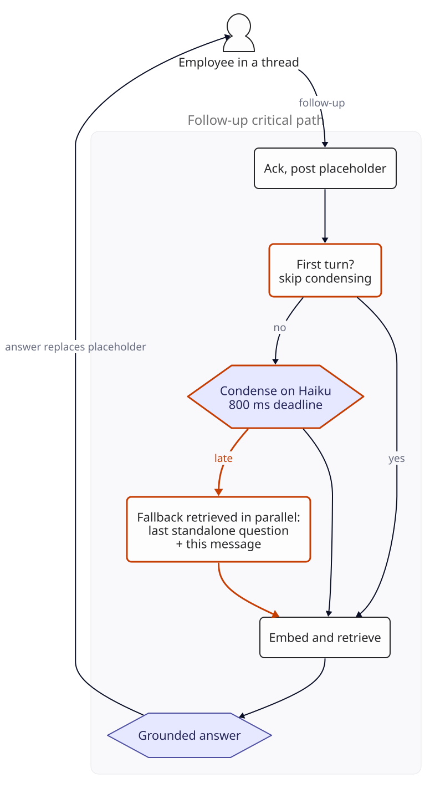
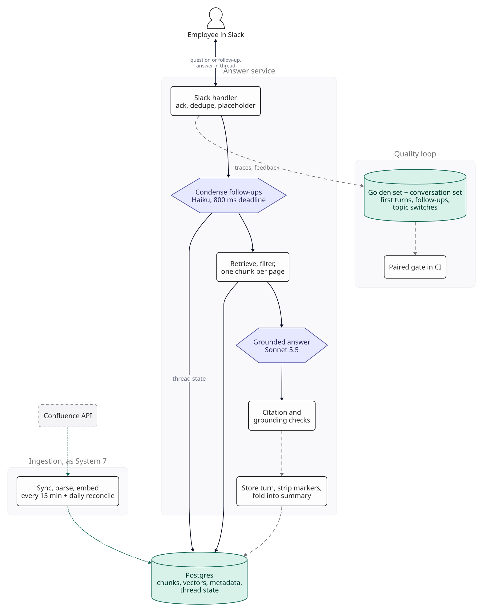

::: {.chapter-meta}
[Level ★★]{} [Part II, Retrieval]{} [Uses O1 O3 O4 O9]{}
:::

A question answered once is System 7. A question answered and then followed up is a conversation,
and a conversation breaks three things System 7 took for granted: that the message is the
question, that the prompt has a fixed size, and that a source number means the same thing for the
whole exchange. This chapter adds conversation to System 7's bot one failure at a time. As in the
rest of the book, nothing here was measured: the scenario supplies the inputs, the arithmetic is
real, and every threshold is a target you set.

## The brief

::: {.brief}
[From the head of People Operations, Kestrel Freight]{.from}
The wiki bot is doing well, but people talk to it like a person. They ask about sabbatical leave,
get an answer, then reply in the thread "and for contractors?" or "what does pro-rated mean
here?". The bot answers those as brand-new questions and gets them wrong. Can it follow a
conversation? Some threads go back and forth ten or fifteen times.
:::

Kestrel Freight is System 7's worked scenario, three months after launch; its traffic and thread
shapes below are assumptions, not data. "Talk to it like a person" is the requirement. "Ten or
fifteen times" is the warning: whatever the bot does per turn, it does that many times in one
thread.

## Questions to ask

| Question | Why it changes the design | We assume |
|---|---|---|
| How often do people follow up, and how many times? | Sets how much traffic the new path carries and how long the history gets |  of first questions get a follow-up; those threads average  follow-ups; a long thread reaches  turns (a turn is a question and its answer) |
| Does every follow-up depend on what came before? | A follow-up that starts a new topic must not drag the old one into retrieval | No: about  of follow-ups start a new topic ("also, how do I reset my VPN?") |
| When should the bot answer in a thread? | Answering every reply would join conversations between people, and "thanks!" is not a question | On a mention; or when the original asker replies directly after the bot's answer, mentions nobody, and the message is a question (see Version 2) |
| May the bot read every message in its channels? | Answering un-mentioned replies needs a subscription that delivers all channel messages, including people's own circumstances | Legal agrees, on condition that the handler discards anything outside the rule above without storing or logging it |
| How long may thread content be kept? | History is personal data the asker typed | 90 days after a thread's last turn, under the trace store's access rules; this chapter adds the job that deletes it |
| How fast? | System 7 promised a full answer within 5 s at p95; follow-ups add work | The same 5 s for first questions; for follow-ups, see Where latency breaks |
| What do we keep from System 7? | Its retrieval, grounding contract, checks and quality loop are designed and gated | All of it. This chapter changes what goes into retrieval and into the prompt, and when the bot speaks |

The second row is the one teams miss. A conversational bot that always uses the history answers
"also, how do I reset my VPN?" with the sabbatical policy still in its retrieval query.

## The numbers

::: {.numbers}
First questions:   a month (System 7's traffic, assumed)
Follow-ups:        x  x  =  a month (assumed shape)
Turns:             a month,  times System 7's volume

One earlier turn, kept as text:          40 question + 220 answer =  tokens
One earlier turn, kept with its chunks:  40 + 5 x 400 + 220 =  tokens
First turn's generation input:           450 system + 2,000 chunks + 40 =  tokens,  on Sonnet 5.5
:::

Traffic is still tiny: about twice System 7's, which was 0.07 queries a second in a busy hour.
What changes is the size of each request. Every turn in a conversation re-sends what came before it,
so the cost of a turn depends on its position in the thread, and the cost of a thread grows with
the square of its length ([F5](../foundations/f5-optimisation.qmd), O3).
How fast it grows depends entirely on what "what came before" includes, and that is the design
decision this chapter turns on.

## Version 0

Version 0 is System 7 as it stands. The bot replies in a thread, and when someone mentions it in a
reply, the handler treats the reply as a new question: embed it, retrieve five chunks, answer with
citations, check them.

{fig-alt="Version 0. An employee replies in a thread with 'and for contractors?'. System 7's handler embeds only that message, retrieves the top 5 chunks from Postgres with pgvector, generates a grounded answer and runs the citation and grounding checks, then answers in the thread."}

Before changing it, extend the instrument. System 7's golden set holds single questions. Add a
**conversation set**:  real threads from the HR and IT channels,
redacted as System 7's set is, with  follow-up turns between them. For
each follow-up, a person writes the standalone question it means ("Is sabbatical leave available
to contractors?"), notes the source page, and tags it. In this worked scenario the tags split as
 that depend on the thread,  that start a new
topic,  that ask about the bot's own answer ("what does pro-rated mean
here?") and  that correct the bot ("no, I meant Pune").

Those slices are small. At a score of 50%, the worst case, the 95% interval is up to plus or minus
 points on 100 turns and  on 50
([F4](../foundations/f4-evaluation.qmd)), and turns from the same thread are not independent, so
the real uncertainty is wider. So this chapter states its targets as counts, compares versions on
the same turns, and counts the turns that changed outcome.

## Where follow-ups break

"And for contractors?" contains one content word. Embedded on its own, it is likely to be nearest
to pages mostly about contractors, such as onboarding or invoicing, and none of those is the
sabbatical policy. Retrieval then finds pages that answer a question nobody asked, and the grounding
contract, doing its job, can produce a well-cited answer to that question. The checks pass, because
every sentence is supported by its sources. The answer is to a different question.

::: {.breaks}
How you would see it: hit rate at 5 on the  dependent follow-ups. System 7
targets 85% on first questions; the target here is at least 80 of the 100, read with its interval
of about plus or minus 10 points. Read the misses: a retrieved page that matches the follow-up's
words but not the thread's topic is this failure.
:::

## Version 1

[**Changed** the thread as context: retrieval embeds the whole thread, and the prompt carries every earlier turn with its chunks.]{.changed}

The obvious fix is to give the system what a person reading the thread would have. The handler
fetches the thread with Slack's `conversations.replies`, which returns a thread's messages given
its channel and timestamp, and embeds the whole thread's text as the retrieval query. The prompt
gets every earlier turn: each question, the chunks retrieved for it, and the answer given. Slack
messages do not contain chunks, but System 7's traces record the chunk IDs behind every answer, so
the handler looks those up and reloads the chunk text from Postgres. The model now sees what it
saw before, plus the new message.

{fig-alt="Version 1. The handler fetches the thread through Slack's conversations.replies, embeds the whole thread's text for retrieval, and sends the model every earlier turn with its chunks plus the new message."}

**Measure before and after.** On the dependent follow-ups, count the turns version 1 answers right
that version 0 did not. On the new-topic follow-ups, count the turns version 1 gets wrong that
version 0 got right: that second count is what the next break is about.

## Where the history breaks

Version 1 fails in two ways, one in retrieval and one in the bill.

**Retrieval leans on the first topic.** The retrieval query is the whole thread embedded as one
text. On turn 4 that is about  x  = 780 tokens of
earlier questions and answers and 40 tokens of new message, so the new message is a small part of
what the vector represents. For a dependent follow-up that may not matter, since it is about the
same topic. For a follow-up that starts a new topic, the query vector is still mostly about
sabbaticals, so the pages it finds can be too. The new-topic slice is where to check.

**The prompt grows by a whole retrieval every turn.** Each earlier turn brings its question, its
five chunks and its answer:  tokens. Turn $n$ therefore sends
 + $(n-1) \times$  input tokens.

::: {.breaks}
Generation input and cost per turn on Sonnet 5.5, and for a whole -turn thread:



: Version 1 against version 2's bounded history, generation only (version 2's small Haiku calls are not included). Prices as of .

Turn 10 under version 1 sends  tokens, 9.2 times turn 1's, and costs
, 6.7 times as much (the 220 output tokens do not grow). Most of the
input is chunks retrieved for questions that have already been answered.

How you would see the retrieval half: on the  new-topic follow-ups, the
count whose retrieved pages belong to the thread's earlier topic. The target is at most 2.
:::

## Version 2

[**Changed** a condensation step, a bounded history of the last three turns as text plus a running summary, thread state in Postgres, a new-topic flag, and a rule for when to answer.]{.changed}

Separate the two jobs version 1 gave the thread. Retrieval needs one well-formed question.
Generation needs enough of the conversation to answer naturally, but not the evidence for answers
already given.

**Condense the question.** A small model, Claude Haiku 5.5 (O9), reads
the running summary, the last three turns and the new message, and returns JSON with three fields:
the standalone question the message means; whether it starts a new topic; and whether it is a
question at all. "And for contractors?" becomes "Is sabbatical leave available to contractors?".
"Also, how do I reset my VPN?" comes back unchanged, flagged as new. "Thanks, that's clear" comes
back as not a question, and the bot stays silent. Retrieval embeds the standalone question, never
the thread. The prompt is  tokens and the output about
, so a condensation costs .

**Show what was understood.** A follow-up's reply starts with one line, "Answering: Is sabbatical
leave available to contractors?", before the answer and its sources. A misread follow-up is the
one failure the grounding checks cannot see, because they compare the answer with its sources, not
with what the asker meant. The line lets the asker see it at once, and the trace records the
standalone question, the flag and the intent for the weekly review.

**Keep history as text, and bounded.** Generation gets the system prompt, a running summary of
older turns (at most  tokens, enforced with `max_tokens` on the summary
call), the last  turns as question and answer text, the new chunks, the
original message and the standalone question. Each stored message is cut to
 tokens, so a pasted error log cannot fill the window. Earlier turns' chunks
are not re-sent: if an earlier source still matters, the standalone question will retrieve it
again. When a turn falls out of the window, Haiku folds it into the summary, for
. When the flag says new topic, the history is left out of the generation
prompt, so the old topic cannot leak into the answer.

**Keep the thread state ourselves.** A row per thread in Postgres, keyed by channel ID and thread
timestamp together (a message timestamp is unique within a channel, not across channels), holds the
summary, the window of recent turns, the last standalone question and the timestamp of the bot's
last answer. The bot writes it after each answer, so it never has to re-read the thread from Slack
to answer its own follow-up. Turns in one thread are processed one at a time under a row lock, so a
second reply waits for the first turn's state, summary included, to be written.

**Answer only when asked.** The bot answers in a thread when it is mentioned, or when all of these
hold: the thread has a state row, the message comes from the asker of that thread, nobody else has
posted since the bot's last answer, the message mentions nobody, and the condenser says it is a
question. A reply to a colleague that names no one still passes the first four tests if nobody else
has spoken, which is the case the "Answering" line and a thumbs-down are there to catch. When the
bot is mentioned partway through a thread it did not start, it reads the thread with
`conversations.replies` and uses the last three messages before the mention, each cut to
 tokens, as the first window.

The history now costs at most 450 +  +  x
 =  tokens before the new chunks, whatever the
thread length: from turn 5 on, every turn sends  tokens and costs
. A -turn thread costs
 in generation instead of ,
 times less.

{fig-alt="Version 2. The handler sends the follow-up and the thread state (summary, last 3 turns, last standalone question) to a condenser, which returns a standalone question and a new-topic flag. Retrieval embeds the standalone question. Generation gets the summary and last 3 turns as text plus the new chunks. Afterwards the oldest turn is folded into the summary and the thread state is updated."}

**Measure before and after.** Condensation: at least 180 of the 200 standalone questions judged
equivalent to the person-written ones. The new-topic flag, against the tags: at most 2 of the 50
new-topic turns missed, and at most 5 of the other 150 wrongly flagged as new. Drift on the
new-topic slice: at most 2 of 50, the target from the break. And hit rate at 5 on dependent
follow-ups, aiming at 80 of 100.

## Where citations break

System 7's answers carry citation markers: "Eligible after six months [2]." Version 2 keeps earlier
answers in the prompt as text, markers and all. On the next turn, the new chunks are numbered from
1 again, so "[2]" in the history now names a different source than it did when it was written. A
model asked "and for contractors?" can reasonably write "as above, eligibility starts after six
months [2]", citing the number it sees in the history.

System 7's citation check cannot catch this. It confirms that every marker is between 1 and the
number of sources supplied, and "[2]" is. The grounding test catches it only when the sentence
contains a number or a name that the new source 2 lacks. A sentence that cites the wrong source
and contains no value passes both checks, and a reader who clicks the link finds a page that does
not say what the bot claimed.

::: {.breaks}
How you would see it: on the conversation set, the count of follow-up answers with at least one
citation a judge rates as not supporting its sentence. The target is at most 5 of 200. The grounding
test's refusal rate on follow-ups in production, next to its rate on first questions, is the cheap
signal; the two come from different questions, so read the difference with both intervals, not as a
paired comparison.
:::

## Version 3

[**Changed** history stored without citation markers, and a citation check that counts only this turn's sources.]{.changed}

Two small changes remove the ambiguity instead of detecting it.

**Store answers without markers.** After the checks pass, the answer goes into the thread state
with each marker replaced by the cited page's title in plain words: "Eligible after six months
(Leave Policy, Sabbatical leave)." The history the model sees on the next turn contains no numbers
it could confuse with this turn's sources.

**Tell the model, and check it.** The prompt says that only the numbered sources in this turn may
be cited, and that anything from earlier in the conversation must be supported by them or left
out. The citation check is unchanged in code, but its meaning is now exact: every marker refers to
a chunk retrieved for this turn. If the earlier source is still the right one, the standalone
question retrieves it again and it gets a number like any other.

{fig-alt="Version 3. Thread state stores answers without citation markers, as plain text with page titles. Generation may cite only this turn's numbered sources; the citation check confirms markers are in range of this turn's sources, and the answer is stored with markers replaced by page titles."}

**Measure before and after.** The judged count of unsupported citations on follow-ups, against the
target from the break. Also count follow-ups that version 3 refuses because the source an earlier
answer used was not retrieved again: those point at the condenser, not at citations.

## Where latency breaks

System 7's latency budget, summed from its assumed stage times, was 2,160 to 5,050 ms for a full
answer, against a target of 5 s at p95. A follow-up now runs a model call whose output the
retrieval query depends on, so retrieval with the condensed question cannot start until it returns.

::: {.breaks}
The condenser's time, with System 7's assumed time to first token for a hosted Claude model (400 ms
to 1.2 s) and [F2](../foundations/f2-numbers.qmd)'s planning range for decode (40 to 150 tokens a
second) over about 50 output tokens (330 to 1,250 ms): 730 to 2,450 ms, added in series.

| | Low | High |
|---|--:|--:|
| System 7's full-answer budget | 2,160 ms | 5,050 ms |
| Read thread state from Postgres | 10 ms | 30 ms |
| Condense on Haiku 5.5 | 730 ms | 2,450 ms |
| **Follow-up total** | **2,900 ms** | **7,530 ms** |

The low end fits 5 s. The high end misses by about 2.5 s, and none of it can be won back from the
condenser without a deadline, because the condenser is in front of everything else.
:::

## Version 4

[**Changed** no condensation on first turns, a fallback retrieval run in parallel with condensation, a deadline derived from the budget, and a separate latency target for follow-ups.]{.changed}

**Skip it when it cannot help.** The first message in a thread has no history, so it goes straight
to retrieval exactly as in System 7. Only follow-ups pay for condensation.

**Retrieve a fallback in parallel.** As in [System 8](08-production-rag.qmd)'s rewrite stage, the
handler does not wait idle for the condenser. The moment a follow-up arrives, it starts retrieval
with a fallback query, the thread's last standalone question followed by the new message ("Is
sabbatical leave available to employees on probation? And for contractors?"), while the condenser
runs. If the condenser answers before the deadline, the handler embeds and retrieves its standalone
question and uses those chunks. If not, it uses the fallback's chunks, which are already there.

**On a fallback, play safe.** The fallback cannot say whether the message starts a new topic, so
generation gets the fallback query as the question and no history: a new topic then cannot inherit
the old one, and a dependent follow-up still carries the previous question in its query. The
stored "last standalone question" is left unchanged, so a run of fallbacks cannot grow the query
turn by turn. The condenser call has already been sent, so it is billed whether or not its answer
arrives in time; the cost table counts one per follow-up.

**Derive the deadline from the budget.** The follow-up target this chapter sets is 6 s at p95. The
high end of the path with a deadline $D$ is 300 (Slack and placeholder) + 30 (state) + $D$ + 250
(embed and search the standalone question) + 1,200 (first token) + 3,000 (answer) + 300 (checks
and update) = 5,080 + $D$ ms. For 6,000 ms, $D$ can be at most 920 ms; this chapter sets 800, which
leaves 120 ms. Be clear what that means: on the assumed condenser range of 730 to 2,450 ms, the
condenser only beats an 800 ms deadline at the very fast end. Unless traces show it running fast,
most follow-ups will use the fallback, and the fallback's quality becomes the design's quality.

**Change the promise, explicitly.** Follow-ups get a 6 s target at p95, first questions keep 5 s,
and the placeholder System 7 posts within the first second stays. A target set from a sum of
stage maxima is a planning number, not a measured p95; agree it with People Operations as part of
the design and tighten it when traces allow.

{fig-alt="Version 4. The handler acknowledges and posts a placeholder. If this is the first turn, it goes straight to retrieval. Otherwise the follow-up is condensed on Haiku with an 800 ms deadline; if the condenser is late, a fallback query made from the last standalone question plus this message is used instead. Retrieval and the grounded answer follow, and the answer replaces the placeholder."}

**Measure before and after.** Two numbers decide whether the deadline is in the right place. The
share of follow-ups that use the fallback, from traces in the first week. And what the fallback
costs in quality: re-run the conversation set with the fallback forced on every follow-up and
compare dependent-slice hit rate with the condenser's, turn by turn. If the fallback is close, keep
the deadline. If it is far behind and most follow-ups fall back, either the condenser must get
faster (a shorter prompt is the first lever) or the follow-up target must move; that is a decision
for People Operations, with the counts in front of them.

## The final design

{fig-alt="Final design. Ingestion is System 7's: sync, parse and embed every 15 minutes plus a daily reconcile, into Postgres, which also holds thread state. The answer service acknowledges Slack events and posts a placeholder, condenses follow-ups on Haiku with an 800 ms deadline using the thread state, retrieves with filters and one chunk per page, generates a grounded answer on Sonnet 5.5, runs the citation and grounding checks, and stores the turn with markers stripped, folding old turns into the summary. Traces and feedback feed the golden set and the conversation set, which run as a paired gate in CI."}

| Component | Choice | Why this and not something bigger |
|---|---|---|
| From System 7, unchanged | Sync, chunking, exact-scan retrieval, the grounding contract and both checks, the paired CI gate | Designed and gated there |
| From System 7, changed | The Slack handler's trigger rule and subscription; the prompt layout, which now carries history before the numbered sources | Needed to follow a thread; the sources and their numbering rules are unchanged |
| When to answer | Mention; or the asker's question directly after the bot's answer, mentioning nobody | Answering every reply would join conversations between people |
| Thread state | One Postgres row per (channel, thread): summary, last 3 turns, last standalone question; row lock per thread | No need to re-read Slack on the bot's own follow-ups; holds only the bot's exchanges |
| Condensation | Claude Haiku 5.5, JSON with standalone question, new-topic flag and intent; 800 ms deadline; fallback retrieved in parallel | Retrieval needs one clean question; the fallback bounds the time without leaving the handler idle |
| History in the prompt | Summary of at most  tokens plus the last  turns as text, each message cut to  tokens, without citation markers; none on a new topic or a fallback | Bounded at  tokens before the chunks; cannot be confused with this turn's sources |
| What the asker sees | "Answering: ..." on follow-ups, then the answer and sources | A misread follow-up passes every check; the asker can see it |
| Generation | Claude Sonnet 5.5, as System 7 | Same grounding contract, same reasons; Haiku is System 7's optimisation to evaluate |
| Latency targets | 5 s at p95 for first questions, 6 s for follow-ups, placeholder within 1 s | Follow-up arithmetic cannot show 5 s at the high end of the assumptions |
| Quality loop | System 7's golden set plus the conversation set, both in the paired CI gate | Conversation failures only show on conversation data |

A follow-up, end to end, with System 7's assumed stage times and the condenser capped:

| Step | Assumed range |
|---|---|
| Slack event to our handler, acknowledge, post placeholder | 100 to 300 ms |
| Read thread state | 10 to 30 ms |
| Condense on Haiku, fallback retrieval alongside (deadline 800 ms) | 730 to 800 ms |
| Embed and search the standalone question (skipped on a fallback) | 60 to 250 ms |
| Model: time to first token | 400 ms to 1.2 s |
| Model: about 220 output tokens | 1.5 to 3 s |
| Checks, edit the Slack message, store the turn | 100 to 300 ms |
| **Sum** | **2,900 to 5,880 ms** |

As System 7 says, the sum of each stage's slowest value is not the p95; the traced end-to-end p95
decides whether the 6 s target holds.

## Deployment

The deployment is System 7's, in AWS Mumbai, with four additions.

- **Thread state table** in the same Postgres database. A row holds about
   tokens of history text, about 6 KB at 4 bytes a token (rule of
  thumb) with keys and metadata. That is  MB of new rows a
  month at pilot and  MB at growth; with 90-day retention the
  table holds about  MB at growth, small next to the vectors.
- **Retention job.** A nightly job deletes thread state 90 days after a thread's last turn, and the
  trace store's retention is set to match, so the two copies of a conversation expire together.
- **Slack scopes and events, required.** Answering a reply without a mention means subscribing to
  the `message.channels` event, which needs the `channels:history` scope (and the `groups:history`
  equivalents for private channels); `conversations.replies` needs the same scopes. The handler
  receives every message in the bot's channels, so it applies the answering rule first and discards
  anything that fails it without storing or logging its text. Slack's documentation does not spell
  out how thread replies are marked in these events, so test the rule against real replies in a
  test workspace before launch.
- **Condenser deadline** lives in configuration, so it can follow the traces without a release.

Nothing else is new: no queue, no conversation service, no vector store for history. The thread
state is small, written once per turn, and read once per follow-up.

## Cost

Monthly cost at System 7's three scales, with the thread shape from the questions table. Prices as
of .



: Monthly cost of the final design: Sonnet 5.5 generating, Haiku 5.5 condensing. {.striped}

Follow-ups roughly double the generation lines, because they double the turns. A follow-up that
uses the history costs a little more than a first question ( at turn 3
against ); one that starts a new topic costs about the same. Condensation
is  of a follow-up's model cost. Conversation adds
 a month at pilot and  at the large scale,
and almost all of it is Sonnet answering more turns.

The table has no summary updates, and that is a limit of the assumed shape, not a property of the
design: the mean thread of four turns fills the three-turn window exactly and never overflows it.
The long threads the brief mentions do overflow, and each turn past the fourth pays
 for a summary update. Replace the mean with the distribution of thread
lengths from the traces before quoting this line.

The pilot column has the same shape as System 7's: the fixed lines and the evaluation runs are
most of the bill. The conversation set makes evaluation the largest single line at pilot, which is
the price of being able to see conversation failures at all.

## Optimisation

**O3 History compaction, already applied.** It is the core of version 2,
and the growth table is its saving against version 1's uncompacted, uncached history:
 times on a -turn thread. The settings to tune are
the window and the summary length. A window of 2 instead of 3 saves  tokens
per follow-up from turn 5 on (at turn 4 the summary takes most of it back); test it on the
conversation set's turns that refer back more than two turns, which are the ones it would lose.

**O1 Prompt caching does not apply to this design as built,** and the
reason is structural. F5's first choice for growing history is to cache it, which works when the
history only ever grows at the end: each request then starts with the previous request's bytes.
Version 2's history does not. From turn 4 on, every turn drops the oldest turn from the window, and
from turn 5 the summary is rewritten too, so the bytes after the 450-token system prompt differ on
every request. The system prompt alone is below the -token minimum, which
is System 7's reason for not caching either.

Caching would need an append-only history: keep the window growing to six turns, then fold the
oldest three into the summary at once, so the prefix holds for three turns at a time. Whether that
pays is arithmetic plus one measurement. A cache hit saves  per
million history tokens on Sonnet 5.5; a miss pays  per million extra
to write. Caching therefore pays when more than  of follow-ups arrive
within the cache lifetime (5 minutes by default) of the previous turn and within the same block.
The gaps between turns are in the Slack timestamps already in the traces. Even at a perfect hit rate
the saving is capped at about  a month at pilot and
 at the large scale, so decide on latency first: if traces show
cached prefixes shortening time to first token, that is the better reason.

**O9 Haiku for condensation.** The same call costs
 on Haiku 5.5 and  on Sonnet 5.5. At
pilot that is the difference between  and
 a month; at the large scale, between
 and , which matters. Haiku is
also the model most likely to fit an 800 ms deadline. The condensation target from version 2 is the
gate; if Haiku misses it, try a shorter prompt before moving the step up a tier, since a slower
model makes the deadline problem worse.

**O4 Output control** is System 7's: at most 150 words. It matters more
here, because generation is the only stage left on the follow-up path that can shrink.

## Operating it

The thresholds are starting values to calibrate in the first month, not known healthy ranges. They
add to System 7's table; everything there still applies.

| Metric | Starting target | Alert when |
|---|---|---|
| CI gate, conversation set: newly failing turns | 3 or fewer against the last release | More than 3, or zero turns run (the build fails) |
| Follow-ups answered from the fallback | Set from the first week's traces | Doubles week on week: the condenser has slowed or its prompt has grown |
| Follow-ups flagged as a new topic, or as not a question | Steady week on week | Either doubles or halves: the condenser's behaviour changed |
| Thumbs-down on follow-ups, against first questions | Within a few points | Twice the first-question rate: read the "Answering" lines first |
| Grounding-test refusals, follow-ups against first questions | Within a few points | Follow-ups twice the first-question rate: history or citations are leaking |
| Prompt tokens before the chunks, p99 | At or below  | Above it: the summary, window or message cap is not holding |
| Thread-state rows past retention | Zero | Any: the retention job has stopped |
| p95 latency, follow-ups | Under 6 s | Over 8 s for 15 minutes |

**Failure modes to expect.**

- **The summary drifts.** A summary rewritten on every turn can drop the detail a later turn needs
  ("for the Pune office") or keep a detail the asker corrected. The correction-tagged turns in the
  conversation set exist to catch this; read a sample of summaries in the weekly review.
- **The asker changes subject without saying so.** "What about Diwali?" after a leave question is a
  follow-up; after a VPN question it is a new topic. The flag will get some of these wrong in both
  directions, which is why both error counts have targets.
- **The asker replies to someone else.** If a colleague answers in the thread and the asker replies
  to them, the rule holds the bot back, because someone else spoke after the bot. If the asker talks
  to a colleague without one of them posting first, the bot may answer; the "Answering" line makes
  that visible and a thumbs-down records it.
- **A pasted instruction in the thread.** Thread text reaches the condenser, the summary and the
  history, and the summary can carry it forward for many turns. The condenser's output becomes a
  search query, part of the generation prompt and stored state. The bot still has no tools, and its
  output is escaped as System 7's is, so the damage is limited to a wrong answer with visible
  sources; see [F6](../foundations/f6-safety-observability.qmd).

## Variants

**If the bot were a web chat instead of Slack.** The thread state becomes the session and the
answering rule disappears, since every message is addressed to the bot. Streaming would not help
much: the condenser runs before there is anything to show, and System 7's checks need the whole
answer before it is shown.

**If conversations were long and exploratory** (a research assistant rather than an HR bot), the
three-turn window would lose context people expect to keep. A longer summary, or retrieving earlier
turns by relevance instead of recency, are the next steps; both change the history bound, so redo
the growth table first.

**If the corpus had exact identifiers.** Condense first, then run [System 8](08-production-rag.qmd)'s
glossary rewrite and keyword search on the standalone question, and tell the condenser to carry
identifiers forward ("and WMS-4013?" becomes a question that names WMS-4013).

**If some pages were restricted.** History is the new leak: an answer built from a page the asker
could read stays in the thread state, and must not reach a different person who mentions the bot in
the same thread. Thread state belongs to the asker; that is part of [System 10](10-multi-tenant-rag.qmd).

**If questions came in Hindi.** The condenser must keep the asker's language or translate
deliberately, the conversation set needs Hindi threads, and every token count above grows by two to
four times ([F2](../foundations/f2-numbers.qmd)).

## Trade-offs

| Decision | Alternative | Why we chose it |
|---|---|---|
| Condense to a standalone question for retrieval | Embed the whole thread | The new message is a small part of a whole-thread embedding; revisit only if condensation misses its target after prompt work |
| Last 3 turns as text plus a summary | Every earlier turn with its chunks | Bounded at  tokens before the chunks instead of growing by  a turn; a needed source is retrieved again |
| Sliding window, uncached | Append-only blocks with a cached prefix | Simpler state; caching pays only above  quick follow-ups and is capped at  a month at the large scale. Switch if traces show quick follow-ups and a latency gain |
| A new-topic flag that drops history | Always send the history | A new topic should be answered as a first question; both flag error counts have targets |
| Strip citation markers from stored answers | Detect stale markers after generation | Removes the ambiguity instead of trying to detect a wrong number that passes the range check |
| Show "Answering: ..." on follow-ups | Hide the condensed question | The only place a misread follow-up becomes visible before the weekly review |
| Thread state in our own Postgres, keyed by channel and thread | Re-read the thread from Slack each turn | One read per follow-up from a database we already run; holds only the bot's own exchanges |
| Haiku condenser with an 800 ms deadline and a parallel fallback | Sonnet, or wait for the condenser | The deadline comes from the budget; the fallback keeps the handler busy while it waits. Revisit if most follow-ups fall back and the fallback misses the hit-rate target |
| A 6 s follow-up target, agreed with People Operations | Keep 5 s for everything | The arithmetic cannot show 5 s at the high end of the assumptions; tighten it if traced p95 allows |
