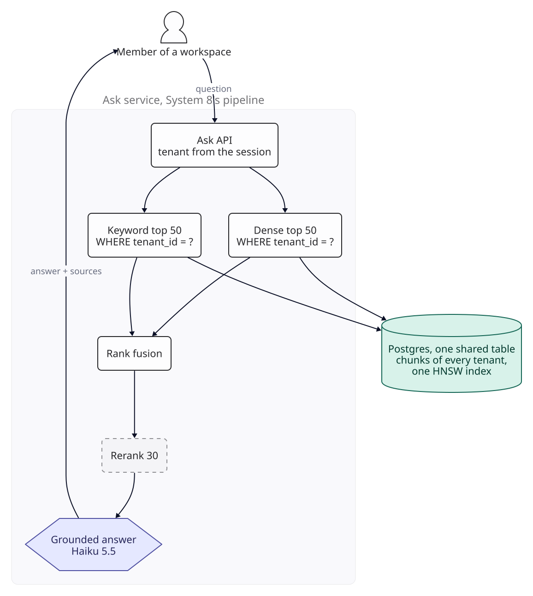
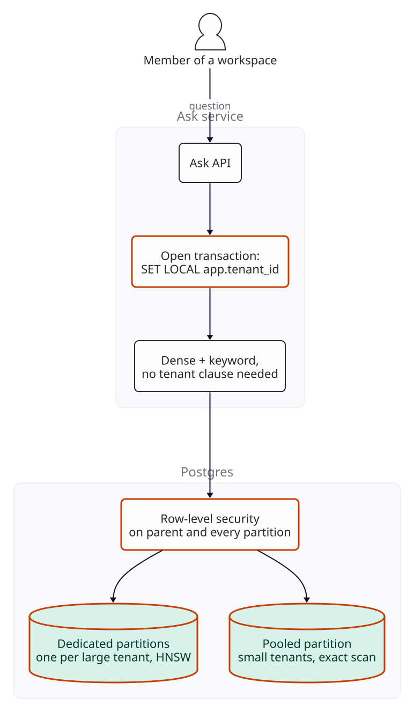
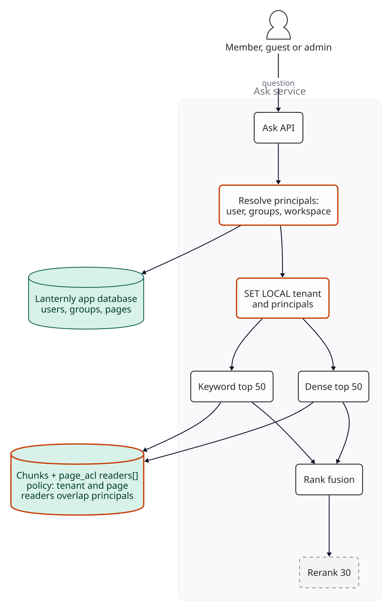
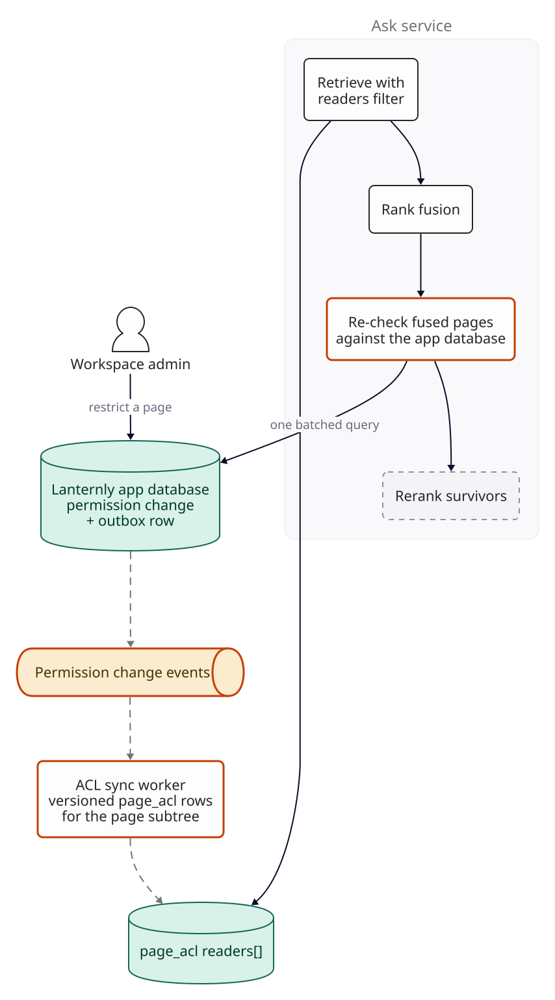
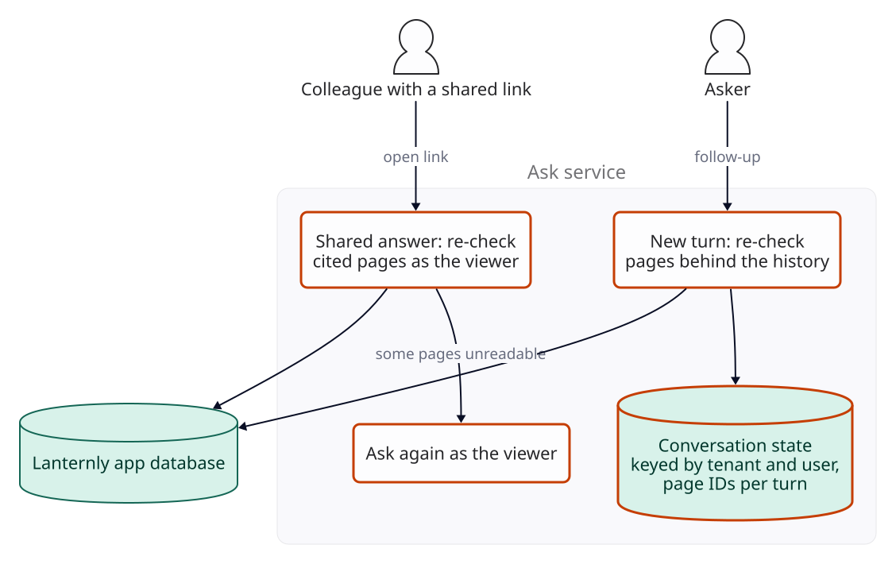
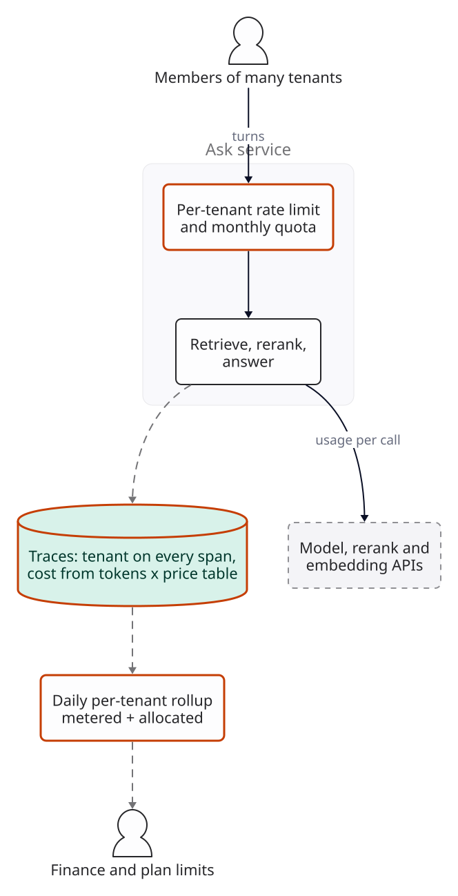
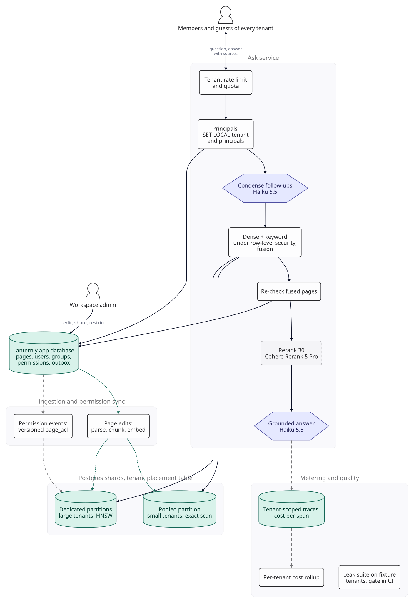

::: {.chapter-meta}
[Level <span class="level">★★★</span>]{} [Part II, Retrieval]{} [Uses <span class="ocode">O1</span> <span class="ocode">O2</span> <span class="ocode">O8</span>]{}
:::

Systems 7, 8 and 9 answered questions for one company, over content everyone asking was allowed to
read. This chapter takes that pipeline into a SaaS product, where thousands of customers share one
deployment and, inside each customer, people may read different pages. Two new kinds of failure
appear. One is a leak: an answer built from something the asker may not open, whether it belongs to
another customer or to a colleague's restricted space. Leaks do not show up in quality scores at
all. The other is a bill that arrives as one number for thousands of customers. As in the rest of
the book, nothing here was measured: the scenario supplies the inputs, the arithmetic is real, and
every threshold is a target you set.

## The brief

::: {.brief}
[From the VP of Product, Lanternly]{.from}
Every customer demo now ends with "can it answer questions?". We want an Ask panel in Lanternly: ask
a question, get an answer from your workspace's pages with sources, and follow up. We have about
2,400 paying workspaces, from ten-person startups to a bank with 20,000 seats. The bank's security
team has already asked two things: can our data ever show up for another customer, and can Ask show
someone a page they can't open? People will also want to share a good answer with a colleague.
Finance wants to know what it costs us per customer, because we haven't decided how to charge.
:::

Lanternly is a worked scenario: a team wiki and documents product sold per seat. Its tenant counts,
page counts and traffic below are assumptions, not data. The bank's two questions are the
requirements; everything else in the brief is a feature. "Share a good answer" is the line that will
cause the most trouble, and "per customer" is a metering requirement that has to be designed in, not
added afterwards.

## Questions to ask

| Question | Why it changes the design | We assume |
|---|---|---|
| How are tenants distributed by size? | Decides whether one index layout can serve a ten-page workspace and a 200,000-page one |  small workspaces ( seats,  pages each),  mid-size ( seats,  pages),  enterprise (on average  seats and  pages; the bank has  and ) |
| Who may read a page today? | Ask must follow the product's rules exactly, including the odd ones; it must not invent its own | Spaces are open to all members or restricted to groups; a page can be restricted further, and its subpages inherit that; guests see only pages shared with them. Admins manage permissions but read only what they are granted. All of it lives in Lanternly's own Postgres database |
| What isolation do contracts promise? | A promise of a separate database per customer is a different system from a promise that no data crosses | Logical isolation on shared infrastructure, for every plan. A dedicated database for one customer is a Variant |
| How quickly must a permission change take effect in Ask? | Sets how stale the index's copy of permissions may be | A revoked permission takes effect on the next question; a new grant within a minute |
| Can we read customers' pages to build an evaluation set? | Systems 7 and 8 built golden sets from real questions and content | No. Only Lanternly's own workspace and design partners who opt in in writing |
| Where may the data be processed? | Could force a region per tenant | Lanternly runs in AWS us-east-1; customers accept the model, embedding and reranking vendors as sub-processors under their data processing terms. EU residency is a Variant |
| How fast? | Sets the budget the new checks must fit in | System 8's: first words within 2 s at p95; follow-ups as System 9 |
| What do we reuse? | Retrieval, grounding and follow-ups are designed and gated already | System 8's hybrid retrieval, fusion, reranking and generation on Claude Haiku 5.5, without its glossary rewrite (one company's vocabulary); System 9's condensation and bounded history |

The evaluation row is the one teams discover late. A multi-tenant product cannot tune on its
customers' data, so the test data has to be built, and the most important test (did anything leak?)
has to be built on purpose.

## The numbers

::: {.numbers}
Seats:    2,000 x 25 + 380 x 300 + 20 x 4,000 = 244,000 seats (assumed tiers)
Turns:    244,000 x  weekly active x  turns x 4.35 weeks =  turns/month (assumed)
           of turns are follow-ups (assumed); a turn is a question or a follow-up
Peak:     85% in 220 business hours, peak twice the average =  turns/second

Chunks:   pages x 1,600 tokens / 400 per chunk = 4 chunks a page
          2,000 x  + 380 x  + 20 x  =  chunks
Vectors:   x 1,536 dims x 4 bytes =  GB raw

Per turn: generation   500 system + 6 x 400 chunks + 40 =  in,  out on Haiku 5.5 = 
          reranking    30 x (400 + 40) =  tokens x /M = 
          a follow-up adds  tokens of history and a condensation, 
          average turn, everything metered: 
:::

Three things follow. Traffic is small:  turns a second at peak
across every customer. The corpus is not:  GB of raw vectors is
more than System 8's large scale, spread over 2,400 tenants of wildly different sizes, so the shape
of the index is the first design problem. And the model cost of an average seat is tiny
( turns a month at  is
), which says nothing yet about the seats that are not average.
That is the last break.

## Version 0

Version 0 is System 8's pipeline with a tenant column. Every chunk of every workspace goes into one
Postgres table with a `tenant_id`; one HNSW index covers all the vectors, with iterative index scans
on, as System 7 advised for filtered search. The Ask API takes the tenant from the signed-in
session, and every query in the code adds `WHERE tenant_id = ?`. Inside a workspace, every member
can see whatever Ask finds.

{fig-alt="Version 0. A workspace member asks the Ask API, which takes the tenant from the session. Dense and keyword retrieval each query one shared Postgres table holding every tenant's chunks under one HNSW index, each with a WHERE tenant_id clause. Results are fused, reranked by an external reranker and answered by Haiku 5.5 with sources."}

Before changing anything, build two instruments, because the brief asks two different questions.

**A golden set for quality.**  questions, System 8's size, drawn from
Lanternly's own workspace and from design partners who have opted in, tagged by tenant size and by
question type. It answers "are the answers good?", exactly as in System 8.

**A leak suite for isolation.**  fixture tenants built for the purpose,
each with  users whose access is designed: members of different groups, a
member of none, a guest, an admin. One fixture tenant is small enough to sit with the small tenants
and one is large enough to be treated as a large one (Version 1 makes that distinction matter).
Every chunk of every fixture page carries a canary: a unique random string that no question would
produce by chance, one per chunk, because a page's canary only proves something about the chunk it
is in.  probe questions aim at restricted pages and at other tenants'
content. A leak is a canary from a page the asker may not open reaching anything that passes text on
or keeps it: reranker input, prompt, answer, trace or log. That is checked in code, with no judge,
and the target is zero. Two rules keep the suite honest. It fails if no probes ran. And it includes
control probes, the same questions asked by users who may read the page: if their canaries never
appear either, the probes are not reaching the pages and a zero proves nothing.

Be clear what a zero means. Zero leaks in  probes bounds the leak rate per
probe below about  at 95% confidence (the rule of three: 3 divided by the
number of trials), and only for the paths and permission shapes the probes exercise. The suite is a
regression gate on the design below, not a proof that it cannot leak.

## Where the shared index breaks

Version 0 fails in two ways, one about safety and one about recall.

**Isolation depends on every query remembering.** The tenant clause lives in application code, so it
is only as good as the least careful query. Count the paths that read tenant content: dense
retrieval, keyword retrieval, fetching chunks by ID to render citations, loading a conversation,
the re-indexing job, exporting traces for debugging, the admin tools support staff use. Each is a
place where one forgotten clause returns another customer's rows, and the leak suite only exercises
the paths it calls.

**Small tenants get no results.** With an approximate index, pgvector applies the `WHERE` clause after
the index scan (pgvector README). A small workspace's  chunks are
 of the  in the index.

::: {.breaks}
Matching rows the HNSW scan can be expected to find for a small tenant, if its chunks are spread
through the graph in proportion to their number:

| Scan | Tuples visited | Expected matches for a small tenant |
|---|--:|--:|
| Default scan, `hnsw.ef_search` =  |  |  |
| Iterative scan, up to `hnsw.max_scan_tuples` |  (default) |  |
| Needed for System 8's  dense candidates |  |  |

The proportional spread is an assumption, and probably a pessimistic one: a tenant's pages share
topics and vocabulary, so its chunks may sit closer to its own users' queries than chance would put
them. Read the table as a break-even instead. To expect  matches
within  visited tuples, one visited tuple in 
must belong to the tenant,  times the small tenant's share of the index. Nothing in the
index guarantees that, so the full candidate list is no longer guaranteed. When it fails, dense
retrieval returns a handful of candidates or none, and the answer leans on keyword search alone.

How you would see it: the number of dense candidates returned per query, by tenant size. The target
is the full  for every query whose tenant has at least that many
chunks. For isolation: cross-tenant probes in the leak suite, target zero, plus a check that runs
every query path with no tenant set and expects zero rows.
:::

## Version 1

[**Changed** row-level security keyed on a per-transaction setting, and a partitioned table: small tenants pooled and scanned exactly, large tenants in partitions of their own with HNSW.]{.changed}

**Make the database refuse, not the code remember.** Postgres row-level security attaches policies to
a table, and their conditions are added to every query against it. Policies come in two kinds:
permissive ones are combined with OR, restrictive ones with AND, and a row needs at least one
permissive policy to be visible at all. Each table holding tenant content (chunks, conversations,
shared answers, trace text) gets a restrictive tenant policy for every role, plus a permissive policy
per role saying what that role may do inside a tenant:

```sql
ALTER TABLE chunks ENABLE ROW LEVEL SECURITY;
ALTER TABLE chunks FORCE ROW LEVEL SECURITY;
CREATE POLICY tenant_only ON chunks AS RESTRICTIVE
  USING (tenant_id = current_setting('app.tenant_id', true)::uuid);
CREATE POLICY ask_read ON chunks FOR SELECT TO ask_role USING (true);
CREATE POLICY ingest_write ON chunks TO ingest_role USING (true);
```

Every role that touches a table needs a permissive policy on it, and every table gets the same
restrictive one; a role with no permissive policy sees nothing, which fails closed but also fails
silently. So the list of roles and their policies per table is written down and checked in CI, as
below.

Because the tenant policy is restrictive, no permissive policy added later for some new feature can
widen it. Every request opens a transaction and sets the tenant from the session with
`set_config('app.tenant_id', $1, true)`, the function form of `SET LOCAL`, which (unlike `SET LOCAL`)
takes a bind parameter. Either way the setting lasts only until the end of the transaction (Postgres
documentation), so a pooled connection cannot carry one request's tenant into the next. The
ingestion worker does the same for each tenant's batch, under its own role.

Three details from the Postgres documentation decide whether this holds. With `missing_ok` set to
true, `current_setting` returns NULL when the setting does not exist, so a query on a fresh
connection with no tenant set matches no rows. On a reused connection the setting may instead be
left as an empty string, so the cast fails and the query errors (behaviour to confirm on your
version; the documentation pages cited do not describe it). Both fail closed. Table owners bypass row security unless the
table has `FORCE ROW LEVEL SECURITY`, and superusers and roles with `BYPASSRLS` always bypass it, so
no application role is any of those. And with row security on and no policy, nothing is visible: a
new table fails closed too.

Be precise about what this buys. It turns a forgotten tenant clause into an empty result. It does
not stop code from setting the wrong tenant: the tenant must come from the authenticated session and
nowhere else, and that line of code gets a test of its own.

**Name a role for every job that crosses tenants.** The re-indexing job, the daily cost rollup,
tenant offboarding, partition promotion and support tooling were all leak paths in version 0. Each
gets its own role and goes through the tenant policy one tenant at a time, setting the tenant like a
request does. The rollup reads a cost table that holds token counts and prices but no text, so it has
nothing to leak. Offboarding and promotion run as the migration role, from a runbook, with two people; that role gets tenant-scoped policies like any other, and offboarding counts the tenant's rows in every table afterwards and fails unless every count is zero, because a delete that a policy hides from is a silent no-op.
A CI check fails the build if any application role has `BYPASSRLS`, or if any table with a
`tenant_id` column lacks the restrictive policy, or if a role lacks a permissive policy its written list says it needs.

**Lay the table out by tenant size.** The pgvector README's advice for filtering by many different
values is to partition. One partition per tenant would mean 2,400 partitions at launch and
 at the large scale, and the Postgres documentation says the planner
handles "up to a few thousand partitions fairly well", with planning time and memory growing with
the partitions left after pruning. So the table is partitioned by `LIST (tenant_id)` in two tiers:

- **Pooled.** Tenants with up to  chunks (about
   pages) share the default partition, which has a B-tree index on
  `tenant_id` and no vector index. Without a vector index pgvector searches exactly, which the README
  says gives perfect recall, and the B-tree index limits the scan to one tenant's rows. The largest
  pooled tenant's scan reads  x  bytes =
   MB of vectors. The threshold is an assumption, and so is the target
  set for it: 50 ms for the dense step at p95, which over  rows is
   microseconds a row to fetch the vector and compute the distance. Whether
  a shard meets that depends on how much of the pool stays in memory beside the HNSW indexes; the
  traced p95 decides, and the threshold moves with it.
- **Dedicated.** A tenant above the threshold gets its own partition with its own HNSW index, so its
  index holds only its own chunks. At launch that is the
   enterprise tenants, 
  chunks, about  GB of vectors and graph at the 1.5 overhead rule of
  thumb. As System 7 set out, raise `hnsw.ef_search` above the 
  candidates dense retrieval asks for, and turn on iterative scans.

**Promoting a tenant locks something.** Moving a tenant out of the pool means copying its rows to a
new table, building the HNSW index, then deleting the rows from the pool and attaching the table as
the tenant's partition. While a default partition exists, attaching a new partition makes Postgres
check that the default holds no rows for the new key, which scans the pool under a lock; confirm the
lock level for your Postgres version and schedule promotions in a quiet hour. Writes for that tenant
during the copy are not lost, because page edits reach the index through the ingestion queue: pause
that tenant's queue, copy, swap, and let it drain.

**Keyword search needs its own check.** In the pool, a GIN index on the `tsvector` column finds
matches in every pooled tenant before the tenant filter removes them. The `btree_gin` extension
provides GIN operator classes for ordinary types, and the Postgres documentation suggests a
multicolumn GIN index of this kind for queries that test both kinds of column, so the pool gets one
on `(tenant_id, tsv)`. Two things to confirm before relying on it. The same documentation warns these
operator classes do not beat a plain B-tree on their own. And under row security the Postgres
documentation says policy conditions are evaluated before conditions from the user's query unless
those are leakproof, which can change whether the text-search condition is used as an index
condition. Run `EXPLAIN (ANALYZE, BUFFERS)` on keyword retrieval as the application role, in the pool
and in a dedicated partition. If the GIN index is not used, the keyword step reads a whole tenant's
rows, and the latency budget below does not hold.

Two more details are easy to get wrong. The Postgres documentation pages on row security and on
policies say nothing about whether a partitioned table's policies apply when a partition is queried
directly, so create the same policies on every partition as well, grant the application roles
privileges on the parent only, and test that a direct query on a partition is refused. And keep the
explicit `tenant_id = ?` in queries alongside the policy: it is what lets the planner prune to one
partition. Check with `EXPLAIN` that each query touches one partition; the policy is the guarantee,
the clause is the performance.

{fig-alt="Version 1. The Ask API opens a transaction and sets app.tenant_id locally. Dense and keyword retrieval need no tenant clause for safety. In Postgres, row-level security on the parent and every partition sits in front of a pooled partition for small tenants, searched exactly, and dedicated partitions, one per large tenant, each with an HNSW index."}

**Measure before and after.** Dense candidates per query by tenant tier, against the target of the
full list. Cross-tenant probes, zero. The no-tenant test across every query path, on both a fresh and
a reused connection, zero rows or an error. The keyword plan under the application role. And the CI
check on roles and policies.

## Where permissions break

Version 1 keeps customers apart, but inside a workspace every member still reads everything Ask
finds. In the bank,  of pages sit in spaces or under pages restricted
to groups (an assumption): HR casework, deal rooms, audit findings. A question about "the
reorganisation" retrieves from all of them. Telling the model to respect permissions is a request,
not a control ([F6](../foundations/f6-safety-observability.qmd)): the pages must not reach it.

The obvious fix, retrieve as now and drop what the user cannot open, fails twice. First, everything
before the drop has already seen the passages: the external reranker reads them, and the trace store
records them, which is the warning [System 8](08-production-rag.qmd) left for this chapter. Second,
it starves narrow users exactly as version 0 starved small tenants.

::: {.breaks}
A guest in the bank who has been shared  pages may read
 of its  chunks, .
An iterative HNSW scan stopping at  tuples can be expected to find
 of them, against  wanted. A member who
may read most of the workspace loses little; the people with the least access get the worst answers,
and they are the ones least able to tell.

How you would see it: within-tenant probes in the leak suite, for members, guests and admins. The
target is zero canaries from unreadable pages reaching the reranker, the prompt, the answer, a trace
or a log. For recall, dense candidates per query for the guest and no-group users in the fixture
tenants, against the full list or every readable chunk, whichever is smaller.
:::

## Version 2

[**Changed** a page ACL table of reader principals per page, principals resolved per request from the app database, and the permission filter inside the row-level security policy, so both retrievers apply it before fusion.]{.changed}

**Store who may read each page, once.** The permission sync resolves a page's effective permissions,
inheritance included, into a list of principals: the groups and users that may read it, or one
principal that stands for "every member of this workspace" (guests are not in it). It writes that
list to a small `page_acl` table, one row per page, as a `uuid[]` column called `readers` with a GIN
index. Chunks carry only their `page_id`. Keeping the list per page rather than per chunk matters for
the next break: a chunk row holds a vector, and rewriting it would rewrite its entries in the HNSW
index too.

**Resolve the asker's principals per request.** The Ask service reads, from Lanternly's own database,
the user's ID, their groups, and the all-members principal if they are a member rather than a guest.
It never takes them from the client. It sets them for the transaction next to the tenant.

**Put the filter in the policy.** The Ask role's permissive policy on chunks becomes:

```sql
CREATE POLICY ask_read ON chunks FOR SELECT TO ask_role
  USING (EXISTS (SELECT 1 FROM page_acl a
                 WHERE a.page_id = chunks.page_id
                   AND a.readers && current_setting('app.principals', true)::uuid[]));
```

`&&` is array overlap: a chunk is visible if any of its page's readers is one of the asker's
principals. `page_acl` has the same restrictive tenant policy as every other table, and a permissive read policy for the Ask role, without which the `EXISTS` finds nothing and every chunk is invisible. Dense and keyword
retrieval both query through the policy, so both are filtered before fusion, and the reranker and the
generator only ever receive passages the asker may open. Group membership is resolved per request, so
adding someone to a group or removing them takes effect on their next question without touching a
row.

**Do not let narrow users starve.** An iterative HNSW scan visiting  tuples
can be expected to find  readable chunks only if one in
 of them is readable, so the cut-off depends on the partition: in the
bank's  chunks it is  readable chunks. The
permission sync keeps a count of chunks per principal. Before dense retrieval, the service adds up the
asker's principals' counts, an upper bound on what they can read (a chunk readable through two of
their groups is counted twice). If the bound is at or below the larger of
 and the partition's chunks divided by , the
dense query runs as an exact scan in two explicit steps. First, fetch the asker's readable page IDs
from `page_acl` through its GIN index. Then rank only those pages' chunks by distance, `WHERE page_id
= ANY(...)` through a B-tree on `page_id`, with `SET LOCAL enable_indexscan = off` (as pgvector's
README does for exact search) so the HNSW index is not used. Do not rely on the planner to find that
plan from the policy alone: the policy's `EXISTS` is a correlated subquery, and it may be evaluated row
by row over the whole partition rather than turned into a join. Written this way, the policy is the
backstop, checked only on the few rows the query already selected. Confirm both plans, and the HNSW
plan with the policy, with `EXPLAIN (ANALYZE)` as the Ask role on a dedicated partition before relying
on them. Because the bound overcounts, some users above it can read fewer chunks than it says; their
dense candidate counts, logged, show whether the rule needs a better estimate.

{fig-alt="Version 2. A member, guest or admin asks the Ask API, which resolves the user's principals (user, groups, workspace) from Lanternly's app database and sets tenant and principals for the transaction. Dense and keyword retrieval run against chunks whose pages have a readers array in a page ACL table, under a policy requiring the tenant to match and the page's readers to overlap the principals, then fusion and reranking."}

**Measure before and after.** Within-tenant probes, zero, for every kind of user in the fixture
tenants. Dense candidates for guests and no-group users, against the full list or every readable
chunk: in CI on the fixture tenants, and on production traces, since no fixture is as large as the
bank. And the bound: log it on every request, with the plan chosen, so the cut-off can be moved from
traces.

## Where permission changes break

`page_acl` is a copy of the product's permissions, and a copy lags. Group changes cost nothing,
because it holds group IDs. Page-level changes do not: restricting a page changes the effective
readers of the page and every subpage that inherits from it, and so does moving a page into a
restricted space.

::: {.breaks}
Restricting a top-level page in the bank with  pages beneath it
rewrites  `page_acl` rows and their GIN entries. Had `readers` been
stored on every chunk, it would have been  x 4 =
 chunk rows, each a new row version written into the HNSW graph and every
other index on the table, which is why version 2 keeps it per page. Either way, until the last row is
written a member who just lost access can still retrieve the pages, and Ask will cite a page that now
shows them "you don't have access" when they click it. For any lag above zero, the brief's rule (a
revocation applies on the next question) cannot be met by the index alone.

How you would see it: the time from a permission change committing in the app database to the last
affected `page_acl` row being rewritten, at p99, with a target of 60 s. And revocation probes in the
leak suite: restrict a page, then immediately ask about it as the user who lost access. The target is
zero, which no lag target can deliver.
:::

## Version 3

[**Changed** permission changes published through an outbox to a sync worker with versioned ACL rows, and a batched re-check of the fused candidates' pages against the app database before reranking.]{.changed}

**Publish every change with the change.** When Lanternly's app commits a permission change, it writes
an event to an outbox table in the same transaction, so the event exists if and only if the change
does. Each page's permissions carry a version that the app increments on every change. The sync
worker reads the outbox, recomputes `page_acl` for the affected subtree, and writes a row only if its
version is newer than the one stored, so events processed late or twice cannot roll a page back.
Page creation and deletion go the same way: a new page is unreadable to everyone until its `page_acl`
row exists, and a deleted page's chunks are removed, not just hidden. The sync records the lag of
every event, and a nightly reconcile compares versions with the app; pages whose ACL version is
behind is a metric with a target of zero after the reconcile.

**Re-check what survives fusion.** After fusion, the top 30 candidates come from at most 30 pages.
The service sends those page IDs to the app database in one query, using the same permission
function that decides whether the page opens in Lanternly, and drops any page the asker can no longer
read before the reranker sees it. The index filter does the recall work; the re-check makes the
answer exact at the moment of asking. Every dropped page is counted, and that count is the lag's real
exposure, measured. Traces record candidates before the re-check as IDs only; text enters a trace
only after it.

The cost of re-checking is one indexed query per turn:  a second at
launch peak and  at the large scale. Compare those with the app
database's existing load before launch. Lanternly's page views run the same function on every page
anyone opens, so the scenario assumes the re-checks are small beside them; confirm that from the app
database's own metrics.

{fig-alt="Version 3. A workspace admin restricts a page in Lanternly's app database, which writes the change and an outbox row together. Permission change events flow to an ACL sync worker that recomputes the versioned page ACL rows for the page subtree. In the Ask service, retrieval with the readers filter and rank fusion are followed by a re-check of the fused pages against the app database in one batched query, and only then reranking."}

**Measure before and after.** Revocation probes, zero. Sync lag at p99 against 60 s, which now
governs only new grants (a page shared a minute ago is not yet findable). Dropped pages per thousand
turns: steady is fine, a climb means the sync is falling behind.

## Where conversations break

Ask keeps conversations, using [System 9](09-conversational-rag.qmd)'s condensation and bounded
history: a summary and the last three turns as text. System 9 noted that history becomes a leak path
once pages are restricted. Here there are four such paths, and none goes through retrieval, so
nothing in versions 1 to 3 covers them.

- **Shared answers.** The brief wants people to share a good answer. The answer text was built from
  pages the asker could read; the colleague who opens the link may not be able to.
- **History after a revocation.** Text from a page the asker has just lost is still in the window and
  the summary, and the next turn's condensation and prompt carry it to the model, which can repeat it.
- **Caches.** An answer cache keyed by question, even within one tenant, serves one person's answer
  to another. [F5](../foundations/f5-optimisation.qmd)'s rule is never to semantically cache anything
  personalised, and every answer here is personalised by its asker's permissions.
- **Usage views, traces and logs.** An admin's usage page that lists recent questions and answers
  shows admins answers built from pages they may not open. Lanternly's own support staff reading
  traces, or an error log that records a query's parameters or a passage, is the same leak, across
  tenants.

::: {.breaks}
How you would see it: three new kinds of probe in the leak suite. Share probes: a user asks about a
restricted page and shares the answer, and a user without access opens the link (including a user
from another tenant). Revocation-in-thread probes: ask, lose access, follow up. Admin-view probes: an
admin without access opens the usage page. The target for each is zero canaries reaching the second
person, and zero canaries in application logs.
:::

## Version 4

[**Changed** conversations owned by one user, the pages behind history re-checked every turn, shared answers re-checked as the viewer against every page the answer used, no cross-user answer cache, and views and logs without text.]{.changed}

**A conversation belongs to its asker.** Conversation state is keyed by tenant and user, and its
permissive policy for the Ask role adds the user (`owner = current_setting('app.user_id', true)::uuid`),
so no other user's request can read it. Each stored turn records every page behind its prompt, not
only the pages it cited: the pages whose chunks were sent to the model, plus the pages behind the
history turns and summary it carried, because the citation check confirms that cited sources exist,
not that every source used was cited. The summary records every page folded into it.

**Re-check the history with the candidates.** Each new turn adds the history's page IDs to the same
batched re-check as the candidates, before condensation, so the condenser never sees text from a page
the asker has lost. A turn whose pages are no longer all readable leaves the window; if any page
behind the summary is unreadable, the summary is dropped. The model then answers with less history,
which is a worse answer and not a leak.

**A shared answer is re-checked as its viewer.** Sharing writes a row to a `shared_answers` table: the
asker's own wording of the question (never the condensed question, which can carry facts from the
history), the answer, and that turn's full set of pages, history included. The table has the same restrictive
tenant policy, so a link opened by someone in another tenant returns nothing. When a colleague opens
it, the service reads the row and re-checks every page in that set as the viewer before returning any
text. If all are readable, they see the answer with its sources. If not, they see the asker's wording
and an "Ask again as you" button, which runs it with their own permissions. Continuing a shared
conversation starts a new conversation owned by the viewer, carrying only that wording.

**Views and logs without text.** The admin usage page shows counts and costs by user, not questions
or answers. Trace text is readable by the user who asked, and by Lanternly on-call staff only through
access tied to a support ticket for that tenant, logged. Application and database logs record IDs,
never query parameters or passages.

{fig-alt="Version 4. Conversation state is keyed by tenant and user, with the page IDs behind each turn. A follow-up re-checks the pages behind the history against Lanternly's app database. A colleague opening a shared link has every page the answer used re-checked as themselves; if some are unreadable, they are offered Ask again as the viewer."}

**Measure before and after.** Share, revocation-in-thread and admin-view probes, zero, and zero
canaries in logs. And a product number: the share of opened links that fall back to "Ask again". If
it is high, sharing mostly crosses permission boundaries, which is worth knowing before anyone asks to
relax the rule.

## Where the bill breaks

Every vendor bills Lanternly once: one invoice for model tokens, one for reranking, one for
embeddings, one for AWS. Finance asked what each customer costs, and in version 4 nobody can say.
The average is easy and misleading:  a month over 244,000 seats is
 a seat. The trouble is in the spread, and in what one tenant can do
to the others.

::: {.breaks}
**The spread.** A seat that asks  turns a month costs
 in metered calls. A support team that keeps Ask open and asks
 times a working day asks  turns a month,
 times as many, for  a seat. At the
metered cost of an average turn,  unrounded, every $1 a month of
per-seat price pays for  turns. A flat price set from the average is a bet on how many
tenants look like the support desk, and without per-tenant numbers nobody can see the bet.

**The neighbour.** Anthropic sets API rate limits at the organisation level, and every tenant's
traffic goes through Lanternly's one organisation. A customer's script asking
 turns a second sends  x 
x 60 =  input tokens a minute to Haiku 5.5 and
 tokens a minute to the reranker. That one
script matches the whole growth-scale peak of all  tenants together
( turns a second), and costs  a day. When it
reaches the organisation's limits, every tenant gets HTTP 429 errors (the documented response to an
exceeded limit), not just the one sending the traffic.

How you would see it: the share of each day's model and reranking spend that is attributed to a
tenant. The target is 100% outside evaluation runs. And 429 responses by tenant: any 429 for a tenant
that is under its own rate limit means a neighbour took the headroom.
:::

## Version 5

[**Changed** the tenant on every span with its cost computed from token counts, a daily per-tenant rollup of metered and allocated cost, per-tenant rate limits and quotas, and evaluation in its own Anthropic workspace.]{.changed}

**Meter at the span.** [F6](../foundations/f6-safety-observability.qmd)'s cost attribution, applied:
every span carries the tenant and an opaque user ID. Model spans record the token counts the API
returns, and the cost is computed from them and the price table; reranking and embedding spans record
the tokens sent and are priced the same way. The model request's `metadata.user_id` carries the same
opaque ID, which Anthropic's API reference describes as an external identifier that may help detect
abuse and must not contain names or email addresses.

**Allocate what cannot be metered, and say how.** A daily job sums each tenant's metered cost and adds
a share of the shared lines, by keys that follow what drives each cost. Shards are added for HNSW
memory, so half of the database instances' cost is split by each dedicated tenant's share of that
memory (pooled tenants have none) and half by turns, for the queries every tenant runs; disk is split
by bytes stored; the Ask service and workers by turns. Those keys are a choice, written down where
Finance can read it. A key by stored chunks alone would charge small workspaces for HNSW memory they
do not use; a key by turns alone would let a large, quiet workspace occupy a shard for free.

**Limit by tenant.** The Ask API applies a token-bucket rate limit per tenant, sized from its seats
and capped so that no single tenant may use more than a fixed share of the organisation's limits (a
tenth, say), and a monthly turn quota per plan with a warning at 80% (the same buckets a shared
[gateway](36-llm-gateway.qmd) keeps per feature). A script then hits its own
tenant's limit before it can take the organisation's. The buckets of many tenants added together can
still exceed the organisation's limits when they burst at once; the 429 alert is there for that. Evaluation and leak-suite runs use a separate Anthropic
workspace whose limits are set below the organisation's (Anthropic's rate-limit documentation allows
workspace limits below the organisation's, and organisation-wide limits still apply), so a CI run
cannot take interactive headroom.

{fig-alt="Version 5. Turns from members of many tenants pass a per-tenant rate limit and monthly quota before retrieval, reranking and answering. Calls to the model, rerank and embedding APIs return usage per call. Traces carry the tenant on every span with cost computed from tokens and the price table, and a daily per-tenant rollup of metered and allocated cost goes to Finance and plan limits."}

What the rollup shows at launch, for four example tenants with the design as built:



: Monthly cost per tenant at launch: metered calls, plus the database allocated by HNSW memory, turns and bytes stored, and compute by turns. Prices as of .

For the small and mid-size workspaces about two thirds of the cost is metered calls
( and ), and both come
to  a seat. The bank costs  a seat.
 of that is the shard memory its own HNSW index occupies, which it
pays whether or not anyone asks, and the database as a whole is . The support desk, the same small workspace with
heavy use, costs  a seat. That last row is what the pricing decision
has to cover; the average row is not.

**Measure before and after.** Attributed share of daily spend, against 100%. The rollup's total
against the vendors' invoices each month, which should agree to within the allocated lines' rounding.
429s by tenant.

## The final design

{fig-alt="Final design. Workspace admins edit, share and restrict pages in Lanternly's app database, which holds pages, users, groups, permissions and an outbox. Ingestion parses, chunks and embeds page edits; permission events rewrite versioned page ACL rows. Postgres shards with a tenant placement table hold a pooled partition for small tenants, searched exactly, and dedicated HNSW partitions for large tenants. The Ask service applies the tenant rate limit and quota, resolves principals and sets tenant and principals for the transaction, condenses follow-ups on Haiku 5.5, runs dense and keyword retrieval under row-level security with fusion, re-checks the fused pages against the app database, reranks 30 with Cohere Rerank 5 Pro, and answers on Haiku 5.5. Tenant-scoped traces carry cost per span into a per-tenant rollup, and a leak suite on fixture tenants gates CI."}

| Component | Choice | Why this and not something bigger |
|---|---|---|
| From Systems 8 and 9 | Dense plus keyword retrieval, rank fusion, Rerank 5 Pro over 30, Haiku 5.5 with numbered sources and citation checks; condensation and bounded history | Designed and gated there; the glossary rewrite is dropped because it encoded one company's words |
| Tenant isolation | Row-level security with `FORCE`, a restrictive tenant policy plus a permissive policy per role, a per-transaction `app.tenant_id`, policies on the parent and every partition, CI check for roles and policies | A forgotten clause returns nothing instead of another customer's rows |
| Index layout | `LIST` partitions: a pooled default partition, exact scan, for tenants up to  chunks; dedicated HNSW partitions above | Filtering a shared approximate index starves small tenants; one partition per tenant would be thousands |
| Permissions | A `page_acl` table of reader principals per page with GIN; principals resolved per request from the app database; filter inside the Ask role's policy | Both retrievers filter before fusion; group changes are instant; a restriction rewrites page rows, not vectors |
| Narrow users | Exact scan when the asker's readable-chunk bound is at or below the larger of  and the partition's chunks /  | A guest's few pages are invisible to a filtered HNSW scan |
| Permission changes | Outbox in the app's transaction, versioned ACL rows, sync worker per subtree, nightly reconcile, lag target 60 s at p99 | The index copy cannot lag for zero time; the re-check covers revocations |
| Re-check | One batched query over the fused candidates' pages and the history's pages, with the product's own permission function, before condensation and reranking | Exact at the moment of asking; the reranker never sees a revoked page |
| Conversations and sharing | State owned by one user; shared answers re-checked as the viewer against every page the answer used, "Ask again" otherwise; no cross-user answer cache | Every answer is personalised by its asker's permissions |
| Metering | Tenant and opaque user on every span, cost from token counts, daily rollup with written allocation keys | The only way to answer Finance and to see a noisy tenant |
| Limits | Per-tenant token bucket and plan quota; evaluation in its own Anthropic workspace | Organisation-level vendor limits are shared by every tenant |
| Quality and safety loop | Golden set of  on own and opted-in workspaces; leak suite of  probes with controls, zero-leak gate in CI | Quality and leakage are different questions; leakage is checked in code |

A first question, end to end, with System 8's assumed stage times (without its rewrite) and the
additions here, also assumed:

| Step | Assumed range |
|---|---|
| Network, session, tenant rate limit | 50 to 150 ms |
| Resolve principals, open the transaction, set tenant and principals | 5 to 20 ms |
| Embed the question, dense and keyword retrieval, fusion | 50 to 160 ms |
| Re-check the fused pages | 5 to 20 ms |
| Rerank 30 candidates | 150 to 410 ms |
| Model: time to first token | 400 to 900 ms |
| **First words on screen** | **660 to 1,660 ms** |

The new steps add 10 to 40 ms. Follow-ups add System 9's condensation step on top. As in System 8,
the sum of each stage's slowest value is not the p95; traces decide whether the 2 s target holds.

## Deployment

Everything runs in AWS us-east-1, next to Lanternly's existing application. The model, embedding and
reranking calls go to their vendors under the sub-processor terms customers accepted.

- **Postgres shards.** RDS for PostgreSQL with pgvector, db.r6g.2xlarge Multi-AZ (64 GiB). The
  dedicated partitions' HNSW indexes should stay in memory, so a shard takes up to
   GB of them (half its memory, an assumption to check against cache hit
  rates). That is  shard at launch
  ( GB),  at growth
  ( GB) and  at the large scale
  ( GB). A tenant placement table in the app database maps each tenant to
  its shard; the Ask service connects to the right one, and a tenant never spans two.
- **The app database stays where it is.** Principals and re-checks read Lanternly's existing
  database; the outbox is a new table in it.
- **Ask service.** ECS Fargate,  turns a second at launch peak. The
  database role it uses owns nothing and has neither superuser nor `BYPASSRLS`. Ingestion, permission
  sync, the cost rollup and support tooling each have their own role of the same kind; migrations,
  offboarding and promotion run as the migration role.
- **Workers.** Ingestion and permission sync on Fargate, always on, because permission events have a
  lag target.
- **Tenant offboarding.** Deleting a tenant drops its dedicated partition or deletes its pooled rows,
  its conversations and its trace text, and the deletion is recorded. Backups keep the data until
  they expire, so the contract states that period, and each vendor's retention follows its own data
  processing terms.
- **The leak suite** runs in CI on every change to retrieval, prompts, policies or schema, and nightly
  against production code with the fixture tenants loaded in a production shard, so the real
  policies and roles are the ones tested.

## Cost

Monthly cost at three scales. Launch is Lanternly today; growth and large are three and ten times as
many tenants in every tier, both assumptions. Prices as of .



: Monthly cost of the final design: Haiku 5.5 generating, Rerank 5 Pro reranking, Postgres shards in us-east-1. {.striped}

The database is the largest line at every scale ( at launch,
 at the large scale), because the corpus is large and traffic is not.
The margin is not wide: at launch, reranking would overtake it at
 turns a month, about a quarter more than assumed. Reranking is next,
and per turn it costs more than generation does, as in System 8. The permission work has no line of
its own here. The sync worker shares the ingestion tasks; principals and re-checks run on
Lanternly's existing app database, which is outside this table, so size their load there along with
the outbox.

As in System 7, the table leaves out fixed AWS charges not yet in this book's price data: load
balancers, NAT gateways, Secrets Manager, logs and trace storage, and data transfer. Price them before
quoting a budget. The leak suite is  of the evaluation line: it has more probes than the golden set has questions, but needs no judge.

## Optimisation

**<span class="ocode">O2</span> Retrieval budget.** Reranking is  of an
average turn's metered cost. Rerank 5 Fast at /M tokens instead of Pro
at /M costs  a turn instead of
:  a month at launch and
 at the large scale. Run the golden set paired on both, and the
leak suite too, since a reranker change must not change what is retrieved, only its order.

**Smaller vectors** (not in F5's list). The shard count is set by HNSW memory. pgvector's HNSW
supports `halfvec`, two bytes a dimension, up to 4,000 dimensions (pgvector README). Halving the
vectors roughly halves the hot memory, which takes the growth scale from 
shards to  and the large scale from  to
:  and
 a month at  a shard. At launch it saves
nothing, because one shard is the floor. Gate it on the golden set's recall slice.

**<span class="ocode">O1</span> Prompt caching does not apply as built.** The system prompt is
 tokens, below the -token minimum for the
5.5 models, and everything after it varies by question. A per-tenant prefix (a tenant glossary, as a
Variant) would be cacheable, but only per tenant: caches match exact bytes, so 2,400 tenants mean
2,400 prefixes, each warm only while that tenant is busy.

**<span class="ocode">O8</span> Answer caching, only in a safe form.** A cache entry may be served
only to a request from the same tenant with exactly the same principal set, and only while every
source page is unchanged. Many members of a workspace share a principal set (members with no groups),
so the hit rate is not zero, but it is unknown. Replay a month of a design partner's questions,
grouped by tenant and principal set, and count repeats within the cache lifetime before building it;
at  a turn, the saving has to beat the cost of one more thing that can leak.

## Operating it

The thresholds are starting values to calibrate in the first month, not known healthy ranges.

| Metric | Starting target | Alert when |
|---|---|---|
| Leak suite, all probe kinds | Zero leaks; control probes all see their canaries | Any leak, any control miss, or zero probes run (the build fails) |
| Dense candidates returned, by tenant tier and user kind | The full list, or every readable chunk | Below it for more than 1% of queries in a tier |
| Permission sync lag, p99 | Under 60 s | Over 5 minutes, or the outbox backlog grows for 15 minutes |
| Pages whose ACL version is behind the app's, after the nightly reconcile | Zero | Any: an event was lost or the sync is failing |
| Pages dropped by the re-check, per 1,000 turns | Steady week on week | Doubles: the sync is falling behind or failing |
| Queries with no tenant set (policy returned nothing or errored) | Zero | Any: a code path is missing its transaction |
| Attributed share of daily spend | 100% outside evaluation | Below 99% |
| 429s from vendors | Zero for tenants under their own limit | Any for such a tenant: the limits are not doing their job |
| Turns per tenant | Within its rate limit and quota | A tenant at five times its trailing weekly rate |
| Exact-scan dense step, p95 | Under 50 ms | Over it: lower the pool threshold or promote the tenant |
| p95 time to first words | Under 2 s | Over 2 s for 15 minutes |

**Failure modes to expect.**

- **A new table without a policy.** Someone adds a table of tenant text for a feature and forgets row
  security. With row security on and no policy the table is invisible, which fails closed; with row
  security off it is wide open. The CI check that lists tables with a `tenant_id` column and no
  restrictive tenant policy
  is what catches the second.
- **Permission rules that diverge.** The product adds a new kind of sharing ("anyone with the link")
  and the indexer does not know it. The re-check uses the product's own function, so Ask stays safe,
  but those pages are never retrieved for the people who can open them. Dropped-page counts and
  thumbs-down on "Ask couldn't find it" are the signal. Treat the permission function as shared code
  with tests that run in both places.
- **A tenant outgrows the pool.** A small workspace imports 20,000 pages. Its exact scans slow down
  before anyone notices quality; promote it on the exact-scan latency alert, not on a schedule.
- **A shard fills up.** Placement is per tenant, so moving the bank to a new shard is a copy, a short
  write freeze for that one tenant, and a placement update. Plan it before the hot set passes the
  memory budget.
- **Prompt injection through a page.** A page in a workspace can contain instructions. Ask has no
  tools and every source it can see is one the asker may read, so injected text can mislead the
  asker but cannot fetch another person's pages; see [F6](../foundations/f6-safety-observability.qmd).
  Rendered links and images in answers follow F6's allowlist rule.

## Variants

**If a customer requires its own database.** Place it on a shard of its own (the placement table
already allows it). The cost is visible: one more db.r6g.2xlarge Multi-AZ is
 a month at  an hour, before storage, which
belongs in that customer's price. Keep the same policies: a dedicated database is a second wall, not
a reason to remove the first.

**If some customers need EU residency.** A second deployment in an EU region, with its own shards,
traces and app data, and the placement table deciding the region per tenant. The model and reranking
calls must then use endpoints that process in the EU; check each vendor's regional processing
terms for the exact endpoint, as [F6](../foundations/f6-safety-observability.qmd) warns.

**If tenants connect outside sources** (a shared drive, another wiki). Permissions then live in a
system Lanternly does not control, the re-check cannot call it on every turn at a reasonable cost,
and the lag is whatever that system's change feed allows. Sync its permissions into `page_acl`, state
the lag in the product, and re-check against the synced copy. That is much of System 16.

**If each tenant wanted its own vocabulary.** System 8's glossary rewrite returns, one glossary per
tenant, cached per tenant (see <span class="ocode">O1</span> above for what that cache can and cannot
do), written by the tenant's admins and covered by the leak suite like any other tenant content.

**If a tenant brings its own model key.** Its generation cost leaves Lanternly's bill and its rate
limits stop being shared, which removes the noisy-neighbour problem for that tenant. The metering
still records its token counts, so its cost stays comparable.

## Trade-offs

| Decision | Alternative | Why we chose it |
|---|---|---|
| Row-level security keyed on a per-transaction setting | A tenant clause in each query | A forgotten clause fails closed; keep the clause too, for partition pruning |
| Pooled exact-scan partition plus dedicated HNSW partitions | One shared HNSW index, or one partition per tenant | The shared index starves small tenants; per-tenant partitions would number thousands |
| Reader principals in the database, filter in the policy | Filter after retrieval | Post-filtering shows unreadable passages to the reranker and traces, and starves narrow users |
| Group IDs in a per-page `page_acl`, principals resolved per request | Expanded users on every chunk | Group changes touch no rows; a restriction rewrites one row per page instead of re-inserting vectors into HNSW |
| Outbox and sync worker, plus a re-check before reranking | A lag target alone | No lag is zero; the re-check makes revocations exact for one query per turn |
| Exact scan for narrow users, chosen by a bound | Always HNSW with iterative scans | Expected matches for a guest are a handful; exact search is complete |
| Conversations owned by one user; shared answers re-checked as the viewer | Sharing the text | The text carries the asker's permissions to someone else |
| Tenant on every span, written allocation keys | Splitting invoices by seat count | Seat count hides a support desk asking  times the average |
| Per-tenant limits and a separate workspace for evaluation | Relying on vendor limits | Vendor limits are shared by every tenant in the organisation |
| A leak suite with a canary per chunk and control probes, checked in code | Reviewing samples by hand | Zero in  probes bounds the rate below about  on the paths exercised; hand review cannot bound it at all |
