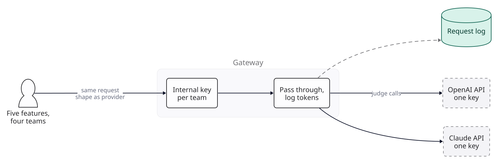
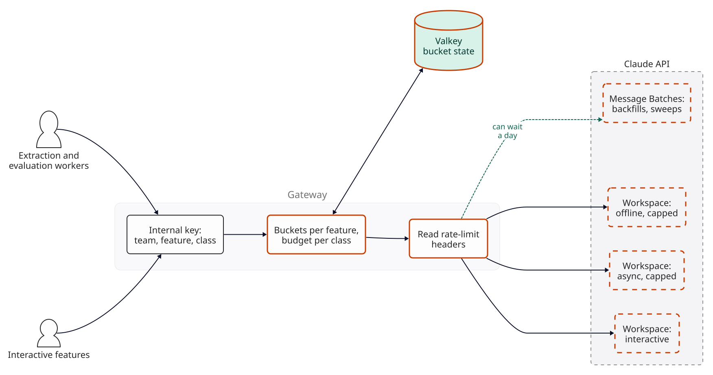
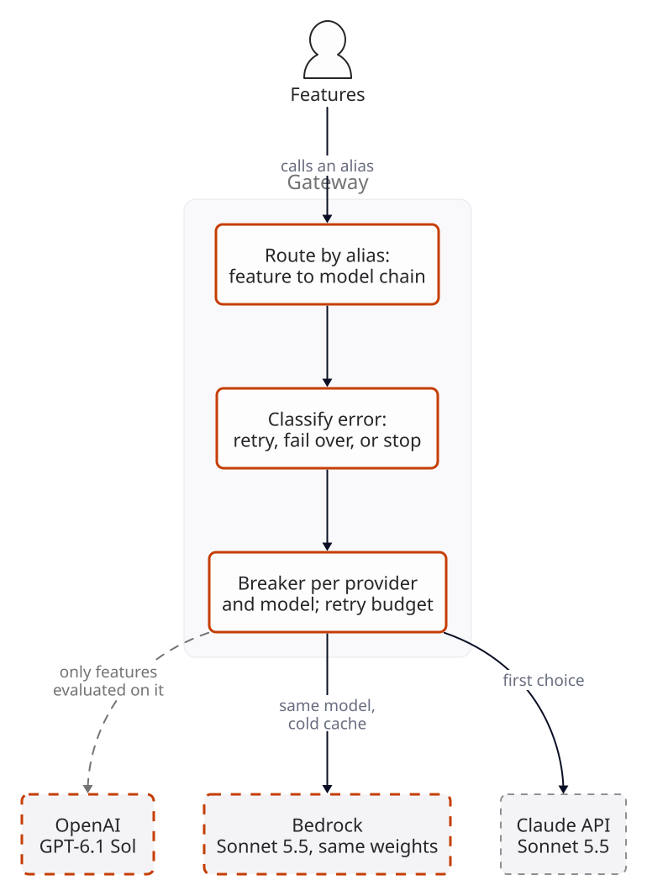
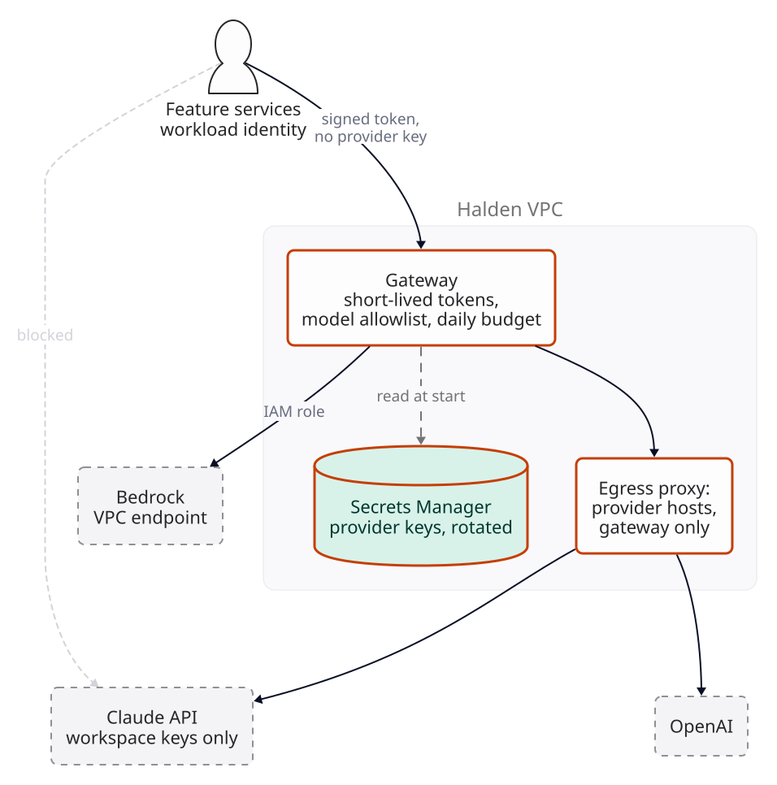
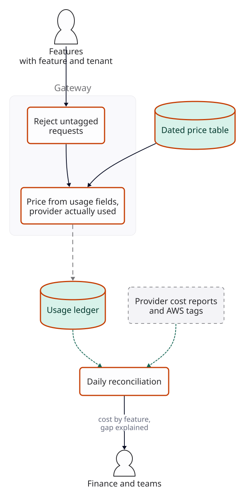
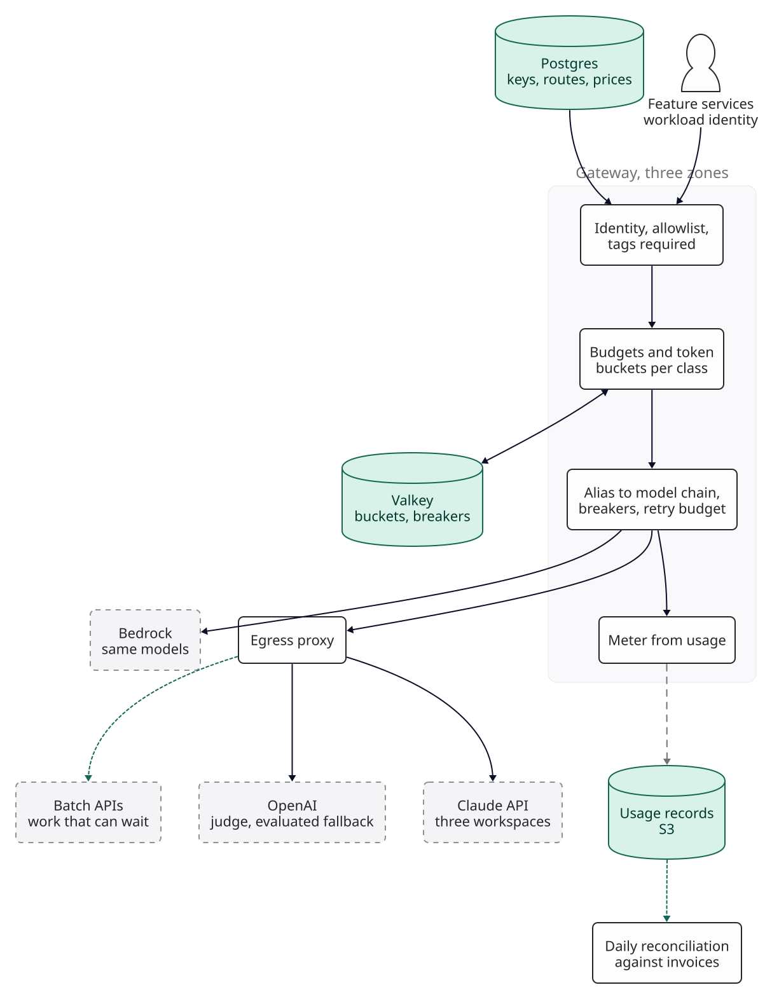

::: {.chapter-meta}
[Level ★★★]{} [Part VI, The model platform]{} [Uses O1 O7 O8 O9]{}
:::

Earlier chapters lean on a gateway without designing one. [System 39](39-self-hosted-inference.qmd)
puts keys, quotas and metering in one; [System 10](10-multi-tenant-rag.qmd) needs cost per tenant
and limits per tenant; [System 17](17-tool-calling-assistant.qmd) keeps its one provider key in a
secrets manager and hopes; [System 28](28-voice-agent.qmd) wants a model provider to fail over to.
This chapter designs the shared service those chapters point at. It is the least glamorous system
in the book and the one most companies build by accident, one team's proxy at a time. Nothing here
was measured: the scenario supplies the inputs, the arithmetic is real, provider behaviour comes
from the providers' documentation, and every threshold is a target you set.

## The brief

::: {.brief}
[From the CTO, Halden]{.from}
We have five features on Claude and OpenAI now and every team does it differently. Finance asked
what the support assistant costs and nobody could say. Last month a backfill took down search for
an afternoon, and when Anthropic had a bad hour, three features went with it. Someone pasted a key
into a public gist in the spring. Can the platform team put one thing in front of all of it?
Keep it cheap, and don't make it slower.
:::

Halden is this chapter's worked scenario: a B2B software company in AWS us-east-1 with four product
teams. Its features, volumes and limits below are assumptions, not data. The brief names four
failures (cost nobody can attribute, a neighbour that takes the shared limit, an outage with
nowhere to go, a key in the wild), and they are this chapter's four breaks, in the order the
traffic finds them. "Don't make it slower" is a requirement with a number, set below.

## Questions to ask

| Question | Why it changes the design | We assume |
|---|---|---|
| Which features, models and volumes? | Sizes every limit and the bill | The five features in the table below,  requests a month at growth |
| Which calls is a person waiting for? | Decides who gets the limit when there is not enough | The support assistant, search answers and email drafts are interactive. Extraction runs from a queue; evaluation runs in CI |
| What are the organisation's limits? | A gateway that does not know them cannot share them | On the Claude API,  input and  output tokens a minute for each of Sonnet 5.5 and Haiku 5.5 (assumed; read yours on the console) |
| What does a failed request cost? | Decides how much fallback is worth | The support lead's view: an agent without the assistant works as before, slower. Search without answers falls back to plain results. Nothing loses data, so fallback is bought for experience, not for correctness |
| May data go to a second provider? | A fallback provider is a sub-processor too | Bedrock is already approved for processing in the United States (Halden's other workloads run on AWS), so the fallback uses a US Geo inference profile, not global cross-region inference. OpenAI is approved for evaluation and for features whose owners ask for it |
| Who may hold a provider key? | Decides the blast radius of a leak | After this chapter, nothing but the gateway |
| Who needs cost, at what grain? | Decides what every request must carry | Finance wants cost per feature monthly; System 10's product wants cost per tenant daily; teams want their own spend hourly |
| What may the gateway store? | It sees every prompt | Usage records only (who, which model, token counts, cost, timings). Prompts and responses stay in each feature's own traces, under that feature's retention |
| How much latency may it add? | It sits on every request | A target of 20 ms at p99 for everything Halden adds (the caller's span minus the provider's time as seen at the egress proxy: load balancer, gateway and proxy hops together), and no buffering of streamed answers |

The second and fourth rows decide most of what follows. A gateway is a policy engine for a shared,
limited resource, and the policy is a business decision: who waits when there is not enough, and
what a request is worth when the first choice is down.

## The numbers

The five features at the growth scale. Token counts per request and request volumes are
assumptions; cached tokens are the feature's shared prefix plus, for the support assistant,
the conversation's history, read from the cache on a warm request.



: Halden's features at growth. Cost per request is warm: cached tokens at the cache-read price. Prices as of .

::: {.numbers}
Traffic:      working days a month;  of a day's traffic in  business hours; busiest hour x that average (F2)
Peak:        support , search , extraction  requests a minute
Limits:       ITPM and  OTPM per model class (assumed)
Model bill:   a month at growth
:::

Three facts from the providers' documentation (checked 2026-11-04) shape every version. Anthropic
measures limits in requests, input tokens and output tokens per minute (RPM, ITPM, OTPM) for each
model class, set at the organisation, with a token bucket that refills continuously rather than
resetting each minute. For most current Claude models only uncached input counts toward ITPM:
cache reads do not, cache writes do, and ITPM is estimated when the request starts and corrected as
it runs. OpenAI's limits are per organisation and per project and per model, and a request counts
against TPM as the larger of its `max_tokens` and an estimate from its length. Google's Gemini API
applies its limits per project, not per API key, so on that provider a key per feature isolates
nothing and a project per class would. Every provider answers an exceeded limit with HTTP 429. So
a gateway that counts "tokens" without saying which ones is counting something no provider counts.
All the cached prefixes in the feature table are above the 512-token minimum Anthropic sets for
caching on Sonnet 5.5 and Haiku 5.5; a shorter prefix is processed uncached without an error, and
every ITPM figure below would rise with it.

## Version 0

Version 0 is the gateway teams usually build first, and it is not wrong. One service holds one
Claude API key and one OpenAI key. Each team gets an internal key, a random string in its
service's environment. A request arrives in the provider's own shape, the gateway checks the
internal key, swaps in the provider key, forwards the request, streams the response back as it
arrives, and logs the team, model and the token counts from the response's usage fields. Retries
are the SDK's defaults on both sides.

{fig-alt="Version 0. Five features from four teams send provider-shaped requests with an internal key per team to the gateway, which checks the key, passes the request through to the Claude API or, for judge calls, the OpenAI API with one provider key each, and logs tokens to a request log in the background."}

Passing the native shape through is a decision, not laziness. A gateway that translates every
request into one common format must carry every provider feature a prompt relies on (cache
breakpoints, thinking settings, strict tool schemas) or silently drop it; LiteLLM, for one,
documents passing Anthropic's `cache_control` through, and each other feature is a line to check.
Version 0 forwards bytes it does not need to understand, so nothing is lost in translation.

Before changing it, build the instrument. The gateway's tests are a **replay harness**: recorded
request shapes for each feature, played against a stub provider that can be told to answer 429 with
or without `retry-after`, 529, 500, a slow first byte, or a stream that breaks halfway. Every later
version adds cases to it, and each break below names the case that shows it.

## Where shared limits break

The organisation's limit is one bucket, and version 0 lets whoever asks first drain it. At the
growth peak, Haiku 5.5's two features need  ITPM for search and
 for extraction: , or
 of the  limit. Comfortable, until a new
customer's archive arrives.

::: {.breaks}
A backfill of  documents,  extraction workers
each with one call in flight,  s a call (all assumed):

-  x 60 /  =  requests
  a minute, x  uncached tokens =  ITPM:
   of the limit on its own.
- If it lands in the busiest hours, demand with the ordinary peak on top is
   ITPM,  times the limit, for
   minutes until the backfill drains. The break does not need this many
  workers: at the busiest hour, any more than  take the organisation
  over its limit.
- Search sends about  requests in those minutes at its peak rate.
  The bucket does not know that a person is waiting for them and not for the backfill, so search
  takes its share of the 429s.
- Sonnet has the same exposure from the offline side. An evaluation sweep of
   requests run by the same  workers sends
   x  =  ITPM,
   times Sonnet's limit, and the support assistant and drafts share it.

How you would see it: 429s from the provider by feature, and the provider's remaining-token
headers (`anthropic-ratelimit-input-tokens-remaining`) sampled each minute. Target: no 429 from a
provider on an interactive feature while that feature is under its own budget. Replay case: the
stub drains its bucket from one key and the harness checks who gets the errors.
:::

## Version 1

[**Changed** token buckets per feature inside a budget per workload class, counted the way the provider counts; interactive features sized to their peak and the rest to what is left; the provider's rate-limit headers read on every response; a workspace per class with its own limits; backfills and most evaluation through the batch API.]{.changed}

**Count what the provider counts.** Each internal key now carries its team, its feature and one of
three classes: interactive, async (extraction) and offline (evaluation). The gateway keeps token
buckets per feature, inside a budget per class and model, in Valkey, refilled continuously like
the provider's. A request is charged its uncached input estimate when it starts (the request's
length less the prefix the feature declares as cached), and corrected from the usage fields when it
ends: `input_tokens` and `cache_creation_input_tokens` count, `cache_read_input_tokens` does not.
Anthropic evaluates OTPM as output is produced, so output is charged from the usage when it
arrives. For an OpenAI route the charge is the larger of `max_tokens` and the estimate, because
that is what OpenAI counts, so a feature that sets a generous `max_tokens` spends its budget faster
there. Each feature also has a requests-a-minute bucket at its busiest-hour rate times the same
burst allowance below, so a caller cannot slip under the token buckets with many cache reads.
Buckets are kept per route, not per provider account alone: a feature's Bedrock route has buckets
of its own, sized in version 2.

**Size the buckets from the brief's second row.** Plan to  of the
 ITPM, keeping  as headroom no class may plan to
use. An interactive feature gets its busiest-hour rate times  (an assumed
allowance for bursts within the hour): search's bucket is . The async
class gets what is left, , or about 
extraction requests a minute. When the async bucket is empty the gateway answers the worker with
its own 429 and a `retry-after` computed from the refill rate, and the worker's queue absorbs the
wait. The same backfill on the synchronous path now takes about  hours
instead of  minutes if ordinary extraction stays at its busiest-hour rate
throughout (less off-peak), and search never sees it. On Sonnet, support and
drafts together need  ITPM with the same allowance, only
 of the limit; the offline class may use
 synchronously ( ITPM, about
 evaluation requests a minute), enough for a release gate of a few
hundred tasks, and sends sweeps to the batch API.

**Watch the cache, because it is in the budget.** Search's bucket assumes its
-token prefix is read from the cache. If something starts changing the
prefix, every request writes it instead, and search's ITPM rises from
 to  with no change in traffic,
above its  bucket. The gateway then refuses part of search's peak
while the provider still has room. That is intended: a feature whose cache breaks is held to its
own budget rather than taking its neighbours' headroom, and the alert on the cache-read share per
feature ([F6](../foundations/f6-safety-observability.qmd)) says why its 429s started.

**Let the provider enforce it too.** Anthropic lets an organisation set rate and spend limits per
workspace, below the organisation's, and organisation-wide limits still apply (Anthropic's
rate-limit and workspace documentation, checked 2026-11-04). The gateway's keys for the async and
offline classes live in workspaces of their own, capped at their class budgets, so a gateway bug
that miscounts cannot hand a backfill or a sweep the whole bucket. Two details follow from
workspaces. Prompt caches are isolated by workspace, which costs nothing here because no two
features share a prefix, but one feature must never be split across two workspaces. And Valkey
being unreachable does not open the gates. Each gateway task falls back to a local bucket of a
fixed share of each budget: one over the most tasks the service may run, deploy surge included
( at growth, where at most  run; one
th at large). The tasks together then stay under the budget however many
are up. The price is skew: a task that the load balancer favours runs out first, so interactive
features may see 429s in this mode, which is an incident, not a steady state. Daily spend budgets
(version 3) are not enforced while Valkey is down; the provider workspaces' spend limits are the
backstop, and the counters are rebuilt from the usage records when it returns.

**Send what can wait to the batch API** (O7). A backfill is not
interactive and not urgent. Through Message Batches at half price it costs
 instead of , and takes nothing from the
interactive budget. Batches go through the gateway too: it submits the job with the async class's
key, records the job against its feature in Postgres, polls for results, and meters each result
when it lands, so batch spend is attributed like any other. Anthropic's rate-limit page lists batch
limits separately from the Messages API's; confirm how your tier counts batch requests before
sizing a backfill against them.

**Read the headers.** Every Claude response carries `anthropic-ratelimit-*` headers for requests,
input and output tokens (limit, remaining, reset), and OpenAI's carry `x-ratelimit-*` equivalents.
The gateway records the remaining values, so a limit changed on the console (or a tier upgrade)
shows up on the dashboard the same minute, and a provider 429 that arrives while the gateway
thought there was room is an alert: something else is spending the organisation's bucket.

{fig-alt="Version 1. Interactive features and extraction and evaluation workers call the gateway with an internal key that names team, feature and class. New token buckets per feature inside a budget per class, kept in Valkey and counted as the provider counts, admit or refuse each request, and the gateway reads the provider's rate-limit headers. Requests go to three Claude API workspaces, one interactive and two capped for async and offline work, and the gateway sends backfills and evaluation sweeps to the Message Batches API."}

**Measure before and after.** In the replay harness, the backfill case and the sweep case: provider
429s on search, support and drafts, target zero. In production, provider 429s by feature against the same target, gateway 429s by
class (expected on async, never on interactive below its peak), and the gap between the gateway's
count and the provider's remaining headers, which says whether the counting is right.

## Where a provider outage breaks

Version 1 shares one provider well, and it has only one. The brief's "bad hour" is a scenario
input here, not a claim about any provider: take  hours of Sonnet 5.5
errors in the busiest part of the day.

::: {.breaks}
- At about  requests a minute, about 
  support requests an hour fail:  in the outage, and 
  email drafts with them.
- Version 0's retries make the outage worse. The caller's SDK tries 
  times and the gateway's own client tries  times for each, so a
  failing support request becomes  upstream attempts: about
   a minute at a provider that is already overloaded. Anthropic answers
  overload with 529 and its SDK retries twice by default; stacked layers of polite retries are how
  one bad hour becomes a longer one.
- Retrying is sometimes wrong outright. A 429 whose `error.details.error_code` is
  `enforced_spend_limit_reached` (the organisation's spend cap) comes with no `retry-after`, and
  will not succeed until someone raises the cap (Anthropic's rate-limit documentation, checked
  2026-11-04, which also says only some rate-limit 429s carry `retry-after`); a 400 will fail on
  every provider.

Availability arithmetic says what a fallback is worth, with a labelled input. If a route were
available  of the time (an input for the arithmetic, not a figure for any
provider), it would be down about  minutes a month, about
 of them in business hours. Two routes failing independently would be
down together about  minutes (). They do not
fail independently when they serve the same model, so treat that as the ceiling a second route can
reach, not what it delivers.

How you would see it: error rate by provider and model, per minute, against the
[F6](../foundations/f6-safety-observability.qmd) alert; retries per first attempt on each route
(target: at most  over any five minutes). Replay case: the stub
answers 529 for ten minutes, and the harness counts attempts.
:::

## Version 2

[**Changed** features call aliases, not models; each alias names a chain of routes; errors classified by type and code into wait, fail over, stop or return; a breaker per provider and model; one retry budget for the whole path; the same model on Bedrock as the first fallback; a different model family only where the feature has been evaluated through the translated route.]{.changed}

**Call an alias.** A feature asks for `support-answer`, not `claude-sonnet-5-5`. The alias is a
chain in the gateway's configuration: Sonnet 5.5 on the Claude API, then Sonnet 5.5 on Bedrock,
then (for features that have earned it) GPT-6.1 Sol on OpenAI. The same alias is how a feature
changes model without a deployment (O9), and how a release gate pins a
model version.

**Only interactive Sonnet features have a fallback.** Support and drafts chain to Bedrock. Search
and the async and offline classes stop at their first route: search falls back to plain results,
extraction waits in its queue, and evaluation waits. Their quotas on Bedrock are therefore not
needed, and a Claude API outage never sends  extraction requests a
minute somewhere without capacity.

**Fail over to the same weights first.** Sonnet 5.5 and Haiku 5.5 are on Bedrock: in us-east-1 at
the Claude API's list price for global cross-region inference, and 
more for Geo or in-region processing (price table). Halden's approval is for processing in the
United States, so its fallback uses the Geo price. Both models are also listed on Google Cloud's
Vertex AI. Same model, same prompt: the fallback needs no second prompt. It is not yet the same
evaluation. Bedrock takes the Anthropic Messages body in its own envelope (a model or inference
profile ID instead of the `model` field, AWS credentials and SigV4 instead of an API key), which
the gateway rewrites; beta features, and which tools, thinking options and cache settings are
supported, may differ by platform and date. So each feature's golden set is run once through the
Bedrock route (a run, not a new prompt), and the replay harness diffs the fields of every
recorded request as sent to Bedrock against the Claude API request, failing on anything dropped.
The route also differs in what matters to the gateway: a different error vocabulary
(`ThrottlingException`, HTTP 429, for an exceeded quota) and separate quotas.

**A different family is a different feature.** GPT-6.1 Sol has the same list prices as Sonnet 5.5
per million tokens, but a different tokeniser, a different request shape, different tool-calling
details and different behaviour on Halden's prompts. Features send the Anthropic shape, so this
route needs the adopted proxy's translation, and translation is where a prompt feature is silently
lost. A cross-family fallback is therefore evaluated as the feature will run it, through the
translated route, with its own golden set ([F3](../foundations/f3-models.qmd) on keeping a tested
second choice); whatever the translation drops is then in the result. The chain includes it only
for features whose owners ran that evaluation and passed. For the support assistant, whose tools
and confirmation flow ([System 17](17-tool-calling-assistant.qmd)) were tuned on Claude, the chain
stops at Bedrock, and past that the assistant tells the agent it is unavailable.

**Classify before retrying, on the error, never on a header.** Each response is classified by its
status, error type and error code; `retry-after` is used only for how long to wait, because
Anthropic sends it on some 429s and not others.

| Upstream answer | Meaning | Gateway's action |
|---|---|---|
| 429 `rate_limit_error` (no spend code), or `ThrottlingException` | Our limit at this provider | Within the retry budget, wait once if `retry-after` is 2 s or less; otherwise fail over (the next route has its own quota). With no next route, return 429 with the provider's `retry-after` |
| 529, 503, 500, or a timeout before the first content | The provider is struggling | One retry after a short jittered wait if the retry budget allows, then fail over |
| 429 with `enforced_spend_limit_reached`; any spend or billing-quota error (confirm OpenAI's code for an exhausted quota); 401, 403 | Our account is wrong | Stop and page someone; never fail over to spend elsewhere what a cap was set to stop |
| 400 (invalid request, context too long) | The request is wrong | Return it to the caller; it would fail everywhere |
| Anything else | Unknown | Return it to the caller unchanged, and count it; no failover on a guess |

A 429 that arrives while the gateway's own bucket had room means something else is spending the
organisation's limit (version 1's alert). Failing over each such request sends it to a cold cache,
so a burst of them opens the route's breaker instead of being chased one request at a time.

**One retry budget for the whole path.** On each route, retries may be at most
 of first attempts over a sliding minute, with a floor of one retry a
minute so a quiet route can still retry (below 10 first attempts a minute the floor, not the
budget, is the limit, and the alert ignores such routes). Callers' SDKs are configured not to retry gateway errors,
except queue workers, which honour the gateway's own `retry-after` on its 429s and are counted
separately. A failover is a first attempt on the next route, not a retry. That bounds retries on a
struggling route at  attempts per request instead of
.

**Break per provider and model.** A breaker opens on a route when its errors cross 5% over a
minute, given at least 20 requests and 3 errors in that minute (all starting values), and sends its traffic
down the chain; every 30 s it lets one request through, and closes after a run of successes.
Breakers are per route, so a Sonnet incident leaves Haiku on the Claude API alone. Until a breaker
opens, a request that fails pays its own first attempt and then its failover, so a person waiting
sees that much extra time.

**Fail over only before the first content.** The gateway streams, and once it has sent part of an
answer to the caller it cannot switch providers without the caller seeing two answers spliced. A
Claude stream can begin with HTTP 200 and still carry an `error` event (overloaded) before any text,
so the gateway holds back the stream's opening events (`message_start` and pings, a few hundred
bytes) until the first content delta arrives, and can still fail over until then. After that, a
broken stream ends with an error event, and the feature decides.

**Know what a switch forfeits** (O1). Prompt caches belong to one
provider and one model, so the first requests on Bedrock find nothing cached:

- A warm support request costs  on the Claude API and
   on Bedrock at the Geo price. The first request after the switch rewrites
  the -token shared prefix once; after that, each conversation's next
  request rewrites its own -token history and costs
  ,  times a warm one.
- That lasts about one cache lifetime,  minutes at about
   a minute, some  requests: at most
   a switch, counting every request as a different conversation. The money is small. The rate limit is not: cache writes
  count toward input limits where reads do not, so on the fallback the support assistant needs
  about  ITPM for those minutes against  when
  warm,  times as much, and up to 
  ( times) if the shared prefix is written by many requests at once
  before the first write lands.
- Switching back forfeits the cache again, so the breaker closes slowly (a run of successes, not
  one) and moves traffic back over a few minutes rather than at once.

**Buy the fallback's quota, or it is a fallback on paper.** The Bedrock account's quotas for
Sonnet 5.5 must cover the features that fail over to it at peak with a cold cache. Sized to the
ceiling, that is about  input and  output tokens a
minute for support and drafts, and the gateway's Bedrock buckets for those features are that size,
so a switch is not refused by the gateway itself. Bedrock expresses its quotas in its own units, which may combine
input and output and weight output tokens more heavily; request an increase in Service Quotas in
those units before it is needed, and confirm what the console shows for your account and region.
Two tests keep it honest. A weekly drill sends 1% of each chained feature's traffic down its
fallback, which proves the route, its credentials and request translation, but at 1% it cannot
prove the quota. A daily check reads the applied quota values from Service Quotas, prints how many
it read, and fails if it read none or any is below the sized need, and a short full-rate burst against the Bedrock route each quarter,
off-peak, proves the quota is usable.

{fig-alt="Version 2. Features call an alias instead of a model. The gateway resolves the alias to a chain of routes, classifies each upstream error as retry, fail over or stop, and keeps a breaker per provider and model with one retry budget. The first choice is Sonnet 5.5 on the Claude API, the first fallback the same model on Bedrock with a cold cache, and GPT-6.1 Sol on OpenAI only for features evaluated on it."}

**Measure before and after.** In the replay harness: the 529 case (retries per first attempt on the
route at most ; traffic on Bedrock within a minute); the spend-cap case
(no failover, a page); a 200 followed by an overloaded error event (failover, one answer); a stream
broken mid-answer (an error event, no second provider); the field diff of every recorded request
against its Bedrock form. In production: the weekly drill's error rate on each fallback, against
the first choice's; the daily quota check; and time from a breaker opening to traffic on the next
route.

## Where keys break

Version 2's gateway holds its provider keys, but it is not the only holder. Nothing stops a team
creating a provider key on the console and calling the provider directly, which is how the
spring's gist happened. And the internal keys are long-lived strings in environment files, accepted
from anywhere on Halden's network, with no limit on which models they may call or what they may
spend.

::: {.breaks}
A provider key is worth the organisation's limits times the prices. Cache writes count toward
ITPM and cost more than plain input, so an attacker writing caches sets the ceiling:

- Sonnet 5.5:  input tokens a minute at the 5-minute cache-write price
  and  output,  a minute
  ( with 1-hour writes). Haiku 5.5 adds .
- Together about  an hour,  a day.
- A key found on a Friday evening and noticed on Saturday morning,
   hours, costs about :  of
  a normal month's bill, before counting the outage it causes when it takes every feature's limit.

The provider's spend cap bounds the total, not the rate: a monthly cap set at a normal month's
spending, , is gone in about  hours at these limits.

A stolen internal key is bounded by version 1's buckets, not by the organisation's limits: a drafts
key can spend at the drafts bucket's rate, about  an hour at the same
worst-case prices (more if it spends the bucket's request allowance on large cache reads), and
nothing stops it for a whole weekend; it also starves the real drafts
feature. How you would see both: spend per internal key per hour
against the F6 alert (twice the trailing weekly average for that hour), and the provider's usage
report grouped by API key, where any key that is not the gateway's is a finding. Target: zero
provider keys outside the gateway; zero calls to provider hostnames from anything else.
:::

## Version 3

[**Changed** provider keys only in Secrets Manager, readable only by the gateway's role and rotated; callers authenticate with workload identity, not shared secrets; each internal identity has a model allowlist and a daily budget; workspace spend limits at the provider; egress to provider hostnames only from the gateway.]{.changed}

**No shared secrets for callers.** Each feature's service authenticates to the gateway with its
workload identity: its AWS IAM role, presented as a signed request, or a short-lived token from the
platform's identity provider. There is nothing static to paste into a gist. The gateway maps the
identity to the team, feature and class from version 1.

**Each identity gets an allowlist and a budget.** The email drafts service may call its alias and
nothing else, and may spend at most twice an average working day,  against
. A stolen drafts identity spending at its bucket's token rate would reach
that cap in at most about  hours (sooner with large cache reads) and
then receive 403s; the budget bounds what a
stolen identity can cost, the bucket bounds how fast, and the alert on spend per identity per hour
is what finds it sooner. A feature that needs more for a launch raises its own budget
through a reviewed configuration change, logged with who and why.

**Provider keys live in one place.** The Claude API and OpenAI keys are in Secrets Manager,
readable only by the gateway's task role, read at start and on rotation. Anthropic API keys can be
scoped to a single workspace (Anthropic's workspace documentation, checked 2026-11-04), so each
class's key can reach only its workspace, and each workspace has a spend limit set somewhat above
its expected month. Bedrock needs no key at all: the gateway's role is granted invoke permission on
the inference profiles it routes to (a cross-region profile also needs permission on the model in
the regions it routes to; confirm the exact resources in Bedrock's documentation). Keys rotate quarterly and at once on any suspicion,
which with one holder is a configuration change, not a hunt through repositories.

**Egress enforces the rule.** The VPC has no direct route to the providers' API hostnames. The
only path is an egress proxy that accepts connections only from the gateway's subnets and only to
the allowlisted hostnames; Bedrock is reached through a VPC interface endpoint (confirm it exists
for the runtime API in your region). A service that tries to call a provider directly fails to
connect, which is the point: the policy is enforced by the network, as in
[System 39](39-self-hosted-inference.qmd)'s data boundary, not by a convention. An interface
endpoint is reachable from any subnet unless restricted, and Bedrock needs no key, so its rule is
made of IAM rather than hostnames: the endpoint's security group admits only the gateway's
subnets, its endpoint policy admits only the gateway's role, and an organisation policy denies
model invocation to every other role in the account. The same rule reaches people: console API
key creation is limited to two platform administrators, and a daily job compares the provider's
key list with the gateway's (it must find the gateway's own keys, or it fails as having checked
nothing). Bedrock calls are checked for any principal other than the gateway's role, from
CloudTrail or from Bedrock's model invocation logging; confirm which of the two records runtime
invocations in your account before relying on it.

**The gateway sees every prompt, so say what it keeps.** Usage records only: identities, alias,
route, token counts, cost, timings, status. No prompt or response bodies, which stay in each
feature's own traces under its own retention ([F6](../foundations/f6-safety-observability.qmd)).
A data class on the request (System 39's restricted tenants are the example) can pin the route,
so a request marked restricted is never sent down a chain to a provider it may not reach. When
its only permitted route is down, it gets a 503 that says so, never a quieter route. The opaque
user ID the gateway forwards to a provider (version 4) is a keyed hash of Halden's own ID, so it
identifies nobody outside Halden.

{fig-alt="Version 3. Feature services authenticate with workload identity and hold no provider key. Inside Halden's VPC the gateway checks a short-lived token, a model allowlist and a daily budget, reads rotated provider keys from Secrets Manager, and reaches the Claude API (workspace-scoped keys) and OpenAI only through an egress proxy that allows provider hostnames from the gateway alone. Bedrock is reached through a VPC endpoint with an IAM role. Direct calls from services to providers are blocked."}

**Measure before and after.** Provider API keys that are not the gateway's (target zero, checked
daily); connections to provider hostnames from outside the gateway's subnets in the VPC flow logs
(target zero, alert on any); Bedrock invocations by any other principal (target zero); the leak drill in the replay harness: a valid identity spending at the
stub's limit must be cut off within its budget.

## Where cost attribution breaks

Version 3 knows who sent every request, and the monthly report still does not match the invoice.
Version 0 recorded token counts; cost was computed in a dashboard by multiplying them by one input
and one output price.

::: {.breaks}
What a support request costs, three ways, at growth:



: Cost of one support request and of the month, by how it is computed. Prices as of .

- Pricing cached tokens as input overstates a support request  times
  ( against ), because Sonnet 5.5's cache read is
   of its input price. Search and extraction are overstated
   and  times. The month comes to
   against ,  too
  high, and the error falls hardest on the feature that caches best.
- Failover traffic is on a different invoice (AWS's) at a different price, and the batch API's
  half price is not the same request at the same cost.
-  of version 0's spend (assumed: notebooks, one-off scripts, a key two
  teams share) has no feature at all:  a month nobody owns.

How you would see it: the gateway's computed total for a day against the provider's cost report
for the same day. Target: within 2%, with the difference explained by line.
:::

## Version 4

[**Changed** every request carries a feature, and optionally an opaque tenant and user; cost computed per request from the usage fields and a dated price table for the route actually used; a usage ledger; daily reconciliation against each provider's cost report.]{.changed}

**No tag, no request.** The identity gives the team. Every request must also carry a feature
(the alias implies one) and may carry an opaque tenant and user ID, which
[System 10](10-multi-tenant-rag.qmd) needs for its per-tenant rollup. The gateway passes the user
ID on as the Claude request's `metadata.user_id`, which Anthropic describes as an opaque identifier
for abuse detection, never a name or email. Requests without a feature are rejected with a 400 that
says which header is missing; there is no "untagged" bucket to grow.

**Price from the usage fields, per route.** Each response's usage carries uncached input, cache
writes and cache reads separately, and the gateway prices each at its own rate for the route that
served it: the Claude API, Bedrock (global or Geo price, by the inference profile used), OpenAI, or
a batch job at its discount. Thinking tokens bill as output and are priced as output. The price
table is versioned by date, so a request is priced at the price that applied when it ran, and a
price change (two in [F3](../foundations/f3-models.qmd)'s table are announced) is a new row, not
an edit. A stream the caller abandons is cancelled upstream rather than read to its end, which
would keep paying for an answer nobody reads; its record uses the last usage the stream reported
plus an estimate of the output since, and is marked estimated, as is any record whose upstream
connection was lost. Records are buffered in each task and flushed to S3 every 10 seconds and when
the task stops, so a task that crashes loses at most those seconds, which the reconciliation shows
as a small gap rather than hiding.

**Reconcile daily.** A job sums the ledger by day and route and compares it with each provider's
own figures: Anthropic's Usage and Cost Admin API (cost grouped by workspace, in daily buckets,
usage grouped by API key and model, typically within five minutes of a request); AWS Cost Explorer
for Bedrock, where tags on an application inference profile carry cost allocation per feature; and
OpenAI's usage and cost reporting by project (confirm which groupings your account exposes). A gap
above 2% opens a ticket with its lines: unmetered calls, a price-table row out of date, a route
missing from the join. Evaluation runs are a feature of their own (the CI class), so their cost is
visible, not spread.

{fig-alt="Version 4. Features send requests carrying a feature and an opaque tenant. The gateway rejects untagged requests and prices each response from its usage fields and a dated price table for the provider that served it, writing to a usage ledger. A daily reconciliation compares the ledger with provider cost reports and AWS cost allocation tags and sends cost by feature, with the gap explained, to Finance and the teams."}

**Measure before and after.** The daily reconciliation gap, against 2%; the share of spend with a
feature, against 100%; and the per-request cost of each feature against the feature table above,
which is the first place a prompt regression that adds 500 tokens shows up.

## The final design

{fig-alt="Final design. Feature services authenticate with workload identity to a gateway running in three availability zones. The gateway checks identity, allowlist and required tags from Postgres, applies budgets and token buckets per feature and route kept in Valkey, resolves the alias to a chain of routes with breakers and a retry budget, and meters each response from its usage fields into usage records in S3. Requests leave through an egress proxy to the Claude API, with three workspaces, and OpenAI, for the judge and evaluated fallbacks; Bedrock serves the same models; batch APIs take work that can wait. A daily reconciliation compares the usage records with the invoices."}

| Component | Choice | Why this and not something bigger |
|---|---|---|
| Interface | Each alias's first-choice provider shape (the Claude API's for most features, OpenAI's for the judge), passed through and streamed; re-enveloped for Bedrock, translated for a cross-family fallback; an alias in place of a model name | Nothing lost on the first-choice route; a model change is configuration |
| Identity | Workload identity per feature service, mapped to team, feature and class | No static secret to leak |
| Limits | Token and request buckets per feature and route inside class budgets, counted as each provider counts, in Valkey; interactive sized to peak, async and offline to the rest,  headroom; a workspace per class at the provider | The provider's bucket is shared; the gateway decides who waits |
| Budgets | A daily spend budget per identity; workspace spend limits at the provider | A stolen identity costs a day's budget, not  an hour |
| Routes | Chains per alias: same model on Bedrock first, a different family only where evaluated | The first fallback needs no new prompt or gate |
| Errors | Classified by type and code: wait or fail over, retry once, stop and page, return to caller; one retry budget of ; breakers per route; failover only before the first content | A struggling provider sees at most  attempts per request |
| Keys | Provider keys in Secrets Manager for the gateway's role only, workspace-scoped, rotated; Bedrock by IAM role | One holder, one rotation |
| Egress | Provider hostnames reachable only from the gateway, through an egress proxy; Bedrock through a VPC endpoint | The rule is enforced by the network |
| Metering | Per request from the usage fields, a dated price table per route, a usage ledger, daily reconciliation within 2% | Cost that adds up to the invoice |
| Storage | Usage records only; no prompts or responses | The gateway should not become every feature's copy of its data |

The latency budget is everything Halden puts between a feature and the provider: the internal load
balancer, the gateway's own work (an identity check against a cache, two Valkey round trips for
charge and correction, route selection) and the egress proxy. It is measured as the caller's span
minus the provider's time as the egress proxy sees it (for Bedrock, which bypasses the proxy, as
the gateway times the call at the VPC endpoint), so every hop and its TLS set-up is inside it.
The target is 20 ms at p99, a target to verify with one traced request through a stub before
launch and on every request after. A failover is outside it by design: a request that fails over
pays its first attempt as well, and the trace says so. Two rules keep it honest. Nothing
on the request path waits on Postgres or S3: configuration is cached in each task and refreshed in
the background, usage records are written asynchronously in batches. And Valkey calls have a 5 ms
timeout: three timeouts in a row put the task into its local mode from version 1 for 30 seconds,
breaker and retry-budget state included, so a slow Valkey cannot spend the budget either. And the gateway never buffers
a streamed response, so time to first token is the provider's plus the gateway's few milliseconds,
not the whole answer's time.

## Deployment

- **Gateway:** stateless containers on Fargate in us-east-1, three tasks across three availability
  zones behind an internal load balancer (six at the large scale). Callers reach it by a private
  DNS name; there is no public endpoint.
- **Egress proxy:** three small Fargate tasks, one per zone, behind their own internal load
  balancer, allowing only the providers' hostnames and only from the gateway's subnets. It is on
  the path of every Claude and OpenAI call, so it is run like the gateway: health-checked,
  replaced automatically, its configuration changed through the same review. If it fails, Claude
  and OpenAI routes fail; the breakers move support and drafts to Bedrock, which does not use it,
and the features without a fallback degrade as version 2 describes.
- **Build or adopt:** the data plane need not be written from scratch. LiteLLM's proxy has virtual
  keys with budgets (`max_budget`, `budget_duration`), per-key and per-team `tpm_limit` and
  `rpm_limit`, fallbacks by error type (including context-window and content-policy fallbacks),
  retries and cooldowns per deployment, and spend tracking per key, team and user, with spend by
  request tags listed as an enterprise feature. Agent Router (formerly Envoy AI Gateway, now an
  Agentic AI Foundation project under its new name, by the project's own site) has token-based rate limits, provider fallback by priority,
  and upstream authentication that keeps provider credentials in the gateway, with temporary AWS
  credentials for Bedrock. Managed options exist on the clouds: Azure API Management has an
  `llm-token-limit` policy (429 over a rate, 403 over a quota), an `llm-emit-token-metric` policy
  and backend pools with priority routing and circuit breakers; Cloudflare AI Gateway has
  fallbacks, request-count rate limits, caching, cost analytics and stored provider keys (all from
  each product's documentation, checked 2026-11-04). None of them knows Halden's classes, budgets
  or price table. Expect to adopt one as the proxy and own the policy, the ledger and the
  reconciliation, and check each feature this chapter needs against the version you pin, since
  several are configuration you write and some are paid tiers.
- **Valkey:** two cache.r7g.large nodes, primary and replica, for buckets, breaker state and budget
  counters. Losing it degrades each task to local buckets at a fixed share of each budget (version 1),
  never to no limits.
- **Postgres:** db.t4g.medium, Multi-AZ, for identities, aliases and chains, budgets and the price
  table, read at start and cached. It is not on the request path, so its failure stops
  configuration changes, not traffic.
- **Usage records:** written in batches to S3 and loaded nightly into the reporting store, kept
  13 months so a year-on-year comparison has data.
- **Secrets and egress:** provider keys in Secrets Manager; the egress proxy in its own subnet; VPC
  flow logs on, and an alarm on any provider-bound connection from elsewhere.
- **Migration and break-glass:** features move one at a time, each running through the gateway for
  a week before its own provider key is revoked; egress is closed only when the last feature has
  moved. One break-glass key lives in a separate workspace with a low spend limit, sealed in
  Secrets Manager, with an egress rule that two administrators must enable together, for the day
  the gateway itself is the outage.
- **Change:** aliases, chains, budgets and limits are configuration in a reviewed repository,
  deployed by the platform team, and every change is a log line a feature team can read. A chain
  change runs the replay harness first.

## Cost

What the gateway costs at three scales, against the model spend it carries (the feature table
scaled by 0.3, 1 and 5). Prices as of .



: Monthly cost of the gateway itself. Model spend is shown for scale; the gateway does not change it except through the savings below. {.striped}

At growth the gateway costs  a month, 
of the  it carries. Its cost barely moves with traffic, because the
lines are fixed infrastructure: at the small scale it is  of model
spend, and at the large one . Two things follow. At the small scale, a
single Valkey node and two tasks, or a library and provider workspaces with no gateway at all, may
be the right size (see Variants). The gateway is not justified by savings: the batch API's half
price is available with or without it, and to cover the gateway's line alone,
 of extraction would have to wait for batch. It is justified by the
four breaks, which no saving prices. The table leaves out people, the load balancers, the VPC
endpoints and flow logs; price those for your account before relying on the total. Someone owns
this service, its on-call and its configuration reviews, and at Halden's size that is the largest
cost of a gateway.

The large column carries five times the traffic against limits this chapter assumed for growth,
and it does not fit them: the Haiku peak alone would be five times .
It assumes Halden's tier or contract raises the organisation's limits in proportion, and every
bucket, workspace limit and Bedrock quota in versions 1 and 2 is resized from the same arithmetic.

## Optimisation

**O1 Prompt caching, protected.** The gateway does not cache prompts
itself; it keeps the provider's caches working. It never inserts anything per request before a
feature's cache breakpoint (no request IDs or timestamps in system prompts), keeps one feature in
one workspace, routes a conversation to one provider for as long as that route is healthy, and
moves traffic back slowly after a failover so caches are not forfeited twice. It also reports the
cache-read share per feature, which is both a cost signal and a rate-limit one.

**O7 Batch APIs.** The async class's chain can name a batch route.
Backfills and nightly re-extraction go through it:  a month at growth,
 of the model bill, from  of extraction
(an assumed share; the real one is what the documents team can let wait a day). Evaluation sweeps
are the larger saving:  of evaluation requests through batch saves
 a month on the Sonnet side, with the release gates kept
synchronous because someone is waiting for them.

**O8 Response caching, not here.** A gateway sees every request and is
tempting as a place for a response or semantic cache. It is the wrong place: whether two requests
may share an answer depends on what the feature does (personalised, permissioned, time-bound), and
only the feature knows. A feature that wants one builds it behind its own logic, with the hit rate
estimated from its own logs as F5 describes.

**O9 Routing by alias.** Aliases are where model routing lives. A
feature that passes its golden set on Haiku 5.5 changes its alias, and the change is a reviewed
line, not a deployment. A cascade (try the small model, escalate on a failed check) belongs in the
feature, which owns the check; the gateway only makes both models one name away.

## Operating it

The thresholds are starting values to calibrate in the first month, not known healthy ranges.

| Metric | Starting target | Alert when |
|---|---|---|
| Provider 429s on interactive features under their budget | Zero | Any for 5 minutes: something else is spending the bucket |
| Error rate per provider and model | Steady | Above 5% for 2 minutes, or a breaker opens: page the platform on-call |
| Retries per first attempt on each route with 10 or more first attempts a minute, per minute | At most  | Above it for 5 minutes: a retry layer is stacking |
| Added latency (caller span minus provider time at the egress proxy), p99 | Under 20 ms | Over 40 ms for 15 minutes |
| Spend per identity per hour | Within budget | Twice the trailing weekly average for that hour (F6), or a budget exhausted |
| Provider keys not held by the gateway; connections to provider hosts from elsewhere; Bedrock calls by other principals | Zero, with the count of keys and calls checked printed | Any, or a check that examined nothing |
| Cache-read share per feature | Steady week on week | Halves in an hour: a prefix started changing, and the feature's ITPM rises with it |
| Daily reconciliation gap | Within 2% | Above 2%, or a day with no reconciliation (the job fails on empty input) |
| Weekly fallback drill, error rate on each fallback route | As the first choice | Any route failing its drill: it would fail on the day |
| Applied Bedrock quota against the sized fallback need, daily | At or above it | Below it, or no quota values read |
| Quarterly full-rate burst on each Bedrock route | Completes without throttling | Any `ThrottlingException` |

**Failure modes to expect.**

- **The fallback that was never there.** A Bedrock quota at its default, an IAM permission removed
  in a clean-up, a model retired on one route and not the other. The weekly drill finds the
  permission and the retired model; the daily quota check and the quarterly burst find the quota.
  Nothing else finds them before an outage does.
- **A limit change nobody told the gateway about.** A tier upgrade raises the provider's limits and
  the gateway still plans to the old ones; or a provider lowers a limit and the gateway admits
  requests the provider refuses. The remaining-token headers show both within a minute.
- **The gateway as the outage.** It is on every request, so a bad configuration push takes down
  every feature at once. Configuration changes roll out to one task first, with the replay harness
  run against it, and roll back on the error-rate alert.
- **Budgets that are too tight.** A launch doubles a feature's traffic and its budget cuts it off at
  noon. Budgets warn the owning team at 80%, and a raise is a fast, logged change, not a ticket that
  waits a week.
- **Translation drift.** If the adopted proxy translates request formats, a provider adds a
  parameter and the proxy drops it, on the Bedrock and OpenAI routes that nobody watches until an
  outage. The replay harness's field diff of every recorded request against what each route's stub
  received catches it.

## Variants

**If there were one feature, or two.** A gateway is a shared service, and its fixed cost and its
on-call are worth it when several teams share limits. With one or two features, provider workspaces
with their own rate and spend limits, a key per workspace in a secrets manager, and the provider's
usage report grouped by workspace do most of this chapter's work with nothing new to run.

**If everything ran on one cloud.** On Bedrock alone, IAM replaces keys, application inference
profiles with cost allocation tags give cost per feature, and service quotas are the limits. What
is left for a gateway is classes and budgets inside one account's quota, and a fallback, which
cross-region inference profiles partly provide by spreading requests across regions.

**If some models were self-hosted.** The same gateway routes to vLLM replicas as one more provider,
and adds what [System 39](39-self-hosted-inference.qmd) needs: priority classes passed to the
server, session-affinity routing for prefix caching, and restricted tenants pinned to the
self-hosted route with no chain beyond it.

**If data had to stay in a region.** The data class pins the route, and the chain may only contain
routes that keep the data in place. In Mumbai, Bedrock lists only global cross-region inference
for Claude (price table notes), so for Indian residency the chain is a self-hosted model or
nothing, as [System 1](01-ticket-classifier.qmd) and [System 17](17-tool-calling-assistant.qmd)
found.

**If the calls were real-time audio.** [System 28](28-voice-agent.qmd)'s model calls fit this
gateway; its speech-to-text and text-to-speech streams are long-lived audio connections from other
vendors, whose fallback is a vendor switch at the start of a call, not per request. Its concurrency
quotas are planned the same way, against the peak with headroom, but the gateway is not in that
path.

**If tools came from many teams.** An MCP gateway in front of tool servers is a different service
with the same habits (identity, allowlists, audit); that is [System 18](../appendix/roadmap.qmd).

## Trade-offs

| Decision | Alternative | Why we chose it |
|---|---|---|
| One gateway for every model call | Each team calls providers directly | Limits, keys and cost are shared resources; only one place can share them. Below about three features, or where the gateway is a fifth of model spend as at the small scale, provider workspaces may do (a rule of thumb) |
| Each alias sends its first-choice provider's shape, passed through; re-enveloped for Bedrock, translated for a cross-family fallback | One common format translated for every provider | The first-choice route drops nothing; the fallback routes are diffed field by field and evaluated as translated |
| Buckets counted as each provider counts | Requests a minute, or all tokens | A cache-read token costs no ITPM; counting it would waste most of search's headroom |
| Interactive features sized to peak, async and offline to the rest, a workspace per class | First come, first served | A backfill of  documents took  of the limit on its own |
| Same model on Bedrock as the first fallback | A different model family first | Same weights, same prompt, same evaluation; a cold cache costs  a switch |
| Fallback quota bought and drilled weekly | Configure and hope | A fallback needs  to  times the warm ITPM while caches refill; a 1% drill cannot show the quota, so a daily check and a quarterly burst do |
| One retry budget, SDKs not retrying the gateway | Each layer retries |  attempts per request become  |
| Spend cap and 4xx stop; never fail over | Fail over on every error | A cap is a decision; spending it elsewhere overrides it |
| Workload identity, daily budgets, egress only from the gateway | Internal keys and trust | A provider key at the limits is  an hour; an identity is held to its bucket's rate and a day's budget |
| Cost from usage fields and a dated price table, reconciled daily | Tokens times one price | Naive pricing is  high, worst for the feature that caches best |
| Usage records only | Log prompts at the gateway | The gateway would become a copy of every feature's data |
| Adopt an open-source proxy, own the policy and ledger | Write it all, or buy all of it | The proxy parts are common; classes, budgets and reconciliation are Halden's |
