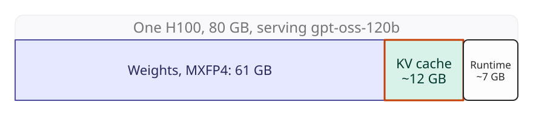
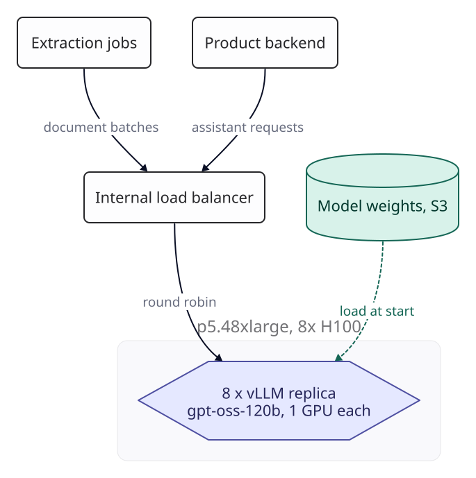
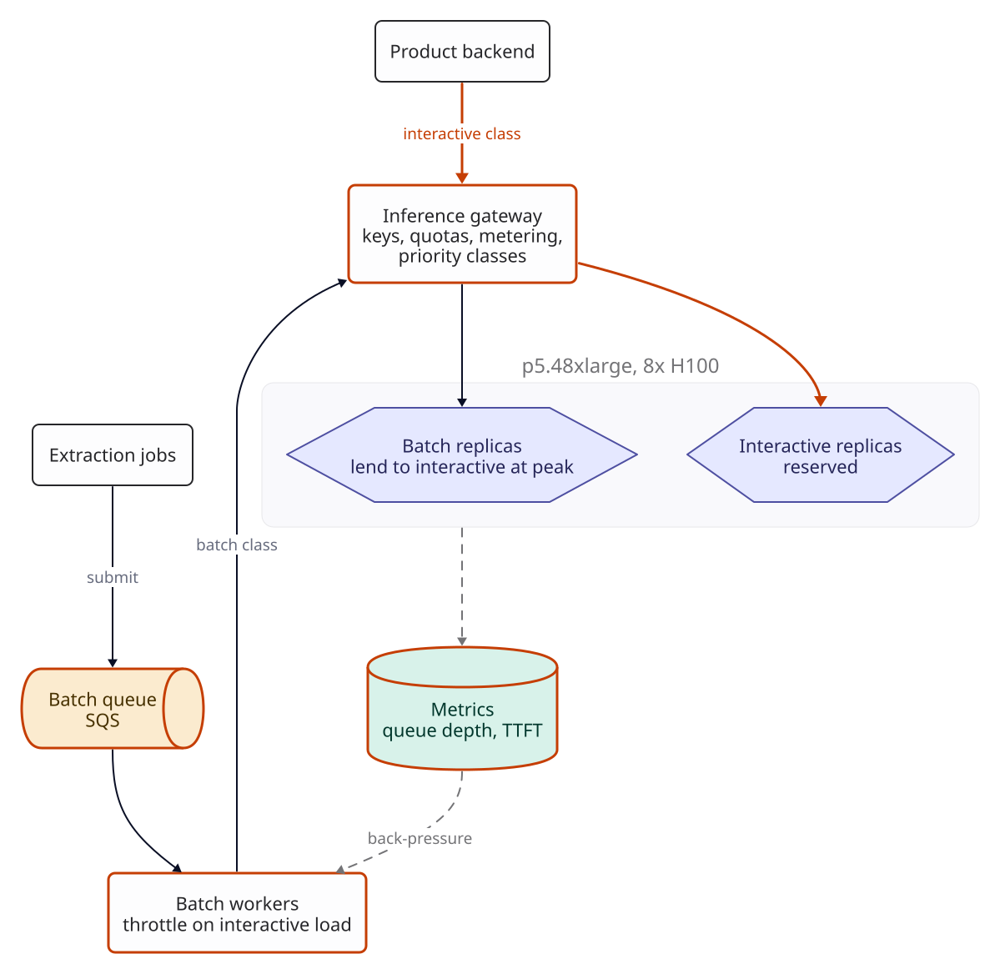
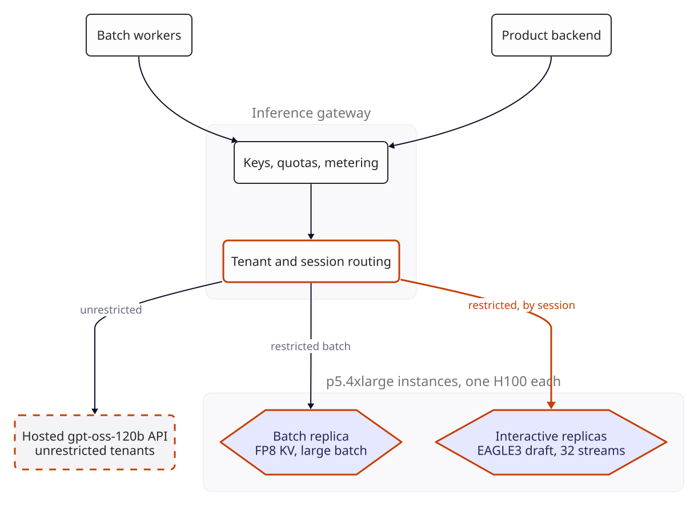
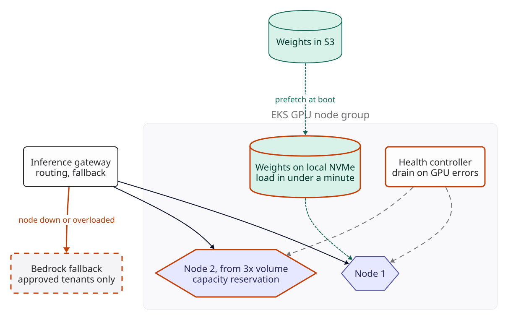
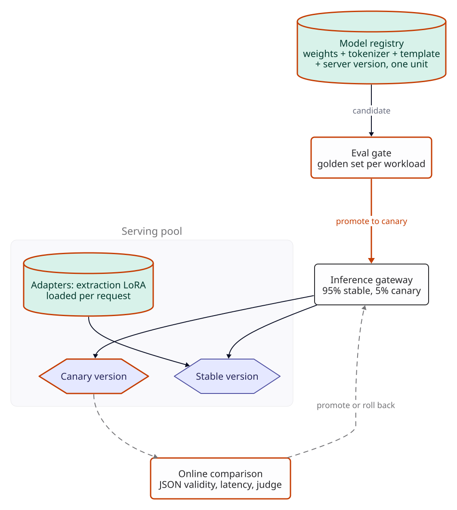
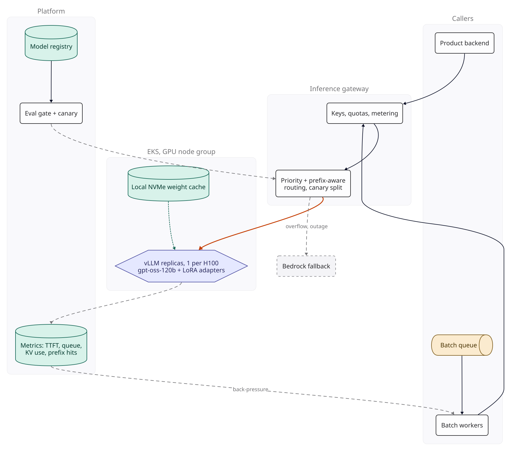

::: {.chapter-meta}
[Level ★★★★]{} [Part VI, The model platform]{} [Uses O7 O12 to O20]{}
:::

"Should we host our own models?" usually arrives as a cost question, and the arithmetic usually
gives an uncomfortable answer. This chapter designs a self-hosted inference platform properly:
sizing GPUs from datasheet ceilings, isolating workloads, right-sizing the hardware, surviving
failures and upgrading safely. It also prices every alternative next to it, because the most useful
thing a design review can do with this request is find out how much of it should be built at all.

## The brief

::: {.brief}
[From the CTO, Ledgerline]{.from}
We process insurance claim documents for carriers. Our model bill on Bedrock is about $110K a
month and volume triples next year. And our two largest customers have new contract terms: from
April, their documents may not be sent to any model provider's service, including the managed AI
services of our cloud. Processing has to run on infrastructure we operate. Can we serve open models
on our own GPUs, and will it save money?
:::

Ledgerline is a worked scenario: its traffic, its contracts and its team are inputs to the
arithmetic, not observations. The brief contains two reasons to self-host, and they are not equally
strong. The contract terms are a hard requirement. The cost hope is a hypothesis to test.

## Questions to ask

| Question | Why it changes the design | We assume |
|---|---|---|
| What are the workloads, in tokens per day, input and output? | Prefill and decode use the GPU differently; their mix sizes everything | Extraction: 1.2B input, 60M output tokens a day, prompts of 4,000 to 10,000 tokens (we use the middle, 7,000, as the mean). Assistant: 300M input, 40M output, prompts of 3,000 tokens on average |
| What latency does each need? | Interactive and batch work should not share a queue | Assistant: first token under 1 s at p95, at least 40 tokens/s per stream (a 25 ms gap between tokens). Extraction: done within 6 hours |
| What is the traffic shape over a day? | Idle GPUs cost the same as busy ones | Assistant in 8 business hours with a peak hour at twice the average. Extraction arrives through the day but can wait |
| Has an open model passed *our* evaluation? | Without this, nothing else matters | The chapter's premise: gpt-oss-120b at medium reasoning effort passes both golden sets. That is an assumption to replace with your own run of [F4](../foundations/f4-evaluation.qmd)'s method, not a result |
| What exactly do the contracts allow? | Decides which options are even legal | Our AWS account, our VPC, our GPUs. No model provider APIs, including Bedrock, for those customers' documents. Other tenants may use any provider |
| What share of tokens is restricted? | Only those tokens have to run on our GPUs | Assumed 40%: the two largest customers' extraction and assistant traffic |
| Who will run it at 3 am? | GPU serving fails in new ways | A platform team of four, one of whom has run GPU clusters; on-call shared with the rest of infrastructure |
| Can we get the GPUs? | H100 capacity is not always available on demand | AWS lists H100s in us-east-1 as p5.48xlarge (8 GPUs) and p5.4xlarge (1 GPU). A list price is not capacity; growth needs a reservation |
| How often will models change? | Upgrades are where self-hosted systems break | A new model or server version every two to three months |

The fourth question saves more money than anything else in this chapter. Moving from a large
proprietary model to a capable open model is a bigger change in cost than any choice about where
the open model runs. The sixth decides how much of the platform to build: only the restricted
tokens have to stay inside the boundary.

## The numbers

Start with what one H100 holds. gpt-oss-120b is a mixture-of-experts model with 117B parameters,
of which 5.1B are active for each token. Its expert weights ship in 4-bit MXFP4 and everything else
in BF16; the checkpoint is  GB ( GiB), and the
model card says it fits a single 80 GB GPU. That simplifies everything: no tensor parallelism, one
replica per GPU, and every GPU is an independent server.

{fig-alt="An 80 GB H100 bar split into model weights at 65.2 GB, an assumed KV cache of about 10 GB, and runtime overhead of about 5 GB."}

::: {.numbers}
vLLM's gpt-oss recipe runs one H100 with `--gpu-memory-utilization 0.95` () to avoid running out of memory.
80 GB x  = 76 GB, less  GB of weights =  GB for KV cache, activations and CUDA graphs.
Assume  GB for the KV cache. vLLM reports the real figure when it starts; use that.
:::



: Datasheet ceilings for gpt-oss-120b on one H100: 989 TFLOPS BF16 and 3.35 TB/s, with no efficiency factor. No server reaches them, so every conclusion below is stated as the share of these ceilings it needs. {.striped}

The prefill ceiling uses the BF16 peak. The H100 datasheet lists no FP4 format (its smallest
floating-point format is FP8), and vLLM's path that pairs MXFP4 weights with MXFP8 activations is listed for
Blackwell only. On an H100 the 4-bit experts save memory, not arithmetic.

The decode ceilings come from [F2](../foundations/f2-numbers.qmd)'s rule that a decode step reads
the weights once, adjusted for experts. Each token picks 4 of 128 experts per layer, so with uniform
routing a batch of 32 tokens touches 1 - (124/128)^32 =  of them. A step
reads the  GB of dense weights, that share of the
 GB of experts, and every sequence's KV cache. Real routing is skewed and
touches fewer experts, so this errs on the slow side.

Now the memory check, which is where the batch workload runs into trouble:

::: {.numbers}
KV per token: 2 (K and V) x 8 KV heads x 64 dims x 2 bytes = 2 KB per layer, x 36 layers =  KB in BF16.
Half the layers (18) use a 128-token sliding window. If the server keeps only the window there, a token of context costs  KB, and  KB with an FP8 cache.
Assistant, 32 streams x 3,000 tokens:  GB at full width in BF16,  GB with the window in FP8. Fits either way.
Extraction, 128 streams x 7,000 tokens:  GB at full width,  GB with the window,  GB with the window in FP8. None fits.
Streams that fit in  GB at 7,000 tokens:  at full width,  with the window,  with the window in FP8 ( at 10,000 tokens,  at 4,000).
:::

The window saving depends on the server. vLLM's hybrid KV cache manager documents it for gpt-oss:
sliding-window layers reserve slots only for the most recent window. Confirm that your version runs
it with the options you enable; without it every layer stores the whole context and the batch
halves. The FP8 cache is a quality change as well as a memory one, and it goes through the
evaluation gate in version 4.

The assistant needs a per-stream speed, which caps how many streams one GPU can carry:



: Decode for the assistant at three batch sizes, 3,000-token contexts, FP8 KV cache. The last column is the share of datasheet bandwidth the server must reach for each stream to get 40 tokens/s. {.striped}

At 32 streams a GPU meets the target only if vLLM reaches  of datasheet
bandwidth. That is the first number to measure. If it falls short, run fewer streams per GPU and
buy more GPUs; if it does much better, 64 streams halve the interactive pool.

Then size the fleet for both workloads:



: GPU sizing at today's volume, next year's and ten times today's, for all tokens. Interactive GPUs are arithmetic from the stream target; batch GPUs assume 50% of the datasheet ceiling, an assumption. The last two rows are the share of paid GPU-hours the work would occupy. {.striped}

The interactive rows are Little's law. Today the assistant writes 40M tokens over 8 hours, doubled
at the peak hour: 2,778 tokens/s. At 40 tokens/s per stream that is 
streams in flight, three GPUs at 32 streams each, plus one spare. The work itself needs
 GPU-hours a day at the ceiling against  x 24
paid, so the fleet would be  busy even if every GPU ran at its datasheet
ceiling. Hold on to that number; it decides the cost section.

## Version 0

One p5.48xlarge (8 H100s) runs eight vLLM replicas of gpt-oss-120b, one per GPU, each exposing an
OpenAI-compatible API. An internal load balancer spreads requests round-robin. The assistant
backend and the extraction jobs both point at it. Weights are pulled from S3 when a replica starts.

{fig-alt="Version 0. The product backend sends assistant requests and extraction jobs send document batches to an internal load balancer, which round-robins to a p5.48xlarge node running eight vLLM replicas of gpt-oss-120b, one GPU each. Weights load from S3 at start."}

vLLM's defaults already do a lot. Continuous batching (O12) serves many
requests at once, chunked prefill is on by default in its V1 engine, and the engine enables prefix
caching by default (though the official gpt-oss recipe's Hopper configuration switches it off, which
matters in version 2). The scheduling policy defaults to first come, first served. That last default
is where version 0 breaks.

## Where workload isolation breaks

An extraction job submits 400 documents at once, and under first come, first served an assistant
request that arrives after them waits behind all of their prefill. Continuous batching shares the
GPU fairly, and fairness is exactly wrong when one workload has a deadline in seconds and the other
has one in hours.

::: {.breaks}
Burst:  documents x 7,000 tokens =  prompt tokens,  per replica under round robin.
Eight GPUs at the prefill ceiling:  / (8 x  tokens/s) =  s. At a quarter of the ceiling:  s.
Assistant budget: first token within 1 s at p95.
:::

The floor, with a perfect GPU, is four times the latency budget. Chunked prefill does not rescue it:
it keeps streams that are already decoding moving while long prompts are processed in pieces, but
new requests still wait their turn. You would see this as assistant p95 time to first token passing
1 s (the target) whenever an extraction job is submitted.

## Version 1

[**Changed** an inference gateway with priority classes, two fixed replica pools, priority scheduling on every replica, and a batch queue drained by workers that back off under interactive load.]{.changed}

**A gateway in front of the replicas.** Every caller gets a key, a workload class and a quota. The
gateway meters tokens per key (the platform's cost attribution), enforces rate limits, and routes
by class.

**Two pools, fixed at launch.** In vLLM the settings that make a replica good at one workload are
launch-time arguments: the speculative decoding configuration, the maximum number of sequences and
the KV cache dtype. A replica cannot switch between interactive and batch roles without draining
and restarting, so the node is split into two fixed pools: four interactive replicas and four batch
replicas.

**Priority inside each replica.** Every replica runs with `--scheduling-policy priority`, and the
gateway sets each request's `priority` field by class (lower is served earlier). Batch requests may
also go to interactive replicas at the lowest priority when interactive load is low, so the nights
are not wasted.

**Extraction goes through a queue.** Jobs submit documents to SQS rather than calling the model
directly. Workers drain the queue at a rate set by back-pressure: they watch waiting requests and
the assistant's time to first token, and slow down when either rises. This is the self-hosted
version of a batch API (O7): the work waits, and in exchange it runs on
capacity that would otherwise be idle.

**Tune chunked prefill** (O18). It is already on; its chunk size,
`--max-num-batched-tokens`, trades one latency for another. vLLM's guidance is that smaller values
give better inter-token latency because fewer prefill tokens slow each decode step; the gpt-oss
recipe's Hopper configuration uses 8,192.

{fig-alt="Version 1. Extraction jobs submit to a new SQS batch queue, drained by new batch workers that throttle on interactive load. The product backend and the batch workers call a new inference gateway with keys, quotas, metering and priority classes. The gateway sends interactive traffic to a new interactive pool with priority scheduling and batch traffic to a new batch pool, and may send batch work to the interactive pool at low priority. New metrics on queue depth and time to first token feed back-pressure to the workers."}

::: {.breaks}
The burst now lands on the four batch GPUs only:  / (4 x  tokens/s) =  s at the ceiling, and no assistant request waits behind it.
Watch: assistant p95 time to first token under 1 s through extraction submissions, and extraction backlog age under 6 hours (both targets).
:::

## Where utilisation breaks

The system now works, and the sizing table already says it is wasteful. This break needs no
dashboard: it is a cost line.

::: {.breaks}
Today's work needs  GPU-hours a day at the ceiling; the node provides 192. Busy share at the ceiling: . At any real efficiency it is higher, but nowhere near full.
The node costs  an hour on demand, about  a month with the cluster around it.
The same tokens on a hosted gpt-oss-120b API cost  a month.
:::

Two things cause it. The unit is too big: today's interactive peak needs three GPUs and one spare,
and the batch work fits in one more, so three of the eight replicas have nothing to do. And the
node carries every tenant's tokens, though the contracts restrict only some of them.

Routing wastes some work too, though less than it might seem. Every assistant prompt starts with the
same 1,800-token system prompt, so each replica keeps it cached whatever the routing: a floor of
1,800 / 3,000 =  of prompt tokens, provided nothing that varies per request
(a date, a tenant name) is placed before it. History is different. With  turns
per conversation (an assumption), each turn adds about  tokens. The chat
format drops the previous turn's reasoning, so the cache matches up to the previous answer and each
turn recomputes about  tokens: a hit rate of up to
 if the turn lands where the last one ran. Round robin over eight
replicas does that one time in eight:  + 24% / 8 = .

## Version 2

[**Changed** single-GPU instances sized per pool, only restricted tenants on our GPUs, session routing, an FP8 KV cache on the batch pool, and speculative decoding on the interactive pool.]{.changed}

**Right-size the unit** (O20). AWS sells the H100 one at a time:
p5.4xlarge is one H100 at  an hour on demand, exactly an eighth of
p5.48xlarge, with 16 vCPUs, 256 GiB of memory and one 3.84 TB NVMe drive. Each pool becomes its own
set of instances, sized from the tables above.

**Self-host only what must be.** The gateway knows each tenant's contract. Restricted tenants' requests go to
our GPUs; everyone else's go to a hosted gpt-oss-120b API, with extraction on its batch tier at
 and  per million input and output tokens. Same
weights, so the outputs are comparable, and the release gate in version 4 checks that they stay so. At
the assumed  restricted share the fleet today is
 GPUs:  interactive (one for
 peak streams, one spare) and 
for batch.

**Route by session** (O14). The gateway hashes the session id onto the
interactive replicas and falls back to the least-loaded one when the owner is busy. Every replica
warms the system prompt with one request at start-up. Hashing the first few thousand tokens instead
would be wrong here: every first turn shares them, so all new conversations would land on one
replica. Session routing cuts the assistant's uncached prompt tokens from
 to . In GPU time that is small: all
of today's uncached assistant prefill is  GPU-hours a day at
the ceiling. The gain is time to first token at peak, not cost. Before relying on any of it, confirm
that prefix caching works for gpt-oss on Hopper in the vLLM version you pin, since the recipe's
Hopper configuration turns it off.

**FP8 KV cache on the batch pool** (O16). It lets
 documents share a GPU instead of . The decode
ceiling rises from  to  tokens/s,
 times, and nearly all of that comes from the bigger batch: at the
same  streams FP8 only trims the KV bytes each step reads, worth
 times. Other context lengths and KV budgets move both factors, so
treat them as arithmetic for these inputs. vLLM sets FP8 scales to 1.0 unless you calibrate them,
and the recipe sets an FP8 cache only in its Blackwell configuration, so its quality on your
documents is unknown until the golden set says otherwise.

**Speculative decoding on the interactive pool** (O15). NVIDIA publishes
an EAGLE3 draft head for gpt-oss-120b, which the vLLM recipe uses, so no draft model has to be
trained. Verifying  drafted tokens per stream makes a step carry
 tokens, which touch  of the experts instead
of . The step reads  times the bytes. Its
arithmetic is still small ( ms at the BF16 ceiling, inside a
 ms step), so the step stays bandwidth-bound and the question is how many
drafted tokens survive.

::: {.numbers}
Speculation breaks even when each step yields  tokens per stream on average.
With  drafted tokens that needs a per-token acceptance rate of about .
A 1.5 times speed-up needs about .
The draft head's own weights and reads are left out, which flatters it slightly.
:::

Measure acceptance on your own traffic before counting on it. On the batch pool the arithmetic is
kinder (the step grows only  times, because
 streams already touch most experts), but the draft head's memory comes out
of the KV budget that sets the batch, and extraction has hours of slack. Leave it off there until a
test shows more tokens per GPU-hour.

**Commit after measuring.** A 1-year EC2 Instance Savings Plan for the p5 family takes the GPU-hour
from  to  ( off). It
covers any p5 size in the region and binds you to the family for a year:
 for today's  GPUs, against
 for one p5.48xlarge. A Compute Savings Plan is
 ( off) but follows you to other instance
families, which is worth paying for if H200 or B200 instances may become the better buy within the
year. Commit to the floor of the fleet only once single-GPU capacity and the bandwidth share are
confirmed.

{fig-alt="Version 2. The product backend and batch workers call the inference gateway, which now has keys, quotas and metering followed by new tenant and session routing. Restricted interactive traffic goes by session to new interactive replicas with an EAGLE3 draft head, restricted batch traffic to a new batch replica with an FP8 KV cache, both on p5.4xlarge instances with one H100 each. Unrestricted tenants go to a new hosted gpt-oss-120b API."}

::: {.breaks}
Today's restricted work occupies  of the  GPUs' paid time at the ceiling.
The fleet is now set by its minimum (one interactive replica, one spare, one batch replica), not by the tokens.
:::

## Where resilience breaks

A small fleet has two failures the arithmetic can show and one it can only watch for.

::: {.breaks}
Blast radius: repairing a faulty GPU means stopping or replacing its instance. On a p5.48xlarge that takes eight replicas; on a p5.4xlarge, one. With one interactive replica and one spare, the restricted assistant survives one GPU failure; a second failure, or a lost availability zone, leaves it queuing.
Recovery time: a replacement instance starts with an empty NVMe drive (instance store does not survive a stop or termination), so its replica downloads  GB from S3. At the instance's 100 Gbps network that takes at least  s; real S3 throughput, the container image pull and warm-up add to it. Target: serving within 10 minutes of instance start.
Capacity: on-demand H100s may not be there when you scale. Watch the time from a scale-up request to a running replica; above an hour, the growth plan is at risk.
:::

## Version 3

[**Changed** a spare in a second availability zone, a GPU health controller, weights copied to local NVMe, scaling per pool on leading signals, and capacity reserved ahead of growth.]{.changed}

**A spare, not a second node.** Redundancy at the GPU level costs one p5.4xlarge,
 a month on the savings plan, not a second eight-GPU node. Put the
spare and its partner in different availability zones, so that one zone does not take both.

**No fallback for restricted tenants.** The contracts allow delay, not a different processor. When
the interactive pool is short, restricted requests queue at the gateway with an explicit status,
and batch work yields first. Unrestricted tenants are already on the hosted API, so the platform
needs no Bedrock fallback; one would add a second model to test and a second route out of the
boundary.

**GPU health.** A controller watches GPU error counters from DCGM and replica health. On an
uncorrectable error it marks the replica unhealthy, stops routing to it, cordons the node and
replaces the instance. With single-GPU instances there is no question of which other replicas to
drain.

**Weights on local NVMe.** A daemon copies the current release to the instance's NVMe drive at
boot, and pods load from it. That makes pod restarts and release switches on a live instance fast.
It does nothing for a replacement instance, whose drive starts empty, so the S3 download stays on
the recovery path and is the step to measure.

**Scale each pool on the signals that lead.** The interactive pool follows waiting requests and KV
cache use; the batch pool follows queue age. Never scale on CPU or GPU utilisation, which are high
whenever batch work runs. At today's size this matters little, but the rule is in place before the
fleet grows.

**Reserve before you need it.** Capacity Blocks reserve p5.4xlarge in us-east-1 up to eight weeks
ahead, for days or weeks at a time. For a standing fleet, an On-Demand Capacity Reservation that
starts immediately holds capacity in one zone for as long as you pay for it, and combines with a
Savings Plan for the discount. AWS's future-dated reservations do not cover the P family, so
reserve when the capacity is there, not when the queue is already long.

{fig-alt="Version 3. The inference gateway, now health-aware, routes to an EKS GPU node group of p5.4xlarge instances in two availability zones, with the new spare in zone b. A new copy of the weights on instance NVMe, copied from S3 at boot, serves fast pod restarts. A new health controller cordons nodes on GPU errors. A new capacity reservation holds instances ahead of growth."}

## Where model changes break

Self-hosting puts every part of the output path in your hands: weights, tokeniser, chat template,
server version and its settings. A server upgrade that changes how the chat template renders tool
calls, or a switch to the FP8 KV cache, can change outputs without anyone thinking they changed the
model. The extraction pipeline retries invalid JSON, so a drop in validity shows up as extra load,
not as an error.

::: {.breaks}
How you would see it: JSON validity, field accuracy and retries per document, per release. Target: a release whose validity or accuracy on the golden set is below the stable release's by more than the set's noise ([F4](../foundations/f4-evaluation.qmd)) has broken, and so has one that raises retries per document in canary.
The hosted path changes too: the provider runs its own server, quantisation and template, and can change them without a release on your side.
:::

## Version 4

[**Changed** a model registry that versions everything that affects outputs as one unit, an evaluation gate for both serving paths, canary routing on the spare GPU, and a judge inside the boundary.]{.changed}

**Version everything that changes outputs, together.** A model release in the registry is the
weights, the tokeniser, the chat template, the serving engine version and its configuration
(KV cache type, draft head, scheduling settings). Changing any one of them is a new release. The
usual self-hosting incident is changing one of these and assuming the others did not matter.

**An evaluation gate.** Each release runs both workloads' golden sets
([F4](../foundations/f4-evaluation.qmd)) before deployment: field accuracy and JSON validity for
extraction, judged correctness and latency for the assistant. The build fails on any regression
outside the noise. The hosted API serves the same weights through someone else's stack, so the same
golden sets run against it weekly and after any provider notice. A regression there is fixed by
routing, since you cannot roll back their release.

**Canary routing.** A passing release takes 5% of restricted traffic for a day, on the spare GPU: the
gateway weights the split, so the canary replica need not take a quarter of the traffic just
because it is one of four. That costs no extra GPU but removes the spare during a rollout; renting
one more on-demand instance for two days instead costs . The gateway
compares canary and stable on JSON validity, retries, refusals, latency and a sampled judge, and
promotes or rolls back automatically.

**A judge inside the boundary.** Restricted documents never go to a hosted judge. The judge is the
stable release at high reasoning effort, run on the batch pool off-peak, comparing canary and
stable answers. It shares the model's blind spots, so it catches regressions between releases, not
absolute quality; that is what the golden set is for. A hosted judge may score unrestricted
tenants' samples.

{fig-alt="Version 4. A new model registry holds weights, tokeniser, template, server version and configuration as one unit. A new eval gate runs a golden set per workload and promotes candidates to canary. The gateway sends traffic to the stable release and 5% to a new canary release on the spare GPU. A new online comparison of JSON validity, retries and a judge sends sampled pairs to a new judge, the stable release at high reasoning effort, inside the boundary, and promotes or rolls back."}

## The final design

{fig-alt="Final design. Callers are the product backend and batch workers draining a batch queue. Both call the inference gateway, which handles keys, quotas and metering, then tenant, priority and session routing with a canary split. Restricted traffic goes to interactive replicas with a spare and EAGLE3, and restricted batch to batch replicas with an FP8 KV cache, on p5.4xlarge GPU nodes in EKS across two zones, loading weights from instance NVMe. Unrestricted traffic leaves through an egress proxy with an allow-list to a hosted gpt-oss-120b API. The platform has a model registry feeding an eval gate and canary, and metrics on time to first token, inter-token latency, queue, KV use and prefix hits, which send back-pressure to batch workers."}

| Component | Choice | Why |
|---|---|---|
| Model | gpt-oss-120b, MXFP4 experts, medium reasoning effort | Assumed to pass both golden sets; fits one H100 per replica |
| Serving engine | vLLM, one replica per GPU, priority scheduling, prefix caching, FP8 KV on batch, EAGLE3 on interactive | Mature, OpenAI-compatible, has a gpt-oss recipe. SGLang and TensorRT-LLM are credible alternatives; benchmark on your traffic |
| Hardware | AWS p5.4xlarge (1x H100):  interactive including a spare,  batch, today | The smallest H100 unit AWS sells; a failure costs one replica |
| Unrestricted tokens | Hosted gpt-oss-120b API, batch tier for extraction | Cheaper per token than our GPUs at any utilisation this workload reaches |
| Orchestration | EKS with a GPU node group in two zones and the NVIDIA GPU operator | Same platform as everything else the team runs |
| Gateway | Keys, quotas, metering, priority classes, tenant and session routing, canary split | All policy in one place; replicas stay simple |
| Batch path | SQS plus workers with back-pressure | Fills idle capacity without hurting interactive latency |
| Weights | S3 as source of truth, copied to instance NVMe | Fast pod restarts; replacements are bounded by the S3 download |
| Release process | Registry bundles, eval gate on both paths, 5% canary, judge inside the boundary | Upgrades change outputs silently; restricted data never leaves |
| Commitment | EC2 Instance Savings Plan for the fleet's floor, after measuring |  off, but a year in one instance family |

## Deployment

- **Cluster:** EKS in us-east-1, private subnets, no public endpoints. The GPU node group runs
  p5.4xlarge in two availability zones with the NVIDIA GPU operator; a separate CPU node group runs
  the gateway, workers, egress proxy and monitoring.
- **Replicas:** a Kubernetes Deployment per pool per release, one GPU per pod. Readiness checks pass
  only after the model has answered a warm-up request. Pod disruption budgets stop more than one
  replica in a pool draining at a time.
- **Gateway:** stateless, three replicas across availability zones, so a zone loss leaves it
  serving the GPUs in the other. Envoy AI Gateway (now renamed Agent Router), LiteLLM, whose proxy
  has virtual keys with spend tracking and per-key rate limits, or a small custom service all fit.
  Check whether your choice can set vLLM's per-request priority and route by session; expect to
  write some of that yourself.
- **Scaling:** KEDA's Prometheus scaler drives each pool from its own query (waiting requests and
  KV use for interactive, queue age for batch), and the cluster autoscaler adds instances from
  reserved capacity.
- **Observability:** the serving engine's Prometheus metrics (time to first token, inter-token
  latency, waiting requests, KV cache use, prefix hit rate, draft acceptance) plus GPU counters
  from DCGM, with traces from the gateway carrying tenant, class, release and token counts.
- **Data boundary, enforced by the network:** GPU and gateway subnets have no route to the
  internet; they reach S3 through a VPC endpoint. The only way out is an egress proxy in its own
  subnet. It accepts requests only from the gateway, only for tenants on an approved list owned by
  whoever owns the contracts, and only to the hosted API's hostname; anything else is dropped, so a
  bug fails closed. The API credentials exist only in that proxy's role. Every egress request is
  logged with its tenant, and an alarm pages on any restricted tenant in that log or any traffic
  from the GPU subnets to anything but the endpoints. A CI test of the tenant list stays, but it
  checks configuration; the network is what enforces it.

## Cost

Eight ways to serve the same tokens, at today's volume, next year's and ten times today's. Prices as
of . The self-hosted rows include the EKS control plane, two CPU nodes for
the gateway and workers, and S3 ( a month). They leave out people, staging
and evaluation runs, the canary, and NAT and egress for the hosted path.



: Monthly cost of serving both workloads. Hosted rows use batch pricing for extraction where the provider offers it (Fireworks does; Bedrock lists no batch price for these models), and assistant prompt caching at the 60% system-prompt floor. Bedrock rows use Global cross-region rates; Geo and in-region rates are 10% higher. Self-hosted GPU counts come from the sizing table, so the batch pool rests on the assumed 50% of the ceiling. {.striped}

Read the table in four steps.

**First, the model change is the saving.** Today's  (or
 at Geo rates) becomes  for
gpt-oss-120b on a hosted API. Claude Haiku 5.5 on the same Bedrock account would cost
, if it passed the golden set, which nobody has tested here. Almost
all of the saving comes from moving off a large proprietary model, not from owning GPUs. Without
the contracts, the answer to "will self-hosting save money?" would be "no; switch models and stay on
an API".

**Second, self-hosting every token loses at every volume.** On single-GPU instances with a savings
plan it costs ,  and
 times the hosted API. The reason does not depend on how efficient
the servers turn out to be, which the break-even table shows.



: What one GPU-hour must produce to match gpt-oss-120b's hosted price. Input and output columns: tokens per second per GPU at batch prices, and in brackets that rate as a share of the prefill or batch-pool decode ceiling. Mix columns: the workload's GPU-hours at the ceiling, priced, over its hosted cost; that is the share of the ceiling a fully busy GPU must average to break even. {.striped}

Read the output column first. At batch prices even a savings-plan GPU would have to write
 tokens a second,  of the decode ceiling:
no server and no utilisation gets there. Input is the opposite, at  of
the prefill ceiling. Mixed as the workloads mix them, a fully busy savings-plan GPU matches the
hosted price if it averages  of the ceiling on extraction and
 on the assistant. Whether vLLM sustains a third or half of datasheet on
this model is a measurement, and nobody should buy hardware before making it.

The fleet's problem is that it is not fully busy, and here the arithmetic needs no measurement. A
fleet of G GPUs costs 24 x G x price a day; the work needs W GPU-hours at the ceiling; the hosted
bill is C. The fleet is cheaper only if W / (24 x G) is above W x price / C: the share of paid time
the work needs at the ceiling must exceed the break-even share,  for the
whole mix on the savings plan. Today's fleet needs , and
 at ten times the volume. Put the other way, today's hosted bill buys
 savings-plan GPUs, and the assistant's latency target alone needs
four. The stream target, not the token volume, sets the fleet: interactive GPUs are
 of it today.

**Third, the contract has a price.** The cheapest compliant option keeps only the restricted share
on our GPUs:  a month today against  for
everything on the hosted API. The difference is what the data boundary costs, and it is worth
putting in front of whoever negotiates those contracts. It moves with the restricted share, which is
an assumption here; ask for the real one first.

**Fourth, the unit matters as much as the commitment.** For all tokens today, a p5.48xlarge on a
savings plan costs  a month against  for
right-sized p5.4xlarge instances on the same plan. Buying eight GPUs because that is the shape
everyone quotes is the most expensive mistake available at this size.

Then add people. A platform that needs a GPU-literate on-call rotation, model upgrades every few
months and an evaluation gate costs real engineering time; at three GPUs that time can cost more
than the GPUs. Smaller lines left out of the table: a staging GPU on demand for each release's
golden-set run, the canary instance if you rent one, NAT and egress for the hosted path, and
evaluation runs against the hosted API.

## Optimisation

The versions above already applied most of the inference catalogue. Here they are with their effect
in this system.

| Code | Technique | Effect here |
|---|---|---|
| O7 | Batch APIs, and a queue as a private one | Extraction waits for idle capacity on our GPUs, and uses the hosted batch tier for unrestricted tenants |
| O12 | Continuous batching | The baseline; on by default |
| O13 | Quantisation | MXFP4 experts are why one replica fits one GPU; on an H100 they save memory, not arithmetic |
| O14 | Prefix caching with session routing | Uncached assistant prompt from  to  (four-turn assumption); under half a GPU-hour a day at the ceiling, so mostly a latency gain |
| O15 | Speculative decoding | Breaks even at about  draft acceptance, 1.5x at about ; interactive pool only until measured |
| O16 | FP8 KV cache | Batch pool fits  documents instead of ; decode ceiling x |
| O17 | Parallelism | Not needed: one replica per GPU is the cheapest layout for a model that fits |
| O18 | Chunked prefill | On by default; tune its chunk size for inter-token latency. Disaggregation is not worth it at this size |
| O19 | Autoscaling and spot | See below |
| O20 | Right-sizing the hardware | Single-GPU instances:  to  a month for all tokens |

Autoscaling (O19) has one clear use here. The interactive pool needs its
full size only for the business day: one p5.4xlarge on demand for 10 hours costs
, against  for 24 hours on the savings plan.
So the part of the pool above the floor is cheaper on demand, provided instances can be launched
each morning; without a reservation that is a bet on capacity. Extraction is the natural spot
workload, since an interruption only returns documents to the queue. Check whether spot capacity
for p5 exists in your region before planning on it.

Two optimisations would cut cost further and were not taken. **A smaller model for the assistant**
(O9): if a 20B-class model passed the assistant's golden set, it could
run more streams per GPU, and the interactive pool is most of the fleet. **Distillation**
(O10) of extraction into a small fine-tuned model: the largest long-term
saving available, and a project of its own (System 41).

## Operating it

| Metric | Healthy (target) | Alert when (target) |
|---|---|---|
| Assistant time to first token, p95 | Under 1 s | Over 1.5 s for 10 minutes |
| Inter-token latency, p95 | Under  ms (40 tokens/s) | Over  ms for 10 minutes |
| Waiting requests per interactive replica | Near zero | Above 4 for 5 minutes |
| KV cache use | Under 90% | Above 95% with preemptions |
| Prefix cache hit rate, assistant |  to  | Below : caching is off or something per-request precedes the system prompt |
| Draft acceptance rate | Above  | Below : speculation now costs time |
| Extraction backlog age | Under 6 hours | Over 8 hours |
| GPU errors (DCGM) | None | Any uncorrectable error |
| JSON validity, extraction, per release and per path | Within the golden set's noise of the stable release | Below it, or retries rising |
| Restricted tenants in the egress log | Zero | Any |

**Failure modes to expect.**

- **Preemption storms.** When KV cache fills, the engine evicts running sequences and recomputes
  them later. Throughput collapses while utilisation looks high. Cap concurrency per replica below
  the point where this starts, and alert on preemptions, not just on cache use.
- **Silent template or tokeniser drift.** The cause of the fourth break. Treat any change to the
  serving stack as a model change.
- **A cold prefix cache after a prompt change.** A new system prompt shares nothing with the old
  one, so the uncached share of each prompt jumps from  to all of
  it until the caches refill. Expect a latency bump after every prompt deploy; do not deploy prompts
  at peak.
- **Capacity you cannot buy.** GPUs are not elastic in the way CPUs are. Plan instances a quarter
  ahead.
- **Throughput claims from benchmarks.** Published numbers use short prompts and ideal batches. Your
  prompts are 7,000 tokens long and arrive in bursts. Measure the bandwidth share at 32 streams and
  the prefill rate on your own documents with the engine's benchmarking tool before committing.

## Variants

**If there were no data boundary,** do not build this. Run the golden sets on small proprietary
models and on hosted open models, and use the cheapest API that passes. Revisit self-hosting when
the busy share at the ceiling of the fleet you would need is above the break-even share in the table.

**If most tokens were restricted,** the split saves little and the all-token rows apply. The
recommendation stands; the bill is closer to the self-hosted rows.

**If the cloud's managed service offered the open model inside your account,** check whether the
contract counts it as "a model provider's service". If not, it removes the GPU operations entirely
and is likely cheaper than a fleet that is mostly idle.

**If extraction needed a fine-tune.** 50,000 labelled claims at 7,000 tokens is
 tokens an epoch. At 6 FLOPs per active parameter per token (forward and
backward, an upper bound for LoRA), an epoch is  hours of an 8-GPU node at
the BF16 ceiling, or  at a tenth of it. The model card says the 120B
model fine-tunes on a single H100 node, and inside the boundary that means a p5.48xlarge in our
account, on demand or in a Capacity Block, at  a day. vLLM serves LoRA
adapters for gpt-oss, one adapter per request, and the adapter becomes one more component of a
release.

**If the model did not fit on one GPU** (a dense 70B model in FP8 needs two H100s; larger models
need a node), tensor parallelism enters, replicas become 2 or 4 GPUs wide, and failures take out
more capacity at once. The memory arithmetic in [F2](../foundations/f2-numbers.qmd) decides the
width.

**At 10x volume** the all-token fleet is  GPUs, and on the savings plan it
still costs  times the hosted API. Even at the ceiling
 of its paid time is idle, because  of the GPUs
are the interactive pool sized for one peak hour. The restricted share alone is
 GPUs, large enough that losing one is routine, and disaggregated
prefill and decode (O18) start to be worth a test.

**If latency mattered more than cost** (a voice agent, say, as in [System 28](28-voice-agent.qmd)),
run interactive replicas at 16 streams, which need only  of datasheet
bandwidth for 40 tokens/s, use speculative decoding, and keep them separate from any batch work.

## Trade-offs

| Decision | Alternative | Why we chose it |
|---|---|---|
| Self-host gpt-oss-120b for restricted tenants only | Self-host every token | Hosted tokens are cheaper at any utilisation this fleet reaches; the contracts restrict only some tenants. Revisit if the restricted share approaches all of it |
| p5.4xlarge, one GPU per instance | p5.48xlarge nodes | The fleet needs a few GPUs, not eight; a failure costs one replica |
| One replica per GPU | Tensor-parallel replicas | The model fits one GPU; this is the cheapest and most fault-tolerant layout |
| Two fixed pools with priority scheduling | One pool shared by class | Batch size, KV dtype and speculation are launch-time settings; a replica cannot be both |
| Session routing | Round robin, or hashing the prompt prefix | Keeps history cached; prefix hashing sends every first turn to one replica |
| A spare GPU, queue on overload | Bedrock fallback | Restricted tenants cannot use it, and it adds a model to test and a route out |
| Savings plan after measuring | Commit on day one | A year in one instance family; settle capacity and the bandwidth share first |
| Release bundles with eval gate, canary and an in-boundary judge | Upgrade components independently | Template and KV changes alter outputs silently; restricted data never leaves |
| vLLM | SGLang or TensorRT-LLM | Mature, has a gpt-oss recipe, OpenAI-compatible; the decision is revisited by benchmark, not by preference |
