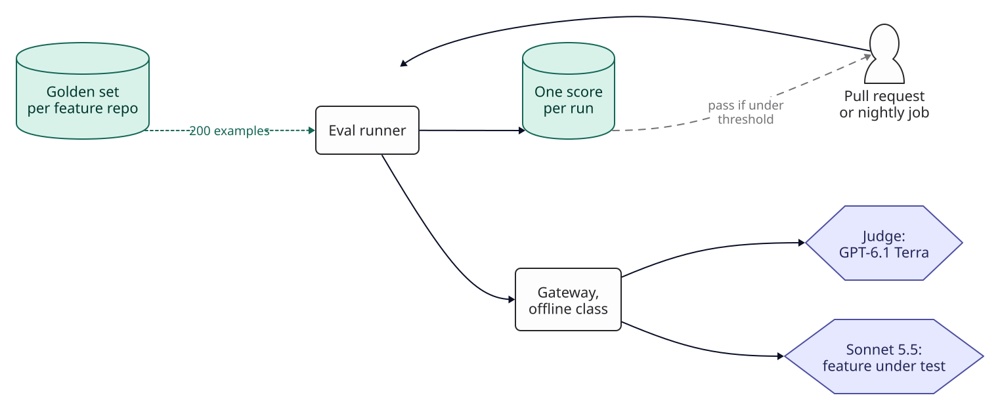
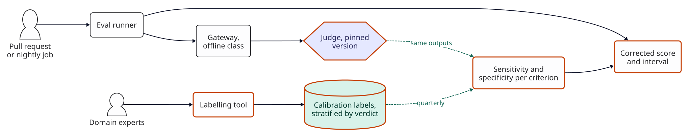
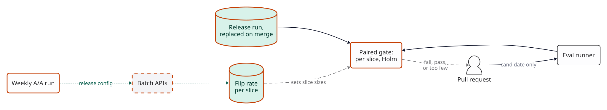
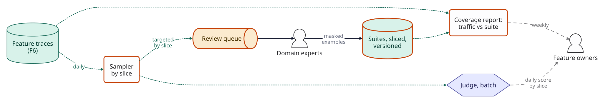
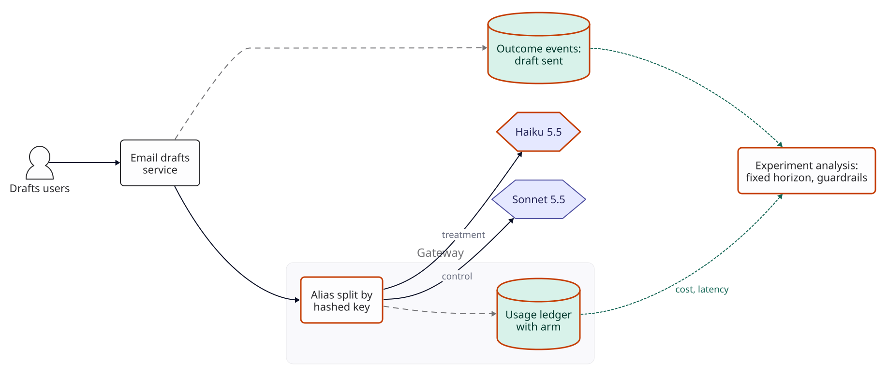
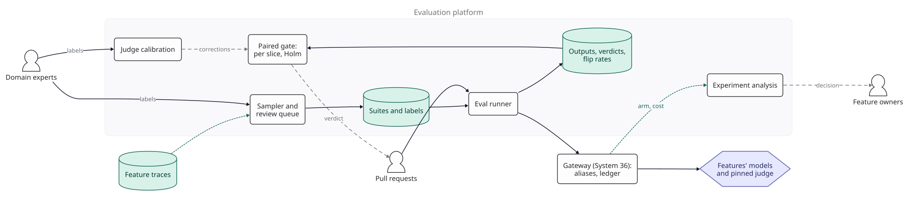

::: {.chapter-meta}
[Level ★★★]{} [Part VI, The model platform]{} [Uses O1 O7 O9]{}
:::

Every earlier chapter builds an instrument before it builds version 1, and every one of them builds
it alone. [System 7](07-simple-rag.qmd) gates on a paired count with a threshold of 3;
[System 8](08-production-rag.qmd) slices its golden set four ways; [System 17](17-tool-calling-assistant.qmd)
scores trajectories on recorded fixtures; [System 36](36-llm-gateway.qmd) gives evaluation a rate
class and a batch route and says a fallback must pass its golden set. [F4](../foundations/f4-evaluation.qmd)
says how to build a golden set, size it, calibrate a judge and gate on it. This chapter is the
shared service those pieces add up to once a company has several features and one platform team.
It does not repeat F4. It asks what F4's rules cost and where they break when run for every
feature on every change. Nothing here was measured: the scenario supplies the inputs, the
arithmetic is real, and every threshold is a target you set.

## The brief

::: {.brief}
[From the head of product, Halden]{.from}
Every team has its own eval script and its own idea of a pass. Search changed its prompt in
August, the eval said fine, and support tickets about wrong answers went up for two weeks before
anyone connected them. The drafts team wants to move to Haiku to save money and I can't tell
whether "the evals look the same" means anything. Half the PRs that touch a prompt fail the eval
check and people just re-run it until it goes green. Can the platform team own this the way it
owns the gateway?
:::

Halden is [System 36](36-llm-gateway.qmd)'s company, and this chapter reuses its four product
features (support assistant, search answers, document extraction, email drafts), their volumes,
the gateway, and the evaluation request's size:  tokens in and
 out on Sonnet 5.5, judged by GPT-6.1 Terra. The brief names four
failures, and they are this chapter's four breaks: a score that can say fine when it is not (the
judge), a check people re-run until it passes (the gate), a regression on a kind of question the
suite did not have (the suite), and a decision no suite can settle (whether people still use a
cheaper model's drafts).

## Questions to ask

| Question | Why it changes the design | We assume |
|---|---|---|
| Which features need a suite? | Sizes everything else | The  product features; evaluation itself is System 36's offline class |
| How often does a gated change happen? | Sets the gate's volume and its false-alarm budget |  changes a feature a month that touch a prompt, model, retrieval setting or tool definition:  gate runs, about  a working day |
| Who can say what a good answer is? | A judge is only as good as the people it is calibrated against | Two domain experts per feature (support leads, the search team's content editors, the documents team, a sales lead for drafts),  minutes an output, at an assumed loaded  an hour |
| May production outputs become test cases? | Decides whether the suite can follow the traffic | Yes, masked, under each feature's trace retention ([F6](../foundations/f6-safety-observability.qmd)); customers' content stays in Halden's account, as in System 36 |
| How long may a gate take? | People wait for it on every change | A target of 20 minutes at p90 from push to verdict |
| What decisions need production traffic? | Decides whether to build online experiments at all | Model changes that save money (System 36's O9), where the question is what users do, not what a judge says |
| Who decides a pass? | A gate nobody owns gets overridden | Each feature's owner sets, in advance, the regression it will not accept; the platform owns the method and the noise |

The third and last rows decide most of what follows. The platform can run anything; what it cannot
do is decide what good means or which regression matters. It owns the instrument, and the feature
teams own the thresholds.

## The numbers

What one example costs, and what Halden runs today (version 0): every feature has a
-example golden set, run for the candidate and the last release on each
gated change, and nightly.

::: {.numbers}
One example:   in +  out on Sonnet 5.5, plus a judgement of  in +  out on GPT-6.1 Terra =  (judgement alone )
Version 0:     features x (2 x  gate runs +  nightly runs) x  examples =  examples a month, 
Budget:       System 36 sized the offline class for  evaluation requests a month at growth,  of Sonnet's input limit synchronously, about  examples a minute
:::

Pricing every example at System 36's evaluation profile overstates extraction's (Haiku, no judge)
and understates the support assistant's (several model calls a task, as in System 17); the totals
are the scale, not a budget per feature. The point of the numbers is a comparison that comes
later: version 0's model spend is small, and the final design's largest lines are not models.

## Version 0

Version 0 is the platform teams usually build first, and its parts are right. Each feature keeps
its golden set in its own repository. A shared runner, triggered by CI or a nightly schedule,
sends each example through the gateway with the offline class's identity (so evaluation spend is
its own feature in System 36's ledger), applies deterministic checks, asks the judge to grade
what is left against the feature's rubric, and writes one score. The gate is System 7's: run the
candidate and the last release on the same examples, count those that passed before and fail now,
and fail the build if the count is above . The job prints how many
examples it ran and fails if that is zero.

{fig-alt="Version 0. A pull request or nightly job triggers the eval runner, which reads a 200-example golden set from the feature's repository, sends each example through the gateway's offline class to the feature's model and to a GPT-6.1 Terra judge, and writes one score per run, which passes the build if the regression count is under a threshold."}

Before changing it, build the platform's own instrument: a **known-answer suite** for the
platform itself. For each judged criterion, a set of outputs with labels people agreed on,
deliberate failures included; for the gate, stored runs of one configuration (which, compared with
each other, are A/A pairs) and synthetic runs with a planted regression of known size. Each break
below names the check in this suite that shows it, so the platform is evaluated the way it
evaluates features.

## Where the judge breaks

A judge's score is the judge's opinion of the outputs, and version 0 reports it as the outputs'
quality. In this worked example the judge passes  of truly good answers and
fails only  of truly bad ones (both assumptions; nobody at Halden has
measured them, which is the break).

::: {.breaks}
The judge's pass rate is the true pass rate $p$ through the judge's two error rates:
observed $= p \times$ sensitivity $+ (1 - p) \times (1 -$ specificity$)$.

- At a true  the judge reports . A change that
  drops the true rate to  is reported as : a
  -point regression shows as . Every difference is
  multiplied by sensitivity + specificity $-$ 1, here .
- So detecting the same real regression needs about 1 / ² =
   times as many examples as F4's sizing assumed, which took the judge as
  exact.
-  of real failures pass. If a change shifts failures towards the kind the
  judge misses (longer, more confident answers, the verbosity bias F4 names), the judge's error
  rates themselves move, and the score can stay flat while quality falls.
- The judge is a model behind an alias too. If its provider updates it and its specificity moves
  to , the same outputs score  instead of
  : a -point move with nothing changed in
  the feature, and a gate that re-judges the release charges it to whichever change ran first.

How you would see it: nobody can, from the scores alone, which is why it is the first break. The
check is people: the known-answer suite's judged outputs, where the judge's verdicts are compared
with the agreed labels. Target: a lower 95% bound of at least  on
sensitivity + specificity $-$ 1 for every judged criterion that gates, measured, not assumed.
:::

## Version 1

[**Changed** every judged criterion calibrated against people on a set stratified by the judge's verdict; sensitivity and specificity stored per criterion and version, with intervals; scores reported corrected; the judge pinned and treated as part of the instrument; a monthly re-judge of the calibration set.]{.changed}

**Calibrate per criterion, not per judge.** F4's rule is that the judge must agree with people
about as well as people agree with each other (a kappa of 0.6 or more), and System 1 sets a higher
bar where an error is expensive. The platform keeps that test and adds the two numbers the break
needs. For each criterion of each feature, two experts label  outputs
independently in the labelling tool, disagreements are adjudicated, and the judge grades the same
outputs. From the agreed labels the platform computes the judge's sensitivity and specificity, with
their intervals, and stores them against the criterion, the rubric version and the judge version.

**Count failures, and sample where they hide.** Specificity is measured on failures only, and
failures are rare. At an assumed  failure rate, the
 outputs a team usually labels first, sampled as they come, hold about
 failures, and a specificity near  is then
known to plus or minus  points. Taking failures from the review queue
or past incidents is cheaper and biased: those are the failures someone already noticed, and the
judge's specificity on them flatters it. So the platform draws fresh outputs, lets the judge grade
them, and samples from the two verdicts separately, weighting each back by the judge's verdict
shares when it computes the error rates. The failures the judge misses sit among the outputs it
passed, where they are about  of the stratum, so that is where most
labels go: of  outputs a criterion,  the judge
failed and  it passed, the split that minimises the specificity interval.
That gives specificity to about plus or minus  points and
sensitivity to plus or minus , for 
person-hours a criterion. Stratifying buys little against  random outputs
(plus or minus ); the number of failures labelled is what sets the
precision, and there is no cheap way round it.

**Gate on the lower bound.** The judge's sensitivity + specificity $-$ 1 then carries an interval of
about plus or minus , so passing the  target on its
lower bound needs a point estimate near . A criterion that misses it is not
gated on. It is reported, marked uncalibrated, and its rubric goes back to the feature team: F4's
"fix the rubric before trusting any number", enforced by the platform rather than remembered by a
team. The gate (version 2) acts on one verdict per example, the AND of every check and every gating
criterion, and the AND has error rates of its own, so the same labels are used to compute the
verdict's sensitivity and specificity, and the bound applies to it as well. Every slice size in
version 2 assumes the verdict has met it.

**Report the corrected score.** Rogan and Gladen (1978), estimating disease prevalence from an
imperfect screening test, give the inversion: true rate = (observed + specificity $-$ 1) /
(sensitivity + specificity $-$ 1). Applied to the break's  it returns the
true . The platform shows that corrected rate with an interval that
includes the uncertainty in the two error rates, and reports "too few examples" where the estimator
falls outside 0 to 100%, as it can on small samples. The correction assumes the judge's error
rates are the same for the configurations compared, and the break's third bullet is how that
fails; the per-slice labels from version 3's review queue are the check on it, and a slice where
the people and the corrected score disagree beyond their intervals is recalibrated.

**Pin the judge, and re-check it monthly.** The judge is called through its own gateway alias,
pinned to one model version where the provider offers a dated one. A change of judge model,
rubric or judge prompt is a change to the instrument: it re-runs calibration before any gate uses
it, and the stored release runs are re-judged so a gate never compares two judges. Calibration is
repeated every  months; each extra recalibration of one criterion
costs about  in labelling, which is the price of changing a judge or a
rubric. In between, the  calibration outputs of every criterion are re-judged
each month through the batch API, for about  at growth and no people. The
platform tests the change in verdicts within the outputs people labelled bad (about
 a criterion) and within those labelled good, separately, with the same
paired test as the gate. That sees a move in specificity of about  points
at the assumed flip rate, so it catches a judge that changed a lot; the break's
 to  drift is smaller, and is the quarterly
recalibration's and version 3's review labels' to find.

{fig-alt="Version 1. The runner sends outputs through the gateway to a judge pinned to one version. Domain experts label a calibration set stratified by the judge's verdict in a labelling tool. Each quarter the judge's verdicts on the same outputs are compared with the labels to give sensitivity and specificity per criterion, which turn the runner's raw judge pass rate into a corrected score with an interval."}

**Measure before and after.** On the known-answer suite: the lower bound of each criterion's
sensitivity + specificity $-$ 1 against ; the share of gating criteria
that are calibrated (target: all). Monthly: the paired test on the re-judged calibration sets, within
the labelled-bad and labelled-good outputs, passing.

## Where the gate breaks

Version 1's judge is measured, and the gate still fails builds that changed nothing. Two causes, both
arithmetic.

::: {.breaks}
**Noise.** Run the same configuration twice and some verdicts differ: the model samples, the judge
samples, a retrieval tie breaks the other way. Call the share of examples whose verdict changes
between two identical runs the flip rate, and assume .

- On  examples, about  go from pass to fail
  with no change at all. A gate that fails above  fails
   of changes that did nothing: if all of Halden's
   gate runs a month changed nothing, about
   would fail. The brief's "half" corresponds to a flip rate of
  about . Either way, re-running is the rational response.
- A fixed threshold of  on  examples keeps
  false failures under 5% only while the flip rate is below . System 7's
  threshold is right for a configuration that flips that little, and nobody had measured whether
  Halden's do.

**Many comparisons.** After the search incident, teams add slices and gate each metric separately.
With  slices and  gated metrics each, a change
faces  tests; at 5% each, a change that did nothing fails at least one
 of the time, even with no noise problem.

How you would see it: gate failures followed by a passing re-run of the same commit, per feature
per week. The known-answer suite's check: compare stored runs of the release configuration with
each other (A/A pairs) and count how often the gate fails them; the target is at most 5%.
:::

## Version 2

[**Changed** one verdict per example; an exact paired test per slice, corrected across slices, against the stored run of the current release, replaced on every merge; slices sized from the regression each owner will not accept, at 80% power and through the judge's bound; the flip rate measured weekly by an A/A run through the batch API; only the candidate runs on a change.]{.changed}

**One verdict per example.** An example passes when every deterministic check and every gating
judged criterion passes; the parts are reported, but only the verdict is gated. With
 gated slices a feature (a cap, see version 3), a change faces
 tests, not .

**Test the discordant pairs, both ways.** Noise moves examples in both directions, and a real
regression moves them one way. So the gate counts, per slice, the examples that went from pass to
fail ($b$) and from fail to pass ($c$), and asks whether $b$ is larger than chance would make it:
McNemar's test (McNemar, 1947), in its exact form, where under no change $b$ is Binomial($b + c$,
0.5). Noise raises $b$ and $c$ together and the test absorbs it; a fixed count cannot.

**Correct for the family.** Each slice's test runs at 5% /  =
 (Bonferroni), or, slightly more powerful, Holm's step-down procedure
(Holm, 1979) on the same family. The change's false-failure rate is then at most 5% across its
slices.

**Size slices from what the gate can see.** The price of honesty is resolution. The table gives the
smallest regression the gate catches  of the time on one slice, as extra
pass-to-fail verdicts and as points of the true pass rate through a judge at the
 bound, with noise flipping examples either way at random:



: Smallest regression a slice's gate detects  of the time, at the Bonferroni level of  (Holm can only improve on it): observed verdicts, and points of the true pass rate through a judge at the  bound. Exact binomial arithmetic; flip rates are assumptions.

Two things set the floor. The family: even with no noise, a regression must be expected to
produce about  pass-to-fail examples before the test, at
, catches it  of the time, and every slice or
metric added to the family raises that number. And the noise. With noise, a slice of 100 at
 flips sees  points, 200 sees
 and 300 sees ; lowering the flip rate
to  buys 300 examples  points. Each feature
owner names the regression it will not accept, and the slice gets the size the table says. In this
worked example Halden's owners accept about  points, so every slice
has  examples and each feature's suite .
The table uses the flip rate of A/A runs; a candidate whose outputs differ draws the judge's errors
afresh and may be noisier. The sizing check is therefore the known-answer suite's planted
regressions, run at each slice's threshold through a changed configuration: if they are caught
less than  of the time, the slice grows.

**Say what a pass means.** McNemar's test asks "did it get worse?"; a pass means it found no
regression, and one of the owner's size would have been caught  of the time.
It does not show that nothing got worse. The gate's verdict therefore has three values: fail,
pass, and "too few examples to see your threshold", which is a finding about the suite, not a
pass. A change made to save money needs the stronger claim, that any drop is smaller than a stated
margin, and that is version 4's non-inferiority test.

**Keep the baseline fresh.** The candidate is compared with one stored run of the current release:
one run, so noise falls on both sides and the exact test's symmetry holds (a majority of several
runs would break it, because flaky examples that usually pass would then lean one way). A stored
run has its own lucky and unlucky verdicts, and every candidate tested against it inherits them,
so it must not live long. It does not: a merged change becomes the release, and its gate run, made
minutes earlier, becomes the stored baseline at no cost. At  changes a
feature a month the baseline changes about every two working days.

**Measure the noise, do not assume it.** Each week the current release configuration is re-run
through the batch API (O7), and its verdicts are compared with the stored
run: that gives the flip rate per slice, and a gate failure on this A/A pair says the stored run is
an unlucky one, which is then replaced. The flip rate per slice feeds the table, which turns it into what each slice can see. A flip rate that
rises is itself a finding (an unpinned model, a judge at a high temperature, a retrieval tie).

**Run only the candidate.** The release's run is stored, so a change runs the candidate only.
Calls go through the gateway's offline class, whose synchronous share System 36 sized at about
 examples a minute: one -example gate takes
about  minutes, inside the 20-minute target, but only one at a time, and at
about  gate runs a working day two will sometimes overlap. Two at once inside
20 minutes need about  input tokens a minute,  of
Sonnet's limit against System 36's : that is the break-even for raising
the offline workspace's share, a configuration change in System 36, when the queue's p90 passes the
target. A change to a shared library runs all  suites, about
 minutes in sequence, and is an accepted exception, announced as such
on the pull request. Its family is all  features' slices together,
corrected as one, so it too fails at most 5% of the time by chance. This chapter corrects System 36
twice. That chapter sized the synchronous share for "a release gate of a few hundred tasks"; a
-example gate is larger, and at about  a day
overlaps are common enough to threaten the target. It also assumed 
of evaluation could wait for batch: here  of examples run
synchronously, so that chapter's batch saving on evaluation is the optimistic case.

{fig-alt="Version 2. A pull request runs only the candidate. The paired gate compares its verdicts per slice with the stored release outputs and verdicts, using an exact test corrected for the family of slices. A weekly A/A run of the release configuration through the batch APIs records the flip rate per slice, which sets slice sizes. The gate returns fail, pass, or too few examples."}

**Measure before and after.** In the known-answer suite: the false-failure rate on A/A pairs of
stored runs of one configuration (after a quarter of weekly runs there are a dozen or more; target at most 5%), and
planted regressions at each slice's stated threshold (target: caught  of the
time). In production: gate time at p90 against 20 minutes. A failed gate is not re-run: a
re-run after a failure is a second chance to pass, and it would cut the gate's
 to well below it. The owner fixes the change or overrides, counted. By
design about  of the  gate runs a month fail
by chance, and those are what overrides are for.

## Where the suite breaks

Version 2's gate is honest about the suite it has. In this worked example the search incident was
on questions the suite did not have: after a summer launch, customers began asking search about
their own uploaded policies, a kind of question that barely existed when the golden set was drawn.

::: {.breaks}
Take a slice that is  of search's traffic now and
 of its golden set ( examples), and a
prompt change that raises its failure rate from  to
:

- The suite's true pass rate moves  points, and through the judge
  : below any gate's resolution.
- Production's moves  points, all of it on one kind of question, and
  shows up as support tickets.
- No slice gate helps:  examples cannot show anything (the gate table
  starts at 100).
- Growing the suite from System 7's weekly review does not fix it in time. Reviewing
   outputs a week sampled uniformly, the new slice receives
   of them, and reaching  examples takes
  about  weeks.

How you would see it: each slice's share of production traffic against its share of the suite,
weekly, from the features' traces (target: every slice above 5% of traffic is a gated slice with
 examples, or is covered by one), and the judged pass rate on
production samples by slice, which moves when the suite does not.
:::

## Version 3

[**Changed** slices defined from production traces and capped at four gated slices a feature; a weekly coverage report of traffic share against suite share; a review queue sampled by slice, targeted at the gaps; production outputs judged daily by slice through the batch API; a traffic-weighted headline from production samples; a held-out part per slice.]{.changed}

**Slice from the traffic, and cap the gated slices.** Each feature tags its traces with the slice
fields it cares about (search: the source type and the customer's language; support: the ticket
category, from a classifier like System 1's; drafts: the email's purpose). The platform counts
traffic by slice weekly from those traces ([F6](../foundations/f6-safety-observability.qmd)) and
sets it beside the suite's counts. Gated slices stay at  a feature, because
every slice added widens the family and costs  examples on every
change. A slice the coverage report flags (above 5% of traffic, too few examples) is either merged
into a gated slice or replaces the smallest one; slices below the line are watched by production
judging and not gated.

**Sample the review queue where the gaps are.** The review queue takes 
outputs a feature a week, as System 7's does, but draws them by slice: the slices the coverage
report flags first, then the rest. The new search slice gets its 
examples in about  weeks instead of .
Reviewed outputs are masked (the masking is tested on the suite like any other component, as in
System 1), labelled with the cause of any failure, and added to the suite through review.
 of every slice is held out and never used to tune a prompt (F4's third
rule). It is a coarse check:  held-out examples see only a gap of about
 points between them and the rest, so it catches gross teaching to the
suite, not fine overfitting.

**Judge production daily, by slice.**  outputs a feature a day are
judged through the batch API with the calibrated judge, and the corrected pass rate is charted by
slice. It is not a gate (it compares no two configurations), and its sample is small per slice; its
job is to move when the suite does not, and to send that slice's outputs to the review queue first.
At judge-only prices it costs  a month at growth.

**Weight the headline by traffic, from production.** The single number a dashboard shows is each
slice's corrected pass rate on the daily production sample, weighted by the slice's traffic share.
Suite pass rates are the wrong input: the review queue adds failures on purpose, so a suite's rate
is biased low and says nothing about the traffic's. The gate still decides per slice, on the suite.

{fig-alt="Version 3. Feature traces are sampled daily by slice. Samples go to a batch judge, whose daily score by slice reaches feature owners, and to a review queue targeted at slices the suite lacks. Domain experts label them, and masked examples enter versioned, sliced suites. A weekly coverage report compares traffic share with suite share per slice."}

**Measure before and after.** The coverage report's count of slices above 5% of traffic not
covered by a gated slice (target zero); reviewed failures entering the suite each week (target
above zero: a loop that adds nothing for a month is broken, System 7's test); the gap between
production's corrected pass rate and the suite's held-out part, per slice.

## Where offline evaluation breaks

Version 3's suites follow the traffic, and they still cannot answer the drafts team's question.
Moving email drafts from Sonnet 5.5 to Haiku 5.5 (System 36's O9, an alias change) cuts a draft
from  to , about
 a month at  drafts.

::: {.breaks}
- Suppose Haiku passes the drafts gate. That means no slice regressed by as much as its owner's
  threshold, about  points, where one that large would have been
  caught  of the time. It does not mean equal, and the judge grades what a rubric names, not
  whether a sales rep sends the email.
- What the Growth team cares about is the share of drafts sent with light edits, assumed
  , and it will accept a drop of at most  points
  for the saving. That margin is itself a break-even:  a month over
  % of  drafts values a sent draft at about
  ; a team that values one more should choose a smaller margin.
- Showing that a drop is smaller than  points (a non-inferiority test,
  one-sided at 5%, 80% power, assuming the true difference is zero) needs about
   drafts in each arm. No offline suite has that many.
- Running it on users has its own arithmetic. Drafts come from  users, about
   drafts each a month on average, and one person's drafts are
  alike. With users randomised, an assumed correlation of  between one user's
  drafts, and usage that varies between users (an assumed coefficient of variation of
  , which inflates the design effect), each arm needs about
   drafts per user, about  working days. Above a
  correlation of  no duration is enough, because 
  users cannot supply the independent evidence; with a third of the users the limit is
  .
- Looking every day and stopping at the first good result inflates the false-positive rate well
  above the nominal 5%, an effect Armitage, McPherson and Rowe tabulated for repeated tests on
  accumulating data (1969).

How you would see it: a model change shipped on the strength of "the evals look the same", with no
online metric attached to it. Target: every change made to save money has a stated margin on a
user-facing metric and an experiment sized to it, or a written reason why none is possible.
:::

## Version 4

[**Changed** the gateway's alias splits traffic between arms by a hashed key and records the arm in the usage ledger; outcome events joined to arms; a fixed horizon computed before the start; a margin, guardrails and a decision rule written down first.]{.changed}

**Assign in the gateway.** The drafts alias gets two routes and a split: a hash of the opaque user
ID System 36's version 4 already forwards, so a user stays in one arm, and the ledger records the
arm on every request. Cost and latency per arm then come from the ledger for nothing. The drafts
service emits one outcome event per draft (sent, edited, discarded, with an edit distance), keyed by
the request ID, and the experiment job joins them.

**Write the decision down before the start.** The plan, reviewed like a gate threshold, states the
primary metric (drafts sent with light edits), the margin ( points), the
unit (the user), and the correlation and the spread of usage measured from last month's events (a
computation on logs, not a guess). If the correlation is above , the unit
becomes the draft instead, which needs about  working days at
 drafts a day, at the cost of a user seeing both models. The plan also fixes
the horizon (whole weeks, so every weekday is in both arms: two weeks at the assumed inputs) and
the guardrails: cost per draft and p95 latency from the ledger, and the calibrated judge's safety
criterion on a daily sample, each with a bound that stops the experiment. The result is read once,
at the horizon. A team that wants to look daily uses a sequential method built for it, not a daily
fixed-horizon test.

**Reduce variance where the data allow.** CUPED (Deng, Xu, Kohavi and Walker, 2013) uses each
user's metric from before the experiment to remove variance the arms share, and is worth turning
on for metrics users had before (sent rate); it does nothing for a new user or a new metric.
Halden adopts an experimentation tool for the statistics rather than writing them: GrowthBook
documents CUPED (docs.growthbook.io, checked 2026-11-04), for one; confirm which features your
plan and version include.

**Offline first, then online.** A change goes to an experiment only after it passes the gate:
online traffic is for what offline cannot settle, never a substitute for the suite. And an
experiment is only possible above some traffic. At the small scale a -point
margin may be out of reach, and the honest choice is a wider margin, a longer horizon or a staged
rollout watched by the guardrails, written down as such.

{fig-alt="Version 4. Drafts users call the email drafts service, which calls the gateway. The gateway's alias splits traffic by a hashed key between Sonnet 5.5 as control and Haiku 5.5 as treatment, and records the arm with cost and latency in the usage ledger. The drafts service sends outcome events for each draft; the experiment analysis joins them with the ledger at a fixed horizon with guardrails."}

**Measure before and after.** Model changes made to save money with an online result or a written
reason (target all); experiments read before their horizon (target none); A/A experiments (both
arms on the same route) through the same split, which should show a difference about 5% of the
time and no more.

## The final design

{fig-alt="Final design. Pull requests trigger the eval runner inside the evaluation platform, which reads suites and labels and sends examples through System 36's gateway to the features' models and a pinned judge. Outputs, verdicts and flip rates are stored and feed a paired gate per slice with Holm correction, which returns a verdict to the pull request. Judge calibration, fed by domain experts' labels, supplies corrections to the gate. A sampler reads feature traces into a review queue that grows the suites. Experiment analysis reads arms and cost from the gateway and sends decisions to feature owners."}

| Component | Choice | Why this and not something bigger |
|---|---|---|
| Suites | Versioned per feature in the platform's store, at most  gated slices from traffic,  examples a slice,  held out, masked production examples | A slice's size comes from the regression its owner will not accept |
| Runner | One runner for every feature, calling through the gateway's offline class; candidate only on a change; weekly A/A and other sweeps through batch | Evaluation spend is a feature in the ledger, and release runs are stored, not repeated |
| Scorers | Deterministic first, then reference-based, then a judge (F4's order), combined into one verdict per example | A free check beats a paid one, and one verdict keeps the family small |
| Judge | GPT-6.1 Terra, a different family from the features' models, pinned behind its own alias | A judge change is an instrument change |
| Calibration |  fresh outputs a criterion, sampled by the judge's verdict, two experts; error rates with intervals per criterion, verdict and version; gated on the lower bound; quarterly, on change, and re-judged monthly | The score's error is measured, and corrected |
| Gate | Exact McNemar per slice against the current release's stored run, Holm across slices; fail, pass or too few examples; no re-runs | Noise is absorbed instead of re-run; a change fails at most 5% of the time by chance |
| Coverage | Weekly traffic share against suite share by slice; a review queue sampled at the gaps | The suite follows the traffic it is meant to describe |
| Production judging |  outputs a feature a day, by slice, batch; the source of the traffic-weighted headline | Moves when the suite does not |
| Experiments | Gateway alias split by hashed user, arm in the ledger, outcome events, fixed horizon, margin, guardrails, adopted statistics | Settles what users do, which no judge can |

The platform's results are evidence for decisions that other people make, so it states its own
error everywhere: a corrected score with its interval, a gate verdict that can say "too few", an
experiment that reports its margin, not a "win". A number from the platform without its count of
examples is not reported.

## Deployment

- **Runner and scheduler:** two small Fargate tasks in us-east-1, taking jobs from a queue (one per
  suite run), calling the gateway with the offline class's workload identity. Jobs are idempotent
  per (suite version, configuration hash), so a retried job does not double-spend.
- **Store:** Postgres (db.t4g.medium, Multi-AZ) for suites' metadata, verdicts, calibration results,
  flip rates and experiment plans; outputs, traces of evaluation runs and suite contents in S3,
  kept 13 months, encrypted, and readable by the platform's role and each feature's owners only.
- **Labelling tool:** one Fargate task running an open-source annotation tool such as Label Studio
  or Argilla behind the company's single sign-on, with two-person labelling and adjudication
  configured; confirm its licence and where it keeps data before use.
- **Build or adopt:** the runner need not be written. Inspect, the UK AI Security Institute's
  open-source evaluation framework (inspect.aisi.org.uk), runs suites with model-graded and
  deterministic scorers, including agent tasks in sandboxes; promptfoo (promptfoo.dev) is an
  open-source CLI with deterministic and model-graded assertions and a GitHub Action for comparing
  a change with its base (both checked 2026-11-04; confirm what the version you pin does). Neither
  knows Halden's slices, calibration corrections or paired gate; expect to adopt one as the runner
  and own those three, and the coverage report.
- **CI:** each feature's pipeline calls the platform with the commit and the alias configuration,
  and waits for the verdict. A gate failure links to the slice, the examples that flipped, and
  their outputs side by side. Overrides exist, need the feature owner, and are counted.
- **Access and data:** suites hold masked production text, so they are data under each feature's
  retention, not test fixtures anyone may copy. The platform's role reads traces through the
  features' own retention rules (F6). Every suite example, stored output and verdict carries the
  ID of its source trace; a nightly job reads the features' deletion log, deletes the example and
  every stored output and verdict keyed by it, prints how many it deleted, and fails if it read no
  log. A deleted example that sat in the current baseline leaves that pair out of the next gate.

## Cost

What the final platform costs a month with two, four and sixteen features (Halden today is four).
Prices as of .



: Monthly cost of the evaluation platform. Model lines priced at System 36's evaluation profile; labelling and engineering at assumed loaded costs. {.striped}

At growth the platform costs  a month, and
 of it is people:  for one platform
engineer (an assumed staffing level and cost) and  for
 expert-hours of calibration and review. The model spend is
,  times version 0's
: suites grew sixfold, and running the candidate only and replacing nightly
full runs with a weekly A/A run through batch paid for most of it. The examples run each month,
, are  of the
 evaluation requests System 36 sized the offline class for, so the
gateway needs no change at four features, and needs one before the fifth.

So the platform is not justified by the savings it enables. The drafts decision is worth
 a month against a  platform. It is justified
by the breaks: a regression that reached customers for two weeks, and a gate the teams had stopped
believing. The labelling line is the one to protect: calibration and review are where the
platform's evidence comes from, and cutting them leaves a gate that measures a judge nobody has
checked. Each extra recalibration of one criterion, after a judge or rubric change, adds about
. The table leaves out the job queue (cents) and the feature teams' own
time.

It also leaves out the first build, which is one-off and large: growing four suites from
 to  examples is 
labelled examples, and with the first calibration about  expert-hours,
. At the review queue's pace of  a week that
is about  weeks per feature, so the first build is a project with its
own staffing, and the gate says "too few examples" on the slices it has not reached. At the small
scale the half engineer is a named owner on another team; a platform without one decays into
version 0 within a quarter, because nobody refreshes the calibration.

The cost follows features and changes, not traffic. Ten times the drafts traffic adds nothing
here, while a new feature adds its suite, its calibration and its share of review.

## Optimisation

**O7 Batch for everything nobody waits on.** The weekly A/A run costs
 a month through batch against  synchronously, and
production judging, the monthly re-judge of the calibration sets and re-judging stored runs after a
judge change go the same way. Gate runs stay synchronous because a person is waiting; System 36's
offline class keeps them off the interactive budget.

**O1 Cache the judge's rubric.** The judge's instructions and rubric
are the same for every output of a criterion, so they are the prompt's prefix and the output comes
last. A cached read costs  of the input price for GPT-6.1 Terra
(price table), so with an assumed -token rubric the saving at growth
is about  a month, before any minimum-length rule or cache lifetime the
provider applies. Small, and free; the calibration is valid only for the exact judge prompt, so
caching must not reorder it.

**Run less, not cheaper.** A change that touches only search's retrieval settings runs search's
suite, not every feature's. Against running all  suites on every change,
that saves about  a month at growth, the largest model saving the
platform makes, and the gate's "too few examples" verdict is how it says a cut went too far.

**O9 Evaluation is what routing needs.** The platform's output is what
makes System 36's aliases safe to change: a route change goes through the gate and, if it saves
money, an experiment. The drafts move is worth  a month once its
experiment passes. [System 38](../appendix/roadmap.qmd), model selection and routing, builds on it.

## Operating it

The thresholds are starting values to calibrate in the first quarter, not known healthy ranges.

| Metric | Starting target | Alert when |
|---|---|---|
| Gating judged criteria with a lower bound of  or more on sensitivity + specificity $-$ 1 | All | Any gating on an uncalibrated or expired calibration |
| Verdict changes on the monthly re-judge of each calibration set | Within the judge's own flip rate | Above it: recalibrate before the next gate |
| False failures on A/A pairs of stored release runs, per feature | At most 5% | Above it over the quarter's pairs: the flip rate rose or a baseline is skewed |
| Flip rate per slice, weekly | Steady | Doubles in a week: something unpinned |
| Gate re-runs after a failure | None: fix or override | Any: the policy is being worked round |
| Gate time, push to verdict, p90 | Under 20 minutes | Over 30 for a day |
| Slices above 5% of traffic not covered by a gated slice | None | Any for four weeks |
| Reviewed failures added to suites, weekly | Above zero per feature | Zero for a month |
| Gate overrides per feature per month | Owner-approved, counted; about 5% of runs fail by chance |  or more: the threshold or the slice is wrong |
| Examples run per job | Printed with every result | Zero: the job failed, whatever its exit code |

**Failure modes to expect.**

- **The judge that changed under you.** A provider moves an alias or retires a version. Pinning and
  the monthly re-judge find it; re-judging the stored runs keeps the gate comparing like with like.
- **The unlucky baseline.** A stored run is luckier or unluckier than its configuration, or drifts
  from what it now produces (a dependency changed, a retrieval index was rebuilt). The weekly A/A
  pair fails, and the stored run is replaced.
- **Teaching to the suite.** A team tunes a prompt until the suite passes, and the held-out part
  starts to disagree with the rest. The held-out part only sees large gaps, so the production
  sample by slice is the second check.
- **The slice that moves with the change.** A slice field that a change itself alters (a
  classifier's category, when the change is to that classifier) moves examples between slices.
  Slice on fields the change cannot touch, or gate on the whole as well.
- **Experiments that never end.** A plan with no horizon, or one extended until it wins. The
  horizon is in the plan and the result is read once.
- **Labelling fatigue.**  hours a month is spread over eight experts
  at growth; when review falls behind, the coverage report shows it within a week, and the queue's
  size, not the experts' goodwill, is what gets cut.

## Variants

**If there were one feature.** F4 and a runner in CI do the job: a paired gate, a calibrated judge,
and a weekly review. The platform's value is in sharing calibration tooling, the gate's statistics
and the experiment split across teams.

**If the system were an agent.** Trajectory checks (System 17's right tools, valid arguments, no
forbidden calls) are deterministic and come first; tasks run against recorded fixtures or in a
sandbox, and each task's verdict feeds the same paired gate. Long trajectories have more places to
diverge between runs, so measure their flip rate before sizing slices; the A/A run matters more.

**If a wrong answer were dangerous.** Clinical or financial outputs ([Systems 47 and 48](../appendix/roadmap.qmd))
need people on every judged release decision, not a judge with a correction: the judge triages,
people decide, and the gate's margin is set by the domain's risk owner.

**If there were too little traffic for experiments.** A B2B feature with a few hundred users may
never reach a useful margin online. Staged rollout by customer, with the guardrails as stop
conditions and the offline gate as the evidence, is the honest substitute, and should be called
that.

**If the judge had to stay in-house.** Where outputs may not go to a second provider, the judge is
a self-hosted model on [System 39](39-self-hosted-inference.qmd)'s platform, calibrated the same
way. A judge from the same family as the feature is then likely, and self-preference (F4) is one
more reason the calibration set must contain the feature's own failures.

**If the labels were training data.** Labels from calibration and review are also preference
data; [System 42](../appendix/roadmap.qmd) is where they train a model, and where the held-out part
of every suite must stay out of the training set.

## Trade-offs

| Decision | Alternative | Why we chose it |
|---|---|---|
| One platform for every feature's evaluation | A script per team | Calibration, the gate's statistics and the split are the hard parts, and the same for every team |
| Judge calibrated per criterion, gated on a lower bound, scores corrected | Trust the judge, or kappa alone | A judge at  turns a -point regression into  and needs  times the examples |
| Calibration set of fresh outputs sampled by the judge's verdict | Sampled as traffic comes, or from noticed failures |  failures give specificity to plus or minus  points;  sampled by verdict give ; noticed failures flatter the judge |
| One verdict per example, exact paired test per slice, Holm | A fixed count, or every metric gated | At  flips a threshold of  fails  of unchanged builds;  tests fail  |
| Slices sized at 80% power through the judge's bound | One suite size for all |  points at 100 a slice,  at 300; the owner chooses |
| One stored run per release, replaced on merge and checked weekly by an A/A run through batch | A long-lived baseline, or a majority of runs | A long-lived baseline's luck fails every change tested against it; a majority breaks the test's symmetry |
| Slices and review sampled from traffic | A golden set fixed at launch | A  slice with  examples moves the suite  points when production moves  |
| Online experiments through the gateway's split, fixed horizon | Ship when the evals look the same | Only users can show whether drafts are still sent;  drafts an arm for a -point margin |
| Randomise by user unless the correlation is above  | Always by request | A consistent experience per user; by draft when users cannot supply the evidence |
| Adopt a runner and an experimentation tool, own calibration, gate and coverage | Build all, or buy all | The common parts are common; the corrections and the thresholds are Halden's |
| Protect the labelling line | Cut labelling to cut cost | It is  of  and the only source of the platform's evidence |
